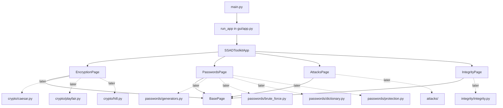

# SSAD Toolkit Project Update

This document records the current state of the SSAD Toolkit project, including the implemented features, interface changes, and validation work completed during the Hill cipher task.

## Current status

The project is a working classical-cipher toolkit. It includes a verified Caesar cipher, a working Hill implementation, and a validated Playfair implementation with manual key entry. The GUI keeps the encryption workflow consistent with the real algorithms and avoids silently generating or auto-filling keys.

## Completed work

### Cipher implementations

- Implemented the Hill cipher in `crypto/hill.py` with modular arithmetic and key validation.
- Added the Playfair cipher in `crypto/playfair.py` with manual-key validation, 5x5 matrix construction, digraph handling, and round-trip encryption/decryption.
- Added support for:
  - key normalization and validation
  - determinant and inverse-matrix handling
  - padding-length logic for plaintext blocks
  - Playfair padding and matrix rules using the J-to-I convention
  - encryption and decryption flows for all implemented ciphers
  - round-trip behavior consistent with classical cipher rules

### GUI integration

- Connected the Hill cipher to the encryption interface in `gui/pages/encryption_page.py`.
- Added a matrix-based key editor for 2x2 and 3x3 keys.
- Included sender/receiver workflow controls for encrypting, sending ciphertext, and decrypting it back.
- Integrated the Hill panel into the main app with layout adjustments in `gui/app.py` to avoid clipping and scrolling.

### Testing and validation

- Added and updated Hill-related tests in `tests/test_ciphers.py`, `tests/test_hill.py`, and `tests/vectors.py`.
- Confirmed the suite passes successfully with `python -m unittest discover -s tests -v`.
- Verified the Playfair vectors and smoke tests check the implemented behavior rather than the old stub expectations.
- Verified the app launches successfully with `python main.py`.

### Layout refinement

- Removed the scroll-based structure from the Hill section.
- Kept the full Hill form visible in the default app window without extra scrolling.
- Preserved the functional logic while only adjusting layout sizing in the interface files.

## What This Project Is

SSAD Toolkit is a Windows-only Python 3.10+ GUI application for a university practical work covering classical encryption, password attacks, and authenticity/integrity tools.

The project now includes a working Tkinter interface, a functional Hill cipher, and a set of validation tests covering the implemented behavior.

## Current Folder Tree

```text
ssad_toolkit/
  main.py
  gui/
    __init__.py
    app.py
    background.py
    pages/
      __init__.py
      base_page.py
      encryption_page.py
      passwords_page.py
      attacks_page.py
      integrity_page.py
  crypto/
    __init__.py
    caesar.py
    playfair.py
    hill.py
  attacks/
    __init__.py
    caesar_attack.py
    playfair_attack.py
    hill_attack.py
  passwords/
    __init__.py
    generators.py
    brute_force.py
    dictionary.py
    protection.py
  integrity/
    __init__.py
    integrity.py
  tests/
    __init__.py
    vectors.py
    test_ciphers.py
    test_smoke.py
  benchmarks.py
  README.md
  PROJECT_UPDATE.md
  .gitignore
```

## Startup Flow

The app starts from `main.py`.

1. `main.py` imports `run_app` from `gui.app`.
2. `run_app()` creates an instance of `SSADToolkitApp`.
3. `SSADToolkitApp` builds the main window, sidebar, and page area.
4. The first page is shown automatically.
5. `app.mainloop()` starts the Tkinter event loop.

In short: `python main.py` starts the whole application.

## GUI Class Interaction Map

The GUI has one main controller class and four page classes.

### 1. `SSADToolkitApp` in `gui/app.py`

This is the main window class.

What it does:

- creates the application window
- configures the ttk theme and styles
- creates the left sidebar
- creates the right-side content area
- registers page classes in `PAGE_DEFINITIONS`
- creates one instance of each page
- switches between pages when a sidebar button is clicked

How it interacts with the pages:

- it imports `EncryptionPage`, `PasswordsPage`, `AttacksPage`, and `IntegrityPage`
- it instantiates each page once at startup
- it stores page objects in a dictionary
- it raises the selected page frame to the front when a button is clicked

### 2. `BasePage` in `gui/pages/base_page.py`

This is the shared parent class for all visible pages.

What it does:

- provides a consistent title label style
- provides a standard placeholder body label
- keeps all page layouts visually consistent

How it interacts with other classes:

- `EncryptionPage`, `PasswordsPage`, `AttacksPage`, and `IntegrityPage` all inherit from it
- each child page calls `BasePage.__init__()` with a page title and placeholder text

### 3. `EncryptionPage` in `gui/pages/encryption_page.py`

This page is the future home of classical encryption and decryption widgets.

Current behavior:

- shows the title `Encryption / Decryption`
- shows the placeholder message `Not implemented yet - add your widgets here.`
- contains a `# TODO` marker for the team that owns this section

How it interacts with the app:

- it is created by `SSADToolkitApp`
- it inherits layout from `BasePage`
- it does not yet call any crypto algorithm module

### 4. `PasswordsPage` in `gui/pages/passwords_page.py`

This page is the future home of password generation and attack tools.

Current behavior:

- shows the title `Passwords`
- shows the placeholder message `Not implemented yet - add your widgets here.`
- contains a `# TODO` marker for password-related widgets

How it interacts with the app:

- it is created by `SSADToolkitApp`
- it inherits layout from `BasePage`
- it does not yet call the password helper modules

### 5. `AttacksPage` in `gui/pages/attacks_page.py`

This page is the future home of attack demonstrations and related tools.

Current behavior:

- shows the title `Attacks`
- shows the placeholder message `Not implemented yet - add your widgets here.`
- contains a `# TODO` marker for attack widgets

How it interacts with the app:

- it is created by `SSADToolkitApp`
- it inherits layout from `BasePage`
- it does not yet connect to any algorithm module
- later it will also connect to `attacks/caesar_attack.py`, `attacks/playfair_attack.py`, and `attacks/hill_attack.py`

### 6. `IntegrityPage` in `gui/pages/integrity_page.py`

This page is the future home of authenticity and integrity tools.

Current behavior:

- shows the title `Authenticity / Integrity`
- shows the placeholder message `Not implemented yet - add your widgets here.`
- contains a `# TODO` marker for integrity widgets

How it interacts with the app:

- it is created by `SSADToolkitApp`
- it inherits layout from `BasePage`
- it does not yet call the integrity helper module

## Module Interaction Map

The current codebase is intentionally split into small files so three teammates can work in parallel with fewer merge conflicts.

### GUI layer

- `main.py` starts the program.
- `gui/app.py` owns the window and page switching logic.
- `gui/pages/base_page.py` provides the shared visual base for all pages.
- `gui/pages/*.py` contain the page shells for each major section.

### Crypto layer

The `crypto/` package contains classical cipher stubs.

- `crypto/caesar.py` will eventually hold Caesar cipher functions.
- `crypto/playfair.py` will eventually hold Playfair cipher functions.
- `crypto/hill.py` will eventually hold Hill cipher functions.

Each of these files currently exposes the same three stub functions:

- `encrypt(text: str, key) -> str`
- `decrypt(text: str, key) -> str`
- `validate_key(key) -> bool`

### Passwords layer

The `passwords/` package contains password-related helpers and attack stubs.

- `passwords/generators.py` is for password set helpers
- `passwords/brute_force.py` is for brute-force attack logic
- `passwords/dictionary.py` is for dictionary attack logic
- `passwords/protection.py` is for password storage/protection helpers

### Integrity layer

- `integrity/integrity.py` is for hashing and verification helpers

## How The Classes Talk To Each Other

This is the simplest way to understand the current structure:



Plain-language version:

- `SSADToolkitApp` controls the whole window.
- Each page class only controls its own section of the UI.
- `BasePage` keeps the page look consistent.
- The algorithm/helper modules are separate so the team can implement them independently later.

## Current Status Of Each File

### `main.py`

Entry point only. It starts the app.

### `gui/app.py`

Contains the main window, styles, sidebar, page registration list, and page switching.

### `gui/pages/base_page.py`

Contains the shared page container used by all four pages.

### `gui/pages/encryption_page.py`

Placeholder for encryption and decryption widgets.

### `gui/pages/passwords_page.py`

Placeholder for password-related widgets.

### `gui/pages/attacks_page.py`

Placeholder for attack-related widgets.

### `gui/pages/integrity_page.py`

Placeholder for authenticity and integrity widgets.

### `crypto/caesar.py`

Stub for the Caesar cipher.

### `crypto/playfair.py`

Stub for the Playfair cipher.

### `crypto/hill.py`

Stub for the Hill cipher.

### `passwords/generators.py`

Stub for password set helpers.

### `passwords/brute_force.py`

Stub for brute-force attack logic.

### `passwords/dictionary.py`

Stub for dictionary attack logic.

### `passwords/protection.py`

Stub for password protection helpers.

### `integrity/integrity.py`

Stub for hash and verify helpers.

## How Teammates Should Work

To keep the project easy to merge:

- One teammate should own one file whenever possible.
- GUI changes should stay inside the correct page file.
- Crypto changes should stay inside the matching cipher file.
- Password changes should stay inside the matching password file.
- Integrity changes should stay inside `integrity/integrity.py`.

If someone needs to change another teammate’s file, they should tell the team first.

## Git Workflow

Recommended workflow for every teammate:

1. Clone the repository.
2. Create a feature branch.

```bash
git checkout -b yourname-feature
```

3. Make your changes.
4. Commit your work.
5. Push your branch.

```bash
git push -u origin yourname-feature
```

6. Open a pull request.

## Quick Run Command

```bash
python main.py
```

## Notes For The Future

When the team starts implementing the real logic:

- keep the GUI shell stable
- add widgets inside the page files
- connect the page buttons to the matching algorithm/helper functions
- keep each feature in its own file to reduce conflicts
