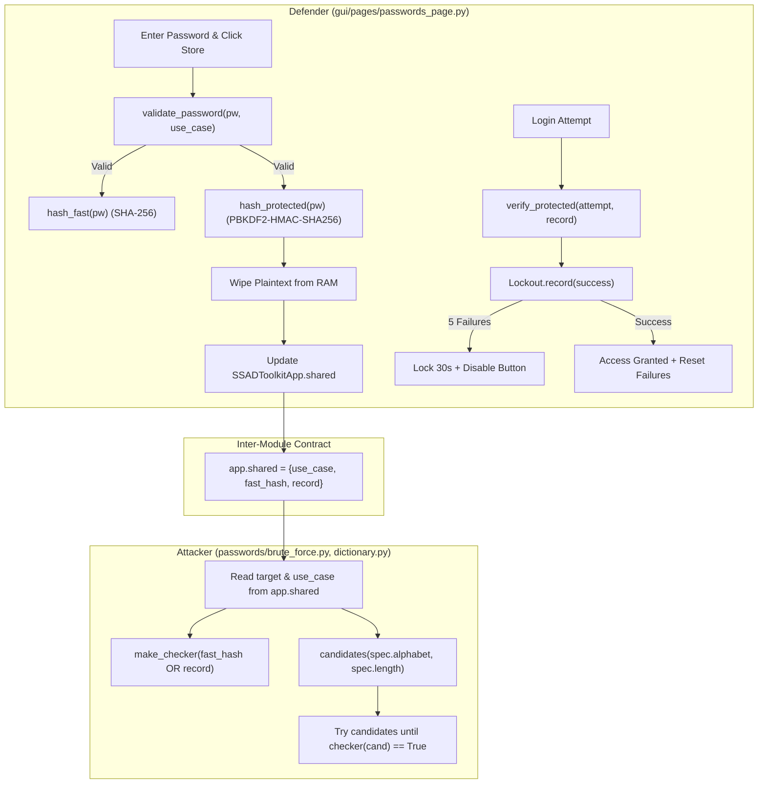

# Technical Architecture & Specification: Hill Cipher & Password Defence System

This document provides a comprehensive technical breakdown of:
1. **The Hill Cipher**: mathematical foundations, block segmentation, key validity conditions, modular matrix inversion, padding mechanics, and step-by-step numerical examples.
2. **Interface Interaction for Hill**: two-party sender/receiver separation, independent key grids, dynamic resizing, strict input validation, and secure transfer mechanics.
3. **The Password Defence System**: architecture, fast hashing vs. salted PBKDF2-HMAC-SHA256, constant-time verification, online login lockout with live countdown, and the polymorphic checker interface.
4. **The Three Use Cases**: specification, alphabet mappings, keyspace scaling ($N = 64^L$), input validation rules, candidate generation, and the coordination contract with the attacker teammate (`self.shared`).

---

## Part I: The Hill Cipher Mechanics

The Hill cipher (invented by Lester S. Hill in 1929) is a polygraphic substitution cipher based on modular linear algebra over the alphabet $\mathbb{Z}_{26} = \{0, 1, \dots, 25\}$, corresponding to letters $A \to 0, B \to 1, \dots, Z \to 25$.

```
Index:   0  1  2  3  4  5  6  7  8  9 10 11 12 13 14 15 16 17 18 19 20 21 22 23 24 25
Letter:  A  B  C  D  E  F  G  H  I  J  K  L  M  N  O  P  Q  R  S  T  U  V  W  X  Y  Z
```

### 1.1 Encryption Process

1. **Normalization**: The plaintext is stripped of spaces, digits, and punctuation, and converted to uppercase using [`normalize()`](file:///c:/Users/hp/Desktop/SSAD/crypto/hill.py#L9-L13):
   $$\text{normalize}(text) \in [A-Z]^+$$
2. **Padding**: For a block size $m \in \{2, 3\}$, if the normalized text length is not a multiple of $m$, trailing `'X'` characters are appended:
   $$\text{remainder} = \text{len} \pmod m$$
   $$\text{pad\_len} = \begin{cases} 0 & \text{if } \text{remainder} = 0 \\ m - \text{remainder} & \text{if } \text{remainder} > 0 \end{cases}$$
3. **Vectorization**: The padded message is split into consecutive blocks of size $m$. Each block is converted into a column vector $\vec{P} \in \mathbb{Z}_{26}^m$:
   $$\vec{P} = \begin{pmatrix} p_1 \\ p_2 \\ \vdots \\ p_m \end{pmatrix}, \quad p_i = \text{ord}(char_i) - 65$$
4. **Matrix Multiplication**: Each column vector is multiplied by the key matrix $K \in \mathbb{Z}_{26}^{m \times m}$ modulo 26:
   $$\vec{C} \equiv K \cdot \vec{P} \pmod{26}$$
5. **Serialization**: Each resulting coordinate $c_i \in [0, 25]$ is mapped back to an ASCII character $\text{chr}(c_i + 65)$ and concatenated to form the ciphertext.

---

### 1.2 Mathematical Criteria for Key Invertibility

A key matrix $K$ is valid for encryption and decryption **if and only if** it has a multiplicative inverse in $\mathbb{Z}_{26}^{m \times m}$.

1. **Square Dimensions**: The key must be $2 \times 2$ or $3 \times 3$ with integer entries.
2. **Determinant Modulo 26**:
   - For $2 \times 2$:
     $$\det(K) = k_{11}k_{22} - k_{12}k_{21}$$
   - For $3 \times 3$ (Laplace expansion along first row):
     $$\det(K) = k_{11}(k_{22}k_{33} - k_{23}k_{32}) - k_{12}(k_{21}k_{33} - k_{23}k_{31}) + k_{13}(k_{21}k_{32} - k_{22}k_{31})$$
   $$\det(K)_{mod} = \det(K) \pmod{26}$$
3. **Coprimality Condition**:
   $$\gcd(\det(K)_{mod}, 26) = 1$$
   Since $26 = 2 \times 13$, $\det(K)_{mod}$ cannot be divisible by 2 or 13. Specifically, $\det(K)_{mod} \notin \{0, 2, 4, 6, 8, 10, 12, 13, 14, 16, 18, 20, 22, 24\}$.
   If $\gcd(\det(K)_{mod}, 26) \neq 1$, [`validate_key()`](file:///c:/Users/hp/Desktop/SSAD/crypto/hill.py#L116-L128) returns `False`, and encryption/decryption raises:
   $$\text{"Key is not invertible mod 26: gcd(det, 26) = } g\text{"}$$

---

### 1.3 Modular Matrix Inversion & Decryption

The modular inverse matrix $K^{-1} \pmod{26}$ satisfies $K \cdot K^{-1} \equiv I_m \pmod{26}$.
It is computed via:
$$K^{-1} \equiv \det(K)^{-1} \cdot \text{adj}(K) \pmod{26}$$

1. **Modular Inverse of Determinant**:
   $$\det(K)^{-1} \equiv \text{pow}(\det(K)_{mod}, -1, 26)$$
2. **Adjugate Matrix $\text{adj}(K)$**:
   - **For $2 \times 2$**:
     $$\text{adj}\begin{pmatrix} a & b \\ c & d \end{pmatrix} = \begin{pmatrix} d & -b \\ -c & a \end{pmatrix} \pmod{26}$$
   - **For $3 \times 3$**: The adjugate is the transpose of the cofactor matrix $C$:
     $$\text{adj}(K) = C^T, \quad C_{ij} = (-1)^{i+j} M_{ij}$$
     where $M_{ij}$ is the $(i, j)$ minor determinant.
3. **Decryption Multiplication**:
   For each ciphertext block $\vec{C} \in \mathbb{Z}_{26}^m$:
   $$\vec{P} \equiv K^{-1} \cdot \vec{C} \pmod{26}$$
4. **Padding Stripping**:
   If the optional parameter `pad_len` ($0 \le pad\_len < m$) is supplied to [`decrypt()`](file:///c:/Users/hp/Desktop/SSAD/crypto/hill.py#L179-L220), the last `pad_len` characters are stripped to recover the exact initial plaintext. If omitted (`pad_len=None`), the full decrypted string including `'X'` padding is returned.

---

### 1.4 Step-by-Step Worked Numerical Examples

#### Example 1: $2 \times 2$ Key without Padding
- **Plaintext**: `"HELP"` $\to \text{length } 4$ (multiple of 2, $\text{pad\_len} = 0$).
- **Key**: $K = \begin{pmatrix} 3 & 3 \\ 2 & 5 \end{pmatrix}$.
- **Determinant**:
  $$\det(K) = (3 \times 5) - (3 \times 2) = 15 - 6 = 9$$
  $$\gcd(9, 26) = 1 \implies \text{valid!}$$
  $$\det(K)^{-1} \equiv 9^{-1} \pmod{26} \equiv 3 \quad (9 \times 3 = 27 \equiv 1 \pmod{26})$$
- **Inverse Matrix**:
  $$\text{adj}(K) = \begin{pmatrix} 5 & -3 \\ -2 & 3 \end{pmatrix} \equiv \begin{pmatrix} 5 & 23 \\ 24 & 3 \end{pmatrix} \pmod{26}$$
  $$K^{-1} \equiv 3 \cdot \begin{pmatrix} 5 & 23 \\ 24 & 3 \end{pmatrix} = \begin{pmatrix} 15 & 69 \\ 72 & 9 \end{pmatrix} \equiv \begin{pmatrix} 15 & 17 \\ 20 & 9 \end{pmatrix} \pmod{26}$$
- **Block 1**: `"HE"` $\to \begin{pmatrix} 7 \\ 4 \end{pmatrix}$:
  $$\vec{C}_1 \equiv \begin{pmatrix} 3 & 3 \\ 2 & 5 \end{pmatrix} \begin{pmatrix} 7 \\ 4 \end{pmatrix} = \begin{pmatrix} 21 + 12 \\ 14 + 20 \end{pmatrix} = \begin{pmatrix} 33 \\ 34 \end{pmatrix} \equiv \begin{pmatrix} 7 \\ 8 \end{pmatrix} \to \text{"HI"}$$
- **Block 2**: `"LP"` $\to \begin{pmatrix} 11 \\ 15 \end{pmatrix}$:
  $$\vec{C}_2 \equiv \begin{pmatrix} 3 & 3 \\ 2 & 5 \end{pmatrix} \begin{pmatrix} 11 \\ 15 \end{pmatrix} = \begin{pmatrix} 33 + 45 \\ 22 + 75 \end{pmatrix} = \begin{pmatrix} 78 \\ 97 \end{pmatrix} \equiv \begin{pmatrix} 0 \\ 19 \end{pmatrix} \to \text{"AT"}$$
- **Ciphertext**: `"HIAT"`
- **Decryption**:
  $$\vec{P}_1 \equiv \begin{pmatrix} 15 & 17 \\ 20 & 9 \end{pmatrix} \begin{pmatrix} 7 \\ 8 \end{pmatrix} = \begin{pmatrix} 105 + 136 \\ 140 + 72 \end{pmatrix} = \begin{pmatrix} 241 \\ 212 \end{pmatrix} \equiv \begin{pmatrix} 7 \\ 4 \end{pmatrix} \to \text{"HE"}$$
  $$\vec{P}_2 \equiv \begin{pmatrix} 15 & 17 \\ 20 & 9 \end{pmatrix} \begin{pmatrix} 0 \\ 19 \end{pmatrix} = \begin{pmatrix} 323 \\ 171 \end{pmatrix} \equiv \begin{pmatrix} 11 \\ 15 \end{pmatrix} \to \text{"LP"}$$
  Plaintext recovered: `"HELP"`.

---

#### Example 2: $2 \times 2$ Key with Trailing Padding
- **Plaintext**: `"BONJOUR"` $\to \text{length } 7$.
- **Key**: $K = \begin{pmatrix} 3 & 2 \\ 5 & 7 \end{pmatrix}$.
- **Determinant**: $\det(K) = 21 - 10 = 11$. $\gcd(11, 26) = 1$.
  $11^{-1} \equiv 19 \pmod{26}$ ($11 \times 19 = 209 \equiv 1 \pmod{26}$).
- **Padding**: Length 7 is odd, so $2 - (7 \bmod 2) = 1$ `'X'` added $\implies$ `"BONJOURX"` ($\text{pad\_len} = 1$).
- **Encryption**:
  - `"BO"` $\to \begin{pmatrix} 1 \\ 14 \end{pmatrix} \implies \begin{pmatrix} 3 + 28 \\ 5 + 98 \end{pmatrix} = \begin{pmatrix} 31 \\ 103 \end{pmatrix} \equiv \begin{pmatrix} 5 \\ 25 \end{pmatrix} \to \text{"FZ"}$
  - `"NJ"` $\to \begin{pmatrix} 13 \\ 9 \end{pmatrix} \implies \begin{pmatrix} 39 + 18 \\ 65 + 63 \end{pmatrix} = \begin{pmatrix} 57 \\ 128 \end{pmatrix} \equiv \begin{pmatrix} 5 \\ 24 \end{pmatrix} \to \text{"FY"}$
  - `"OU"` $\to \begin{pmatrix} 14 \\ 20 \end{pmatrix} \implies \begin{pmatrix} 42 + 40 \\ 70 + 140 \end{pmatrix} = \begin{pmatrix} 82 \\ 210 \end{pmatrix} \equiv \begin{pmatrix} 4 \\ 2 \end{pmatrix} \to \text{"EC"}$
  - `"RX"` $\to \begin{pmatrix} 17 \\ 23 \end{pmatrix} \implies \begin{pmatrix} 51 + 46 \\ 85 + 161 \end{pmatrix} = \begin{pmatrix} 97 \\ 246 \end{pmatrix} \equiv \begin{pmatrix} 19 \\ 12 \end{pmatrix} \to \text{"TM"}$
- **Ciphertext**: `"FZFYECTM"`, Padding added: `1`.
- **Decryption with `pad_len=1`**: Decrypts to `"BONJOURX"`, then trims the final character $\to$ `"BONJOUR"`.

---

#### Example 3: $3 \times 3$ Matrix
- **Plaintext**: `"ALGORITHM"` $\to \text{length } 9$ (multiple of 3, $\text{pad\_len} = 0$).
- **Key**:
  $$K = \begin{pmatrix} 6 & 24 & 1 \\ 13 & 16 & 10 \\ 20 & 17 & 15 \end{pmatrix}$$
- **Determinant**:
  $$\det(K) = 6(240 - 170) - 24(195 - 200) + 1(221 - 320) = 420 + 120 - 99 = 441 \equiv 25 \pmod{26}$$
  $$\gcd(25, 26) = 1 \implies \text{valid!}$$
  $$\det(K)^{-1} \equiv 25^{-1} \equiv 25 \pmod{26} \quad (25 \equiv -1 \implies (-1)(-1) = 1)$$
- **Ciphertext Output**: `"KCRGONILD"`.

---

## Part II: How Hill Interacts with the Interface

The application interface for classical ciphers lives in [`gui/pages/encryption_page.py`](file:///c:/Users/hp/Desktop/SSAD/gui/pages/encryption_page.py).

```
+----------------------------------------------------------------------------------------------------+
|                                    ENCRYPTION PAGE (Hill Panel)                                    |
+--------------------------------------------------+-------------------------------------------------+
| Entity A (Sender)                                | Entity B (Receiver)                             |
+--------------------------------------------------+-------------------------------------------------+
| Key size: [2x2 v]  [Check key]  (Status: VALID)  | Key size: [2x2 v]  [Check key]  (Status: )      |
| [ 3 ] [ 3 ]                                      | [   ] [   ]                                     |
| [ 2 ] [ 5 ]                                      | [   ] [   ]                                     |
| Message:                                         | Ciphertext:                                     |
| [ HELP                                        ]  | [ HIAT                                        ] |
|                                                  | Padding length (optional): [ 0 ]                |
| [ Encrypt ]  [ Send to B ]  [ Clear keys ]       | [ Decrypt ]                                     |
| Ciphertext: [ HIAT                           ]   | Result: [ HELP                                ] |
| Padding added: 0                                 |                                                 |
+--------------------------------------------------+-------------------------------------------------+
```

### 2.1 Two-Party Separation of Concerns
The interface enforces a strict realistic two-party cryptographic model:
1. **Entity A (Sender)**: Contains its own key grid, input message textarea, "Encrypt" button, readonly ciphertext display, and padding indicator.
2. **Entity B (Receiver)**: Contains its own completely independent key grid, ciphertext input entry, optional padding length entry, "Decrypt" button, and readonly result display.

### 2.2 Strict Separation of Keys (No Shared State)
- In early prototypes, "Send to B" copied both the ciphertext and the key. This undermined the educational goal of demonstrating symmetric key agreement.
- In the current implementation:
  - When Entity A clicks **"Send to B"** ([`_send_hill_cipher_to_b()`](file:///c:/Users/hp/Desktop/SSAD/gui/pages/encryption_page.py#L588-L596)), **only** the ciphertext string and the padding count are transferred to Entity B's input fields.
  - Entity B's key grid is left completely untouched. The user (or Entity B) must manually enter the agreed key into Entity B's matrix grid. If Entity B's key is missing or wrong, decryption fails or produces garbled text.

### 2.3 Strict Integer Validation
Key matrices are read via [`_parse_hill_key()`](file:///c:/Users/hp/Desktop/SSAD/gui/pages/encryption_page.py#L485-L503) (Sender) and [`_parse_hill_receiver_key()`](file:///c:/Users/hp/Desktop/SSAD/gui/pages/encryption_page.py#L505-L523) (Receiver):
- Every cell in the grid is checked:
  - If empty: raises `"Entry at row R, column C is empty."`
  - If not an integer: raises `"Entry at row R, column C is not an integer."`
- Negative integers or numbers $\ge 26$ are parsed as valid integers and automatically reduced modulo 26 by [`_coerce_key()`](file:///c:/Users/hp/Desktop/SSAD/crypto/hill.py#L16-L40).

### 2.4 Dynamic Grid Resizing & Synchronization
- When the user changes the key size dropdown (`"2x2"` vs `"3x3"`) on Entity A:
  1. [`_on_sender_hill_size_changed()`](file:///c:/Users/hp/Desktop/SSAD/gui/pages/encryption_page.py#L436-L439) automatically sets Entity B's key size dropdown to match.
  2. Both key grids are destroyed and rebuilt with the new dimensions.
  3. All entry cells are cleared to prevent dimension mismatch errors.
- **"Clear keys" Button**: Calls [`clear_keys()`](file:///c:/Users/hp/Desktop/SSAD/gui/pages/encryption_page.py#L618-L637), which empties all key matrix cells for both Entity A and Entity B simultaneously without touching the messages or ciphertexts.

---

## Part III: The Password Defence System Architecture

The password defence mechanism is distributed across three modules:
- [`passwords/generators.py`](file:///c:/Users/hp/Desktop/SSAD/passwords/generators.py): Use case definitions, fast hashing, and candidate generation.
- [`passwords/protection.py`](file:///c:/Users/hp/Desktop/SSAD/passwords/protection.py): Password validation, salted PBKDF2 hashing, constant-time verification, lockout tracker, and the attacker checker bridge.
- [`gui/pages/passwords_page.py`](file:///c:/Users/hp/Desktop/SSAD/gui/pages/passwords_page.py): Defender UI, live lockout countdown, and hand-off to the attacker.



### 3.1 Fast Hash vs. Protected Record
When storing a password, the system demonstrates the security disparity between unprotected and modern protected storage:

| Metric | Fast Hash (`hash_fast`) | Protected Record (`hash_protected`) |
|---|---|---|
| **Algorithm** | Single SHA-256 round | PBKDF2-HMAC-SHA256 |
| **Salt** | None (deterministic) | 16 cryptographically random bytes (`os.urandom(16)`) |
| **Cost factor** | 1 evaluation | `ITERATIONS = 100_000` HMAC rounds |
| **Rainbow tables** | **Vulnerable**: identical passwords yield identical hashes | **Immune**: unique salt per record renders precomputed tables useless |
| **Offline brute-force** | Millions of guesses per second | A few hundred guesses per second per CPU core |
| **Storage format** | Hex string (64 characters) | Dictionary: `{"salt": hex, "iterations": int, "hash": hex}` |

### 3.2 Memory Hygiene
As soon as [`_store_password()`](file:///c:/Users/hp/Desktop/SSAD/gui/pages/passwords_page.py#L260-L291) or [`_login()`](file:///c:/Users/hp/Desktop/SSAD/gui/pages/passwords_page.py#L304-L339) extracts the string from the entry box:
```python
self.store_password_entry.delete(0, tk.END)
# ... inside finally block:
password = ""
```
The plaintext password is removed from the UI widget and overwritten in the local frame immediately.

### 3.3 Constant-Time Verification
In [`verify_protected()`](file:///c:/Users/hp/Desktop/SSAD/passwords/protection.py#L100-L112), candidate passwords are verified using `hmac.compare_digest(derived, expected_hash)`:
```python
def verify_protected(password: str, record: dict[str, Any]) -> bool:
    salt_bytes, iterations, expected_hash = _parse_record(record)
    derived = hashlib.pbkdf2_hmac(
        "sha256",
        password.encode("utf-8"),
        salt_bytes,
        iterations,
    ).hex()
    return hmac.compare_digest(derived, expected_hash)
```
Standard string equality (`==`) terminates on the first mismatched byte, creating timing leaks where an attacker measures nanosecond differences to determine prefix correctness. `hmac.compare_digest` runs in constant time regardless of where differences occur.

### 3.4 Online Lockout Mechanism
[`Lockout`](file:///c:/Users/hp/Desktop/SSAD/passwords/protection.py#L135-L190) defends against online password guessing:
- Constants: `MAX_FAILURES = 5`, `LOCK_SECONDS = 30`.
- Calling `record(False)` increments the failure count.
- On the 5th failure, `_locked_until = clock() + LOCK_SECONDS` is set.
- While locked:
  - Calling `record(True)` or `record(False)` raises `ValueError("Locked. Try again in N s.")`.
  - The UI disables the "Log in" button and initiates a live 1-second recurring timer (`self.after(1000, ...)`).
  - The status label displays `"Locked. Try again in 30 s."` ticking down to 0.
  - When the countdown finishes, the button is re-enabled and attempts reset.
- A successful login resets consecutive failures to 0.

### 3.5 The Attacker Bridge (`make_checker`)
To allow the teammate to write clean attack loops without branching on storage format, [`make_checker()`](file:///c:/Users/hp/Desktop/SSAD/passwords/protection.py#L114-L133) accepts either a raw hex string or a protected record dict and returns a uniform callable:
```python
check = make_checker(target)
if check(candidate):
    print("Password cracked!")
```

---

## Part IV: The Three Use Cases & System Interactions

The practical work specification defines three password study scenarios. In our implementation, they are mapped to `USE_CASES` in [`passwords/generators.py`](file:///c:/Users/hp/Desktop/SSAD/passwords/generators.py#L17-L23):

```python
CASE_3_ALPHABET = (
    "abcdefghijklmnopqrstuvwxyz"
    "ABCDEFGHIJKLMNOPQRSTUVWXYZ"
    "0123456789"
    "+*"
)

USE_CASES: dict[int, dict[str, str | int]] = {
    1: {"alphabet": "01", "length": 3},
    2: {"alphabet": "1234", "length": 4},
    3: {"alphabet": CASE_3_ALPHABET, "length": 4},
    4: {"alphabet": CASE_3_ALPHABET, "length": 6},
    5: {"alphabet": CASE_3_ALPHABET, "length": 8},
}
```

### 4.1 Use Case Specifications

| ID | Case in TP | Alphabet | Length ($L$) | Keyspace ($N = \lvert\Sigma\rvert^L$) | Feasibility of Brute-Force |
|---|---|---|---|---|---|
| **1** | Case 1 | `"01"` (2 chars) | 3 | $2^3 = 8$ | Instantaneous ($< 1$ ms) |
| **2** | Case 2 | `"1234"` (4 chars) | 4 | $4^4 = 256$ | Instantaneous ($< 5$ ms) |
| **3** | Case 3 | 64 chars | 4 | $64^4 = 16,777,216$ | Feasible live demo (~15 seconds) |
| **4** | Case 3 | 64 chars | 6 | $64^6 \approx 6.87 \times 10^{10}$ | Search space explosion (~19 hours) |
| **5** | Case 3 | 64 chars | 8 | $64^8 \approx 2.81 \times 10^{14}$ | Computationally infeasible (~9 years) |

---

### 4.2 Case 3 Mathematical Mapping

The 64 characters of Case 3 are indexed strictly as follows:
- `a` to `z` $\to$ indices 0 to 25
- `A` to `Z` $\to$ indices 26 to 51
- `0` to `9` $\to$ indices 52 to 61
- `+` $\to$ index 62
- `*` $\to$ index 63

For a password $P = p_0 p_1 \dots p_{L-1}$ of length $L$:
$$\text{value}(P) = \sum_{i=0}^{L-1} \text{index}(p_i) \cdot 64^{L - 1 - i}$$
$$\text{Brute-force attempts} = \text{value}(P) + 1$$
$$\% \text{ of keyspace searched} = \frac{\text{attempts}}{64^L} \times 100\%$$

#### Verified Test Vectors from Mathematics Sheet

| Use Case | Length | Password | Character Indices | Base-64 Value | Brute-Force Attempts | % Keyspace | Dictionary Result |
|---|---|---|---|---|---|---|---|
| **Case 1** | 3 | `010` | $[0, 1, 0]$ | 2 | 3 | 37.50% | Not found (4 attempts) |
| **Case 1** | 3 | `101` | $[1, 0, 1]$ | 5 | 6 | 75.00% | Found: 3rd attempt |
| **Case 1** | 3 | `111` | $[1, 1, 1]$ | 7 | 8 | 100.00% | Found: 2nd attempt |
| **Case 2** | 4 | `1234` | $[0, 1, 2, 3]$ | 27 | 28 | 10.94% | Found: 2nd attempt |
| **Case 2** | 4 | `2413` | $[1, 3, 0, 2]$ | 114 | 115 | 44.92% | Not found (8 attempts) |
| **Case 2** | 4 | `4444` | $[3, 3, 3, 3]$ | 255 | 256 | 100.00% | Found: 6th attempt |
| **Case 3 ($L=4$)** | 4 | `abcd` | $[0, 1, 2, 3]$ | 4,227 | 4,228 | 0.025% | Found: 7th attempt |
| **Case 3 ($L=4$)** | 4 | `Ab56` | $[26, 1, 57, 58]$ | 6,823,546 | 6,823,547 | 40.67% | Not found (10 attempts) |
| **Case 3 ($L=4$)** | 4 | `Q+g4` | $[42, 62, 6, 56]$ | 11,264,440 | 11,264,441 | 67.14% | Not found (10 attempts) |
| **Case 3 ($L=6$)** | 6 | `abcdef` | $[0, 1, 2, 3, 4, 5]$ | 17,314,053 | 17,314,054 | 0.025% | Found: 8th attempt |
| **Case 3 ($L=6$)** | 6 | `Abc123` | $[26, 1, 2, 53, 54, 55]$ | 27,934,809,527 | 27,934,809,528 | 40.65% | Found: 9th attempt |
| **Case 3 ($L=6$)** | 6 | `H*bD88` | $[33, 63, 1, 29, 60, 60]$ | 36,490,829,628 | 36,490,829,629 | 53.10% | Not found (10 attempts) |
| **Case 3 ($L=8$)** | 8 | `abcdefgh` | $[0, 1, 2, 3, 4, 5, 6, 7]$ | 70,918,361,479 | 70,918,361,480 | 0.025% | Found: 7th attempt |
| **Case 3 ($L=8$)** | 8 | `Abcd1234` | $[26, 1, 2, 3, 53, 54, 55, 56]$ | 114,420,140,699,128 | 114,420,140,699,129 | 40.65% | Found: 9th attempt |
| **Case 3 ($L=8$)** | 8 | `jK+73*Dd` | $[9, 36, 62, 59, 55, 63, 29, 3]$ | 42,123,896,289,091 | 42,123,896,289,092 | 14.97% | Not found (10 attempts) |

---

### 4.3 System Interactions Across Modules

#### 1. Input Validation ([`validate_password`](file:///c:/Users/hp/Desktop/SSAD/passwords/protection.py#L21-L41))
- Checks that `use_case` is in `USE_CASES`.
- Checks `len(password) == spec["length"]`. If mismatched:
  $$\text{"Password must have exactly \{length\} characters."}$$
- Checks every character against `spec["alphabet"]`. If invalid:
  $$\text{"Only these characters are allowed: \{alphabet\}"}$$

#### 2. Candidate Generation ([`candidates`](file:///c:/Users/hp/Desktop/SSAD/passwords/generators.py#L25-L37))
- Generates all $\lvert\Sigma\rvert^L$ combinations using `itertools.product(alphabet, repeat=length)`.
- Leftmost character changes slowest; rightmost changes fastest.
- Matches the exact attempt ordering in the mathematics specification:
  - First candidate generated: `"aaaa"` (attempt 1).
  - 4,228th candidate generated: `"abcd"`.

#### 3. GUI Representation ([`PasswordsPage`](file:///c:/Users/hp/Desktop/SSAD/gui/pages/passwords_page.py))
- Dropdown options are generated dynamically:
  - `1 - alphabet 01, length 3`
  - `2 - alphabet 1234, length 4`
  - `3 - alphabet abcdef...+* (64 chars), length 4`
  - `4 - alphabet abcdef...+* (64 chars), length 6`
  - `5 - alphabet abcdef...+* (64 chars), length 8`
- Selecting a new use case resets stored state and clears entries to maintain clean isolation.

#### 4. Attacker Contract (`self.winfo_toplevel().shared`)
The root application [`SSADToolkitApp`](file:///c:/Users/hp/Desktop/SSAD/gui/app.py#L49) maintains:
```python
self.shared = {"use_case": None, "fast_hash": None, "record": None}
```
When the user stores a password or clicks **"Send to Attacks"**, the dictionary is populated.
The attacker teammate's page ([`gui/pages/attacks_page.py`](file:///c:/Users/hp/Desktop/SSAD/gui/pages/attacks_page.py)) integrates by reading:
```python
shared = getattr(self.winfo_toplevel(), "shared", {})
use_case_id = shared.get("use_case")
target_hash = shared.get("fast_hash")
target_record = shared.get("record")

if use_case_id and (target_hash or target_record):
    spec = generators.USE_CASES[use_case_id]
    alphabet = spec["alphabet"]
    length = spec["length"]

    # Unified checker for either mode:
    checker = protection.make_checker(target_hash or target_record)

    # Brute-force runner:
    for candidate in generators.candidates(alphabet, length):
        if checker(candidate):
            # Target password found!
            break
```

---

## Part V: Summary Table of Educational Findings

| Component | Pedagogical Takeaway Demonstrated |
|---|---|
| **Hill Cipher** | Demonstrates polygraphic substitution using linear algebra modulo 26. Proves why square key matrices must have $\gcd(\det(K), 26) = 1$ to be invertible, and exposes vulnerability to Known-Plaintext Attacks due to linearity. |
| **Separation of Keys in UI** | Reinforces the symmetric cryptosystem model: Alice and Bob must agree on the key out-of-band; transmitting ciphertext must never automatically leak or synchronize the private key. |
| **Fast Hash (SHA-256)** | Demonstrates why cryptographic hash functions designed for speed (like SHA-256) are dangerous for password storage without key stretching and salting. |
| **Salted PBKDF2** | Shows how 16 bytes of entropy defeat precomputed rainbow tables, while 100,000 iterations impose a massive CPU penalty per guess on an offline adversary. |
| **Lockout Protection** | Demonstrates how a simple online counter ($MAX=5, \text{DELAY}=30\text{s}$) completely halts online dictionary and brute-force guessing attacks. |
| **Case 1 vs Case 3 Scaling** | Illustrates exponential keyspace growth ($N = \lvert\Sigma\rvert^L$): while 3 binary characters ($N=8$) or 4 digits ($N=256$) are exhausted in milliseconds, expanding to 64 symbols and length 8 ($N \approx 2.81 \times 10^{14}$) provides real-world protection against offline brute force. |
