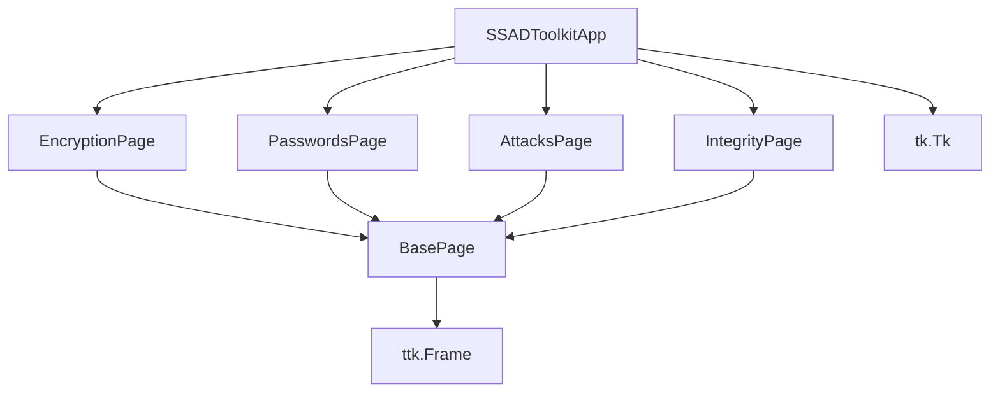
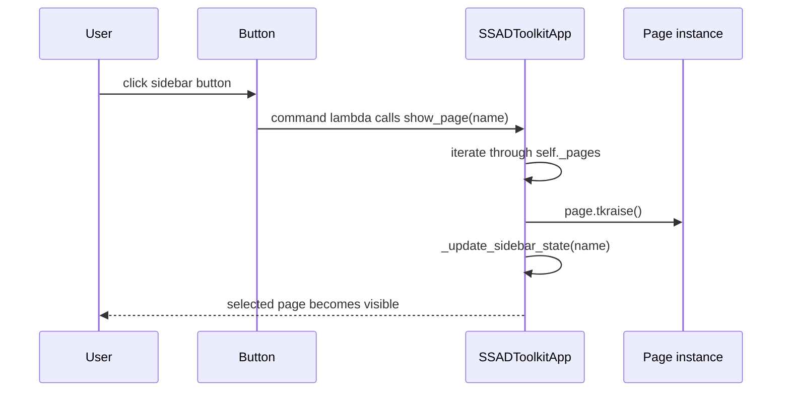
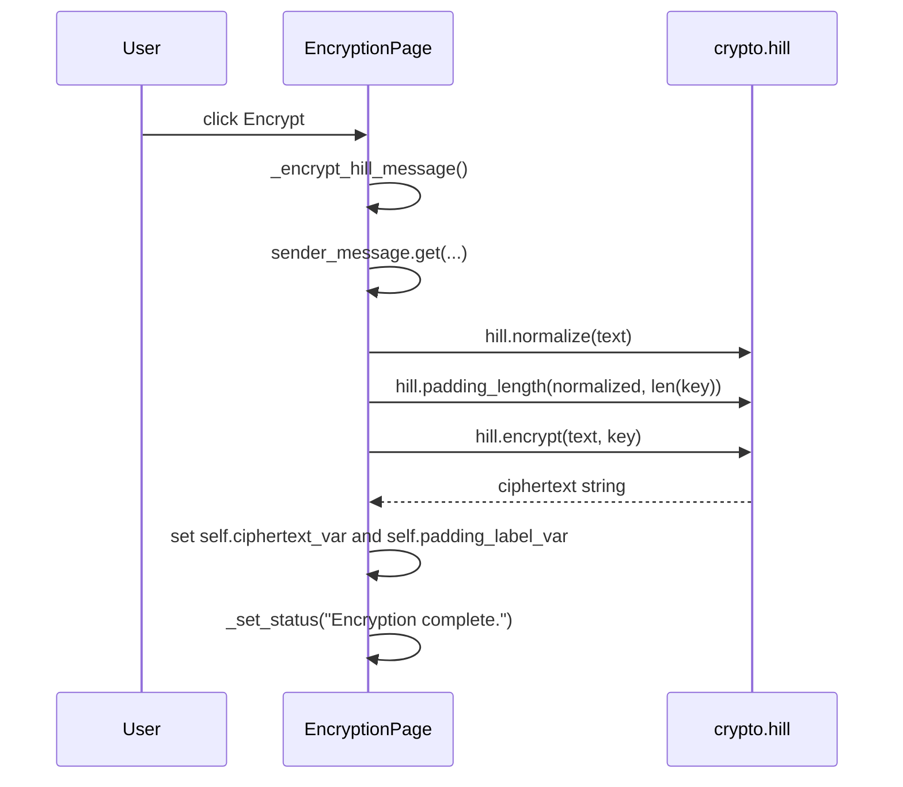
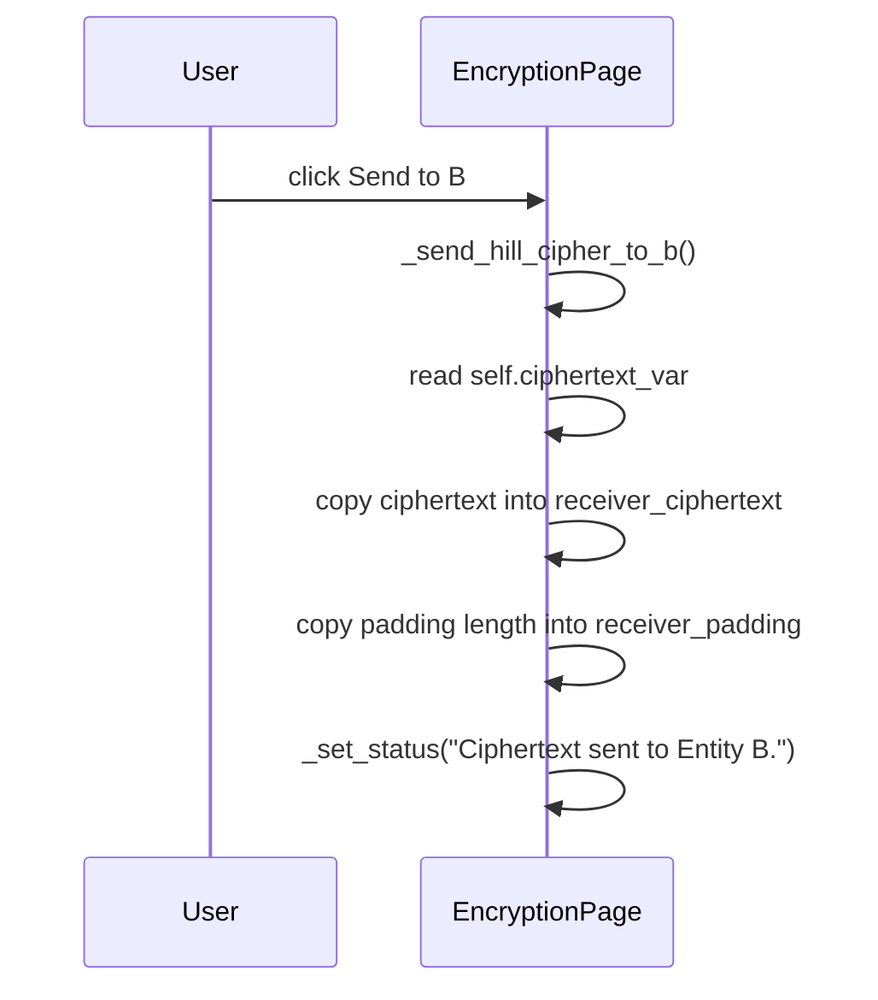
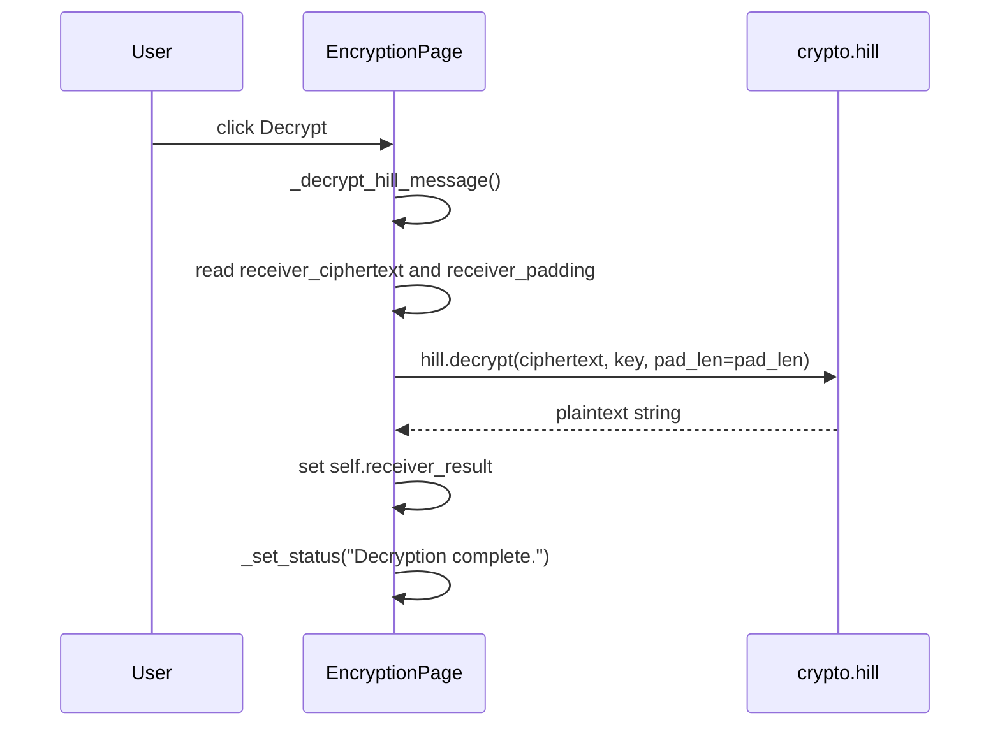

# SSAD Toolkit Project Guide

## 1. Overview

SSAD Toolkit is a Windows desktop application written in Python 3.10+ using only the standard library, mainly Tkinter and ttk. The project is a teaching-style practical work for classical cryptography and related security topics. It groups together a GUI front end, a few cipher implementations, a stubbed password/attack toolkit, and integrity helpers.

The project is meant to be used locally on Windows by students and demonstrators. The usual starting point is:

```bash
python main.py
```

No external packages are required for the current code. The code imports only Python standard-library modules such as `tkinter`, `ttk`, `math`, `time`, and `threading`.

### Implemented now vs still stubbed

| Area | Status | What the code does today |
| --- | --- | --- |
| App shell | Implemented | `main.py` launches `gui.app.run_app()`, and `SSADToolkitApp` builds the window and side navigation. |
| Encryption page | Implemented | `EncryptionPage` supports classical ciphers including Hill, Caesar, and Playfair. |
| Hill cipher logic | Implemented | `crypto/hill.py` provides `normalize`, `validate_key`, `determinant`, `inverse_key`, `padding_length`, `encrypt`, and `decrypt`. |
| Caesar cipher | Implemented | `crypto/caesar.py` implements Caesar encryption, decryption, and key validation. |
| Playfair cipher | Implemented | `crypto/playfair.py` implements Playfair 5x5 key matrix encryption, decryption, and key validation. |
| Password modules | Implemented (Part 3) | `passwords/` implements encryption-based password protection, `make_checker`, `Lockout`, and `cipher_adapter.py`. |
| Integrity module | Implemented (Part 4) | `integrity/hashing.py` provides SHA-256 fast hashing, PBKDF2 stretching, constant-time verification, and slowdown estimation. |
| Attack helpers | Active work | `attacks/*.py` provides cryptanalysis tools, brute-force analysis, and frequency analysis. |
| Tests | Implemented | Unit tests cover ciphers, encryption-based protection, integrity hashing, and lockout. |
| Benchmark helper | Implemented | `benchmarks.py` times callable functions and skips unavailable ones. |

Note: Part 3 protects passwords by encrypting them with ciphers, and all hashing functionality is segregated into `integrity/` (Part 4).

## 2. Folder tree

```text
SSAD/
├── main.py
├── README.md
├── PROJECT_UPDATE.md
├── benchmarks.py
├── .gitignore
├── attacks/
│   ├── __init__.py
│   ├── caesar_attack.py
│   ├── hill_attack.py
│   └── playfair_attack.py
├── crypto/
│   ├── __init__.py
│   ├── caesar.py
│   ├── hill.py
│   └── playfair.py
├── gui/
│   ├── __init__.py
│   ├── app.py
│   ├── background.py
│   └── pages/
│       ├── __init__.py
│       ├── attacks_page.py
│       ├── base_page.py
│       ├── encryption_page.py
│       ├── integrity_page.py
│       └── passwords_page.py
├── integrity/
│   ├── __init__.py
│   └── integrity.py
├── passwords/
│   ├── __init__.py
│   ├── brute_force.py
│   ├── dictionary.py
│   ├── generators.py
│   └── protection.py
├── tests/
│   ├── __init__.py
│   ├── test_ciphers.py
│   ├── test_hill.py
│   ├── test_smoke.py
│   └── vectors.py
└── docs/
    └── PROJECT_GUIDE.md
```

### Roles of the main files

- `main.py`: application entry point; runs `run_app()`.
- `gui/app.py`: main window and sidebar logic; registers pages and switches them.
- `gui/background.py`: helper to run a function in a background thread and return results with `root.after(...)`.
- `gui/pages/base_page.py`: shared base frame for all pages.
- `gui/pages/encryption_page.py`: main UI for algorithm choice and Hill workflow.
- `gui/pages/passwords_page.py`: password protection via cipher encryption and login verification.
- `gui/pages/attacks_page.py`: cryptanalysis and attack workbench.
- `gui/pages/integrity_page.py`: integrity and authenticity verification.
- `crypto/hill.py`: Hill cipher implementation.
- `crypto/caesar.py`: Caesar cipher implementation.
- `crypto/playfair.py`: Playfair cipher implementation.
- `passwords/`: password protection via encryption (Part 3), candidate generation, and lockout.
- `integrity/`: integrity and authenticity hashing package (Part 4).
- `attacks/*.py`: attack and cryptanalysis logic.
- `tests/*`: unit tests and known-good vectors.
- `benchmarks.py`: simple timing helper for implemented ciphers.
- `README.md`: user-facing project overview and run instructions.
- `PROJECT_UPDATE.md`: status summary for the current project state.

`CONVENTIONS.md` does not exist in this workspace. `UNCERTAIN: No conventions file was found, so the code itself is the source of truth.`

## 3. How the application starts

The flow starts in `main.py`:

```python
from gui.app import run_app

if __name__ == "__main__":
    run_app()
```

This calls the function `gui.app.run_app()`, which does this:

1. Creates a `SSADToolkitApp` instance.
2. `SSADToolkitApp.__init__()` calls `super().__init__()` to build a `tk.Tk` window.
3. It sets the window title and initial geometry to `"1000x650"`.
4. It calls `_setup_style()` to configure the ttk theme and color styles.
5. It builds the sidebar via `_build_sidebar()`.
6. It builds all pages via `_build_pages()`.
7. It calls `_size_window_to_content()` to compute a final size based on page requirements.
8. It calls `show_page(PAGE_DEFINITIONS[0][0])` to display the first page.
9. It enters the Tk event loop with `app.mainloop()`.

This is the exact startup chain:

```text
main.py
  -> run_app()
      -> SSADToolkitApp()
          -> __init__()
              -> _setup_style()
              -> _build_sidebar()
              -> _build_pages()
              -> _size_window_to_content()
              -> show_page("Encryption / Decryption")
      -> mainloop()
```

## 4. How the interface is built

### 4.1 `SSADToolkitApp`

`SSADToolkitApp` lives in `gui/app.py` and inherits from `tk.Tk`.

It does the following:

- sets title: `"SSAD Toolkit"`
- sets initial geometry: `"1000x650"`
- allows resizing: `self.resizable(True, True)`
- sets up a custom ttk style with a dark sidebar and light content area
- creates `self.sidebar` and `self.content`
- stores all pages in `self._pages`
- stores all buttons in `self._buttons`
- calls `show_page()` when a sidebar button is clicked

The important definitions are:

```python
PAGE_DEFINITIONS = [
    ("Encryption / Decryption", EncryptionPage),
    ("Passwords", PasswordsPage),
    ("Attacks", AttacksPage),
    ("Authenticity / Integrity", IntegrityPage),
]
```

This is the central page registry. Each tuple is `("label", PageClass)`.

The sidebar is built in `_build_sidebar()`. Each button is created with:

```python
button = ttk.Button(
    self.sidebar,
    text=page_name,
    style="Sidebar.TButton",
    command=lambda name=page_name: self.show_page(name),
)
```

The actual page objects are created in `_build_pages()`:

```python
for page_name, page_class in PAGE_DEFINITIONS:
    page = page_class(self.content)
    page.grid(row=0, column=0, sticky="nsew")
    self._pages[page_name] = page
```

The page switching is handled in `show_page()`:

```python
for name, page in self._pages.items():
    if name == page_name:
        page.tkraise()

self._update_sidebar_state(page_name)
```

This raises the target page to the top of the stacking order, while leaving other pages in memory and hidden.

The sidebar state is updated by `_update_sidebar_state()`, which selects either `SidebarActive.TButton` or `Sidebar.TButton` based on the active page.

The final window sizing is controlled by `_size_window_to_content()`:

```python
self.update_idletasks()
page_widths = [page.winfo_reqwidth() for page in self._pages.values()]
page_heights = [page.winfo_reqheight() for page in self._pages.values()]
required_width = max(page_widths) + self.sidebar.winfo_reqwidth() + 28
required_height = max(page_heights) + 24
```

Then the code clamps values to the current screen size and centers the window:

```python
max_width = max(0, self.winfo_screenwidth() - 40)
max_height = max(0, self.winfo_screenheight() - 80)
required_width = min(max(1000, required_width), max_width)
required_height = min(max(650, required_height), max_height)
self.geometry(f"{required_width}x{required_height}")
self.minsize(required_width, required_height)
```

This is the code path used to adapt the default window size to the content.

### 4.2 `BasePage`

`BasePage` is a thin shared parent class in `gui/pages/base_page.py`.

```python
class BasePage(ttk.Frame):
    def __init__(self, parent: tk.Widget, title: str, placeholder_text: str) -> None:
        super().__init__(parent, style="Content.TFrame")
        self.columnconfigure(0, weight=1)
        self.rowconfigure(1, weight=1)

        title_label = ttk.Label(self, text=title, style="PageTitle.TLabel")
        title_label.grid(row=0, column=0, sticky="w", pady=(0, 14))

        body = ttk.Label(
            self,
            text=placeholder_text,
            style="PageBody.TLabel",
            wraplength=650,
            justify="left",
        )
        body.grid(row=1, column=0, sticky="nw")
```

This gives every page a consistent title label and a placeholder body label. Child pages such as `EncryptionPage`, `PasswordsPage`, `AttacksPage`, and `IntegrityPage` call `super().__init__(...)` and then add their own widgets.

### 4.3 Page classes in the project

#### `EncryptionPage`

`gui/pages/encryption_page.py` is the only page that currently contains real algorithm logic. It is a subclass of `BasePage` and builds a selector for `Caesar`, `Playfair`, and `Hill`.

It creates:

- `self.algorithm_var`: combobox value, default `"Hill"`
- `self.status_var`: a status message for success or error
- `self.hill_key_size_var`: default `"2x2"`
- a top-level `page_frame` to hold the selection and algorithm-specific panel
- a `Hill` panel with sender and receiver sections
- `ttk.Entry` widgets for the Hill key matrix
- `tk.Text` for the sender message
- `ttk.Button` objects for `Encrypt`, `Send to B`, `Check key`, and `Decrypt`

The code for the Hill panel is built in `_build_hill_panel()`. The matrix grid for the key is created and destroyed in `_rebuild_hill_key_grid()`.

#### `PasswordsPage`

`gui/pages/passwords_page.py` is a placeholder page:

```python
super().__init__(
    parent,
    "Passwords",
    "Not implemented yet - add your widgets here.",
)
```

It does not currently implement password widgets. There is only a `# TODO` comment.

#### `AttacksPage`

`gui/pages/attacks_page.py` is a placeholder page with the same pattern as `PasswordsPage` and a `# TODO` comment.

#### `IntegrityPage`

`gui/pages/integrity_page.py` is also a placeholder page for authenticity/integrity tools, with the same pattern.

### 4.4 Mermaid class diagram



This reflects the actual code: `SSADToolkitApp` owns the page instances, and each page inherits from `BasePage`, which inherits from `ttk.Frame`.

## 5. How the components interact

### 5.1 Sequence diagrams

#### a) User clicks a sidebar button



Important detail: the actual callback is created in `_build_sidebar()` as:

```python
command=lambda name=page_name: self.show_page(name)
```

The button does not directly call the page; it calls the app method, which raises the frame to the front.

#### b) User clicks Encrypt in the Hill panel



The boundary is clear: the GUI does not compute the Hill matrix math itself. It passes the raw text and matrix into `crypto.hill.encrypt()`.

#### c) User clicks Send to B



This is a GUI-only handoff. There is no crypto call here; it just copies values from the sender-side fields to the receiver-side fields.

#### d) User clicks Decrypt



Again, all actual mathematics is centralized in `crypto/hill.py`.

### 5.2 Exact method call order for Hill interaction

For the Hill workflow, the call pattern is:

1. `EncryptionPage._build_hill_panel()` creates the inputs and hooks buttons.
2. `EncryptionPage._rebuild_hill_key_grid()` creates the matrix `ttk.Entry` widgets for the selected size.
3. When the user clicks `Check key`, `EncryptionPage._check_hill_key()` runs:
   - `_parse_hill_key()` reads the `ttk.Entry` values and validates that each cell is an integer
   - `hill.validate_key(key)` checks invertibility modulo 26
   - `hill.determinant(key) % 26` is used to get the determinant modulo 26
   - `_set_status()` or `_set_error_status()` sets the label text
4. When the user clicks `Encrypt`, `EncryptionPage._encrypt_hill_message()` runs:
   - `_parse_hill_key()` is the real validation path used before encryption
   - `hill.normalize(text)` strips non-letters and uppercases
   - `hill.padding_length(...)` computes the number of trailing `X` letters needed
   - `hill.encrypt(text, key)` returns ciphertext
   - the result is assigned to `self.ciphertext_var`
5. When the user clicks `Send to B`, `EncryptionPage._send_hill_cipher_to_b()` copies the values to the receiver side.
6. When the user clicks `Decrypt`, `EncryptionPage._decrypt_hill_message()` runs:
   - `_parse_hill_key()` validates the key matrix first
   - reads the ciphertext and optional padding value from `receiver_padding`
   - calls `hill.decrypt(ciphertext, key, pad_len=pad_len)`
   - writes the result to `self.receiver_result`

### 5.3 Error propagation from `crypto/hill.py` to the status label

The error flow is explicit:

- `hill.encrypt()` raises `ValueError` for malformed keys or non-invertible matrices.
- `hill.decrypt()` raises `ValueError` for invalid ciphertext length, bad padding values, or out-of-range padding.
- `EncryptionPage._encrypt_hill_message()` catches `ValueError` and calls:

```python
self._set_error_status(str(exc))
self.ciphertext_var.set("")
self.padding_label_var.set("0")
```

- `EncryptionPage._decrypt_hill_message()` catches `ValueError` similarly:

```python
self._set_error_status(str(exc))
self.receiver_result.set("")
```

- `EncryptionPage._check_hill_key()` does the same for invalid matrix entries and invalid keys.

The actual status color is set in `_set_status()` with red for errors and green for normal status:

```python
self.status_var.set(message)
self.status_label.configure(foreground="#c92a2a" if is_error else "#0f5132")
```

### 5.4 How the matrix grid is built and rebuilt

The key grid is built in `_rebuild_hill_key_grid()`:

```python
size = 2 if self.hill_key_size_var.get() == "2x2" else 3
values = self.HILL_KEY_DEFAULTS.get(self.hill_key_size_var.get(), [3, 3, 2, 5])
self.hill_entries = []

for row_index in range(size):
    row_entries = []
    for col_index in range(size):
        value = str(values[row_index * size + col_index])
        entry = ttk.Entry(self.hill_key_matrix_frame, width=4)
        entry.insert(0, value)
        entry.grid(row=row_index, column=col_index, padx=2, pady=2)
        row_entries.append(entry)
    self.hill_entries.append(row_entries)
```

This rebuilds the matrix whenever the user changes the combo box value.

When the key size changes, the old matrix is destroyed first:

```python
for widget in self.hill_key_matrix_frame.winfo_children():
    widget.destroy()
```

Then values are repopulated with the defaults from `HILL_KEY_DEFAULTS`:

```python
HILL_KEY_DEFAULTS = {
    "2x2": [3, 3, 2, 5],
    "3x3": [6, 24, 1, 13, 16, 10, 20, 17, 15],
}
```

Reading values back is done in `_current_hill_key()`:

```python
text = self.hill_entries[row_index][col_index].get().strip()
try:
    row.append(int(text))
except ValueError:
    row.append(0)
```

This method still converts empty or non-integer cells to `0` if it is used in a computation path. The actual validation path used by the GUI is `_parse_hill_key()`, which rejects empty or non-integer cells immediately with the exact red status message:

```python
self._set_error_status(f"Entry at row {row_index + 1}, column {col_index + 1} is not an integer.")
```

This is the method used when the user clicks `Check key`, `Encrypt`, or `Decrypt`. The current app does not silently coerce malformed entries to zero in those real validation flows, but `_current_hill_key()` remains a latent bug because it does exactly that if it is invoked on malformed input.

## 6. The Hill cipher: the theory

### 6.1 Plain-language explanation

The Hill cipher is a polygraphic substitution cipher. Instead of replacing one letter at a time, it encrypts blocks of letters together using a matrix.

The code uses the standard alphabet mapping:

- `A -> 0`
- `B -> 1`
- `C -> 2`
- ...
- `Z -> 25`

The mapping is implemented implicitly in the code:

```python
vector = [ord(letter) - 65 for letter in block]
```

and later:

```python
plaintext_letters.extend(chr(value + 65) for value in decoded_vector)
```

For a 2x2 key matrix, block size is 2. For a 3x3 key matrix, block size is 3.

For a key matrix `K` and a column vector `v` of letters in the block, the code does matrix multiplication modulo 26:

```python
sum(matrix[row_index][col_index] * vector[col_index] for col_index in range(len(vector))) % 26
```

This means each output letter is a linear combination of the input letters, reduced modulo 26.

A valid Hill key must be invertible modulo 26. If the determinant is not coprime to 26, the matrix cannot be inverted and decryption is impossible.

### 6.2 Why the key must satisfy gcd(det, 26) = 1

The code checks:

```python
det_mod = determinant(normalized) % 26
gcd_value = math.gcd(det_mod, 26)
if gcd_value != 1:
    raise ValueError(f"Key is not invertible mod 26: gcd(det, 26) = {gcd_value}")
```

This means the determinant must be relatively prime to 26. Since `26 = 2 * 13`, the determinant must be odd and not divisible by 13. In modular arithmetic, a matrix is invertible modulo 26 exactly when its determinant has a multiplicative inverse modulo 26.

The modular inverse is computed with:

```python
inverse_det = pow(det_mod, -1, 26)
```

This works because Python 3.8+ supports modular inverses via `pow(x, -1, m)` for values that are invertible modulo `m`.

### 6.3 Decryption and the inverse matrix

Decryption multiplies the ciphertext block by the inverse of the key matrix modulo 26.

For a 2x2 matrix

$$
K = \begin{bmatrix} a & b \\ c & d \end{bmatrix}
$$

its inverse is:

$$
K^{-1} = \frac{1}{ad-bc} \begin{bmatrix} d & -b \\ -c & a \end{bmatrix} \pmod{26}
$$

The code does the equivalent with the adjugate matrix and then multiplies by the modular inverse of the determinant:

```python
adjugate = [[d, -b], [-c, a]]
inverse = [[((entry * inverse_det) % 26) for entry in row] for row in adjugate]
```

For 3x3, the code builds the cofactor matrix and then transposes it (adjugate) before applying the modular inverse of the determinant.

### 6.4 Worked examples matching the code

#### Example 1: `HELP` with key `[[3, 3], [2, 5]]`

This matches the vector in `tests/vectors.py` and the code behavior.

Plaintext: `HELP`

Normalized letters: `H E L P` = `7,4,11,15`

Key:

$$
K = \begin{bmatrix} 3 & 3 \\ 2 & 5 \end{bmatrix}
$$

Block 1: `HE` = `7, 4`

$$
\begin{bmatrix} 3 & 3 \\ 2 & 5 \end{bmatrix}
\begin{bmatrix} 7 \\ 4 \end{bmatrix}
= \begin{bmatrix} 33 \\ 34 \end{bmatrix}
\equiv
\begin{bmatrix} 7 \\ 8 \end{bmatrix}
\pmod{26}
$$

`7 -> H`, `8 -> I` => `HI`

Block 2: `LP` = `11, 15`

$$
\begin{bmatrix} 3 & 3 \\ 2 & 5 \end{bmatrix}
\begin{bmatrix} 11 \\ 15 \end{bmatrix}
= \begin{bmatrix} 78 \\ 97 \end{bmatrix}
\equiv
\begin{bmatrix} 0 \\ 19 \end{bmatrix}
\pmod{26}
$$

`0 -> A`, `19 -> T` => `AT`

So the ciphertext is `HIAT`, exactly as in the test vector.

The inverse key used in the code is `[[15, 17], [20, 9]]`, which is the modular inverse of the matrix modulo 26.

#### Example 2: `BONJOUR` with key `[[3, 2], [5, 7]]`

This is the vector in `tests/vectors.py`.

Plaintext: `BONJOUR` -> 7 letters.

- block size is 2
- padding length is 1, because `7 % 2 = 1`
- padded plaintext is `BONJOURX`

The actual code computes the ciphertext as `FZFYECTM`.

The padding rule is visible in `padding_length()`:

```python
remainder = len(normalized) % n
return 0 if remainder == 0 else n - remainder
```

This appends `X` characters until the message length is a multiple of the block size.

#### Example 3: 3x3 key with `BONJOUR`

Key: `[[6, 24, 1], [13, 16, 10], [20, 17, 15]]`

Plaintext: `BONJOUR`

- length is 7, block size is 3
- padding length is 2, because `7 % 3 = 1`, so the required padding is `2` letters
- padded plaintext is `BONJOURXX`

This matches the vector in `tests/vectors.py`: ciphertext `RDLUVQBNK`.

#### Example 4: 3x3 key with `ALGORITHM`

The project also contains a known 3x3 vector:

```python
ALGORITHM -> KCRGONILD
```

The actual block decomposition is:

- `ALG` -> `KCR`
- `ORI` -> `GON`
- `THM` -> `ILD`

This matches the vector in the implementation and the code path in `tests/test_hill.py`.

### 6.5 Weaknesses of Hill

The code comments in `crypto/hill.py` explicitly note that the cipher is linear and vulnerable to known-plaintext attacks. In practice:

- it is vulnerable to algebraic attacks because the output is a linear function of the plaintext
- if an attacker knows enough plaintext/ciphertext pairs, they can recover the key matrix
- padding with `X` is an ad hoc fix, not a security feature, and it introduces a canonical ambiguity when the last genuine letter is already `X`
- the scheme is deterministic, so repeated blocks produce repeated ciphertext blocks for the same key if the input repeats

A practical example of the padding ambiguity: if the real plaintext ends with `X`, the code cannot tell whether the trailing `X` was intentional or added for block completion. That is why `decrypt()` must be called with `pad_len` when the caller knows how much padding was appended; otherwise it leaves the trailing characters alone.

## 7. The Hill cipher: the implementation

This section describes the functions in `crypto/hill.py` in the order they appear.

### `normalize(text: str) -> str`

Purpose: remove all non-letter characters and uppercase the result.

```python
def normalize(text: str) -> str:
    if not isinstance(text, str):
        text = str(text)
    return "".join(char for char in text.upper() if "A" <= char <= "Z")
```

What it does:

- converts anything to a string if it is not already a string
- keeps only letters `A` to `Z`
- discards spaces, punctuation, digits, and other symbols
- returns uppercase text for the rest of the algorithm

Example: `"Hello, world!"` becomes `"HELLOWORLD"`.

### `_coerce_key(key) -> list[list[int]] | None`

Purpose: validate the matrix shape and type without raising a user-facing exception.

```python
def _coerce_key(key) -> list[list[int]] | None:
    if not isinstance(key, Sequence) or isinstance(key, (str, bytes)):
        return None

    rows = [list(row) for row in key]
    if not rows or len(rows) not in (2, 3):
        return None
```

Important rules enforced here:

- the matrix must be a sequence, not a string or bytes
- it must be either 2x2 or 3x3
- each row must have the same length as the matrix size
- each entry must be an integer, not a Boolean, and is normalized modulo 26

`_coerce_key()` is internal and used by the public functions.

### `determinant(key) -> int`

Purpose: calculate the determinant of a valid 2x2 or 3x3 matrix.

```python
def determinant(key) -> int:
    normalized = _coerce_key(key)
    if normalized is None:
        raise ValueError("Key must be a 2x2 or 3x3 square matrix of integers.")
```

For a 2x2 matrix, it computes:

```python
return normalized[0][0] * normalized[1][1] - normalized[0][1] * normalized[1][0]
```

For a 3x3 matrix, it computes:

```python
return (
    a * (e * i - f * h)
    - b * (d * i - f * g)
    + c * (d * h - e * g)
)
```

This is the standard determinant formula. In the actual code, `_coerce_key()` reduces every entry modulo 26 before the determinant is computed, so the determinant is evaluated on already-normalized entries.

### `inverse_key(key) -> list[list[int]]`

Purpose: return the modular inverse of the key matrix modulo 26.

```python
def inverse_key(key) -> list[list[int]]:
    normalized = _coerce_key(key)
    if normalized is None:
        raise ValueError("Key must be a 2x2 or 3x3 square matrix of integers.")

    det_mod = determinant(normalized) % 26
    gcd_value = math.gcd(det_mod, 26)
    if gcd_value != 1:
        raise ValueError(f"Key is not invertible mod 26: gcd(det, 26) = {gcd_value}")

    inverse_det = pow(det_mod, -1, 26)
```

This is the central decryption rule. The inverse matrix is computed by:

- finding the determinant modulo 26
- checking whether the determinant is coprime to 26
- computing the modular inverse of the determinant
- building the adjugate matrix
- multiplying each adjugate entry by `inverse_det` modulo 26

For 2x2, the code uses the formula `[[d, -b], [-c, a]]`.
For 3x3, it first computes cofactors, then transposes them to create the adjugate matrix.

### `validate_key(key) -> bool`

Purpose: return `True` only for invertible 2x2 or 3x3 matrices modulo 26.

```python
def validate_key(key) -> bool:
    normalized = _coerce_key(key)
    if normalized is None:
        return False

    try:
        det_mod = determinant(normalized) % 26
    except ValueError:
        return False

    return math.gcd(det_mod, 26) == 1
```

This function never raises exceptions for malformed input; it returns `False` instead. `EncryptionPage._check_hill_key()` uses this to decide whether to show the green VALID or red INVALID label.

### `padding_length(text: str, n: int) -> int`

Purpose: compute how many trailing `X` letters are needed for a message to complete the final block.

```python
def padding_length(text: str, n: int) -> int:
    normalized = normalize(text)
    if not isinstance(n, int) or isinstance(n, bool) or n <= 0:
        raise ValueError("Block size must be a positive integer.")
    remainder = len(normalized) % n
    return 0 if remainder == 0 else n - remainder
```

Example: `padding_length("HELLO", 2) == 1` because `HELLO` has length 5, and the next multiple of 2 is 6.

### `_matrix_multiply(matrix, vector) -> list[int]`

Purpose: multiply a matrix by a column vector modulo 26.

```python
def _matrix_multiply(matrix: list[list[int]], vector: list[int]) -> list[int]:
    return [
        sum(matrix[row_index][col_index] * vector[col_index] for col_index in range(len(vector))) % 26
        for row_index in range(len(matrix))
    ]
```

This is the math engine used by both encryption and decryption.

### `encrypt(text: str, key) -> str`

Purpose: encrypt a string with the Hill cipher using a valid key matrix.

This is the full real code from `crypto/hill.py`:

```python
def encrypt(text: str, key) -> str:
    """Encrypt a message with the Hill cipher using a valid invertible key.

    Known weaknesses: the cipher is linear and vulnerable to known-plaintext
    attacks, and the key matrix must be invertible modulo 26.
    """
    normalized = normalize(text)
    if not normalized:
        raise ValueError("Message has no letters A-Z.")

    normalized_key = _coerce_key(key)
    if normalized_key is None:
        raise ValueError("Key must be a 2x2 or 3x3 square matrix of integers.")

    det_mod = determinant(normalized_key) % 26
    gcd_value = math.gcd(det_mod, 26)
    if gcd_value != 1:
        raise ValueError(f"Key is not invertible mod 26: gcd(det, 26) = {gcd_value}")

    block_size = len(normalized_key)
    padded = normalized + ("X" * padding_length(normalized, block_size))
    ciphertext_letters: list[str] = []

    for start in range(0, len(padded), block_size):
        block = padded[start : start + block_size]
        vector = [ord(letter) - 65 for letter in block]
        encrypted_vector = _matrix_multiply(normalized_key, vector)
        ciphertext_letters.extend(chr(value + 65) for value in encrypted_vector)

    return "".join(ciphertext_letters)
```

This is the exact behavior in the code: before any block math, `encrypt()` rejects an empty message, validates the matrix shape, and checks the determinant modulo 26. If `gcd(det_mod, 26) != 1`, it raises `ValueError("Key is not invertible mod 26: gcd(det, 26) = {gcd_value}")` and stops. There is no bug here: the current implementation does reject non-invertible keys.

### `decrypt(text: str, key, pad_len: int | None = None) -> str`

Purpose: recover the plaintext, optionally stripping trailing padding.

```python
def decrypt(text: str, key, pad_len: int | None = None) -> str:
    normalized_key = _coerce_key(key)
    if normalized_key is None:
        raise ValueError("Key must be a 2x2 or 3x3 square matrix of integers.")

    det_mod = determinant(normalized_key) % 26
    gcd_value = math.gcd(det_mod, 26)
    if gcd_value != 1:
        raise ValueError(f"Key is not invertible mod 26: gcd(det, 26) = {gcd_value}")

    block_size = len(normalized_key)
    normalized_cipher = normalize(text)
    if len(normalized_cipher) % block_size != 0:
        raise ValueError(
            f"Ciphertext length {len(normalized_cipher)} is not a multiple of the key size {block_size}."
        )

    inverse_matrix = inverse_key(normalized_key)
    plaintext_letters: list[str] = []
    for start in range(0, len(normalized_cipher), block_size):
        block = normalized_cipher[start : start + block_size]
        vector = [ord(letter) - 65 for letter in block]
        decoded_vector = _matrix_multiply(inverse_matrix, vector)
        plaintext_letters.extend(chr(value + 65) for value in decoded_vector)

    decoded = "".join(plaintext_letters)

    if pad_len is None:
        return decoded

    if not isinstance(pad_len, int) or isinstance(pad_len, bool) or pad_len < 0 or pad_len >= block_size:
        raise ValueError(f"Padding length must be between 0 and {block_size - 1}.")
    if pad_len > len(decoded):
        raise ValueError("Padding length is larger than the decrypted text length.")

    return decoded[:-pad_len] if pad_len else decoded
```

This is the exact current logic in the code: `pad_len` is valid only when `0 <= pad_len < n`, and the code rejects any value outside that range with `ValueError(f"Padding length must be between 0 and {block_size - 1}.")`.

### Trace of one full encryption

Use the exact code path and the key `[[3, 3], [2, 5]]` with plaintext `HELP`.

1. `normalize("HELP")` returns `"HELP"`.
2. `padding_length("HELP", 2)` returns `0` because length is already even.
3. `encrypt()` sees a valid key, computes the matrix multiplication block by block.
4. First block `HE` -> `[7, 4]` -> `[7, 8]` -> `HI`.
5. Second block `LP` -> `[11, 15]` -> `[0, 19]` -> `AT`.
6. Final ciphertext: `HIAT`.

This matches the vector in `tests/vectors.py` exactly.

### Trace of one full decryption

Decrypt `HIAT` with the same key and `pad_len=0`.

1. `normalize("HIAT")` returns `"HIAT"`.
2. `decrypt()` checks the length is a multiple of 2.
3. `inverse_key([[3, 3], [2, 5]])` returns `[[15, 17], [20, 9]]` modulo 26.
4. The first block `HI` is transformed back to `HE`.
5. The second block `AT` is transformed back to `LP`.
6. The result is `HELP`.

If the ciphertext came from a padded message and the caller passes the correct pad length, the function strips the extra `X` characters after decryption.

### Every validation rule and exact error message

The code raises the following exact texts in the current implementation:

- `"Key must be a 2x2 or 3x3 square matrix of integers."`
- `"Key is not invertible mod 26: gcd(det, 26) = {gcd_value}"`
- `"Message has no letters A-Z."`
- `"Block size must be a positive integer."`
- `"Ciphertext length {len(normalized_cipher)} is not a multiple of the key size {block_size}."`
- `"Padding length must be between 0 and {block_size - 1}."`
- `"Padding length is larger than the decrypted text length."`

In addition, `_coerce_key()` rejects invalid shapes and non-integer values before the public functions are called.

## 8. The padding length feature

The padding feature exists because Hill requires block lengths to match the key size. A message whose length is not already a multiple of `n` must be extended with trailing `X` characters.

The key rule is implemented in `padding_length(text, n)`: it calculates the remainder of `len(normalized_text) % n` and adds enough `X` letters to reach the next multiple of `n`.

Examples:

- `padding_length("HELLO", 2) -> 1`
- `padding_length("HELLO", 3) -> 1`
- `padding_length("HELLO", 4) -> 3`
- `padding_length("", 3) -> 0`

The Hill UI exposes this directly:

- `self.padding_label_var` stores the number of added `X` letters
- `self.ciphertext_var` stores the encrypted text
- `self.receiver_padding` is the optional field used for decryption

The sender-side button `Send to B` does this:

```python
pad_len = self.padding_label_var.get().strip()
self.receiver_padding.delete(0, tk.END)
self.receiver_padding.insert(0, pad_len if pad_len and pad_len != "0" else "")
```

This means:

- `0` or `"0"` becomes an empty field
- non-zero padding is copied into the receiver field
- an empty field means `pad_len = None` during decryption

This is important because automatic padding removal is ambiguous. Consider a legitimate plaintext ending in `X`. The code cannot know whether the trailing `X` was original text or material added to complete a block. That is why the UI includes the optional field and why `decrypt(..., pad_len=None)` intentionally keeps the trailing padding in the output.

### What happens when the field is empty, wrong, or out of range

The GUI path is:

```python
ciphertext = self.receiver_ciphertext.get().strip()
pad_value = self.receiver_padding.get().strip()
try:
    pad_len = None if pad_value == "" else int(pad_value)
    result = hill.decrypt(ciphertext, key, pad_len=pad_len)
    self.receiver_result.set(result)
    self._set_status("Decryption complete.")
except ValueError as exc:
    self._set_error_status(str(exc))
    self.receiver_result.set("")
```

In other words:

- Empty field: `pad_value == ""` => `pad_len = None` => `decrypt()` returns the decoded text with trailing padding left in place.
- Wrong type: non-numeric text such as `"abc"` triggers `int(pad_value)` before `hill.decrypt()` runs, so the user sees the exact message: `ValueError: invalid literal for int() with base 10: 'abc'`.
- Negative value: `pad_len < 0` => `ValueError("Padding length must be between 0 and {block_size - 1}.")`.
- Too large for the key: `pad_len >= block_size` => `ValueError("Padding length must be between 0 and {block_size - 1}.")`.
- Too large for the decrypted text: `pad_len > len(decoded)` => `ValueError("Padding length is larger than the decrypted text length.")`.
- Zero: `pad_len == 0` -> the result is returned unchanged.

The `pad_len > len(decoded)` check is real in the API but is not the first failure in the GUI path. In the GUI, a non-numeric entry fails earlier at `int(pad_value)`. In raw library usage, it is reachable only if the caller deliberately passes a pad length larger than the decrypted text length after decryption is complete.

## 9. Tests

The project has a small test suite in `tests/`.

### `tests/vectors.py`

This file stores known-good vectors. It contains:

- `CAESAR_VECTORS`: empty at the moment
- `PLAYFAIR_VECTORS`: empty at the moment
- `HILL_VECTORS`: four real Hill test vectors, including the 3x3 `ALGORITHM` case

The Hill vectors are:

```python
HILL_VECTORS = [
    {"plaintext": "BONJOUR", "key": [[3, 2], [5, 7]], "ciphertext": "FZFYECTM"},
    {
        "plaintext": "BONJOUR",
        "key": [[6, 24, 1], [13, 16, 10], [20, 17, 15]],
        "ciphertext": "RDLUVQBNK",
    },
    {"plaintext": "HELP", "key": [[3, 3], [2, 5]], "ciphertext": "HIAT"},
    {"plaintext": "ALGORITHM", "key": [[6, 24, 1], [13, 16, 10], [20, 17, 15]], "ciphertext": "KCRGONILD"},
]
```

These vectors correspond exactly to the actual Hill implementation and are used by `tests/test_ciphers.py` and `tests/test_hill.py`.

### `tests/test_ciphers.py`

This test file checks the vector-based behavior for Caesar, Playfair, and Hill.

- Caesar and Playfair tests are skipped if their vector lists are empty.
- Hill tests are active because `HILL_VECTORS` is not empty.
- For each vector, it calls `hill.encrypt()` and `hill.decrypt()` and asserts that the results match the expected values.

The test also includes a skip path:

```python
except NotImplementedError:
    self.skipTest("not implemented yet")
```

This is how the suite handles stubs that are not implemented yet.

### `tests/test_hill.py`

This is the real logic test file for the Hill cipher. It checks:

- invalid keys are rejected by `hill.validate_key()`
- invalid key matrices raise `ValueError` in `hill.encrypt()`
- randomized round trips work for valid matrices
- `padding_length()` behaves as expected
- `decrypt()` without `pad_len` preserves the trailing `X`
- ciphertexts with invalid length produce `ValueError`
- `pad_len` is rejected when it is negative, non-integer, or larger than `n - 1`
- an empty message raises `ValueError("Message has no letters A-Z.")`
- the `BOX` and `ALGORITHM` vectors behave exactly as expected

### `tests/test_smoke.py`

This file verifies that:

- importlib can import `crypto`, `passwords`, `integrity`, `attacks`, and `gui`
- Caesar, Playfair, and Hill ciphers function as expected with valid key checks
- `hill` itself functions as expected for the identity key and a valid round trip

### `benchmarks.py`

This file imports `caesar`, `hill`, and `playfair` and uses a timing helper:

```python
from crypto import caesar, hill, playfair
```

It calls `time_it()` for each cipher function. If a cipher raises `NotImplementedError`, `_benchmark_entry()` returns `None`, so the benchmark silently skips unavailable algorithms.

### How to run the tests

From the project root, run:

```bash
python -m unittest discover -s tests -v
```

Real output from the current workspace:

```text
test_vectors (test_ciphers.TestCaesarCipher.test_vectors) ... skipped 'no Caesar
 test vectors yet'
test_vectors (test_ciphers.TestHillCipher.test_vectors) ... ok
test_vectors (test_ciphers.TestPlayfairCipher.test_vectors) ... skipped 'no Play
fair test vectors yet'
test_algorithm_vector_3x3 (test_hill.TestHillCipherLogic.test_algorithm_vector_3
x3) ... ok
test_box_padding_behavior (test_hill.TestHillCipherLogic.test_box_padding_behavi
or) ... ok
test_decrypt_rejects_non_multiple_length (test_hill.TestHillCipherLogic.test_dec
rypt_rejects_non_multiple_length) ... ok
test_decrypt_rejects_padding_range_and_type (test_hill.TestHillCipherLogic.test_
decrypt_rejects_padding_range_and_type) ... ok
test_decrypt_without_pad_len_keeps_padding (test_hill.TestHillCipherLogic.test_d
ecrypt_without_pad_len_keeps_padding) ... ok
test_empty_message_rejected (test_hill.TestHillCipherLogic.test_empty_message_re
jected) ... ok
test_padding_length (test_hill.TestHillCipherLogic.test_padding_length) ... ok
test_round_trip_randomized_text (test_hill.TestHillCipherLogic.test_round_trip_r
andomized_text) ... ok
test_validate_key_rejects_invalid_keys (test_hill.TestHillCipherLogic.test_valid
ate_key_rejects_invalid_keys) ... ok
test_packages_import (test_smoke.TestImports.test_packages_import) ... ok
test_attack_stubs (test_smoke.TestStubFunctions.test_attack_stubs) ... ok
test_crypto_stubs (test_smoke.TestStubFunctions.test_crypto_stubs) ... ok
test_password_and_integrity_stubs (test_smoke.TestStubFunctions.test_password_an
d_integrity_stubs) ... ok

----------------------------------------------------------------------
Ran 16 tests in 0.013s

OK (skipped=2)
```

This is the exact current status from the workspace: 16 tests ran, 14 passed, 2 were skipped, and the suite ended with `OK (skipped=2)`.

## 10. How to add a new algorithm or page

### Adding a new cipher to the encryption page

To add a new algorithm such as Caesar or Playfair, the code path is:

1. Add the actual algorithm to the matching file in `crypto/`.
   - `crypto/caesar.py`
   - `crypto/playfair.py`
2. Add or update the vector file in `tests/vectors.py`.
3. Add or update tests in `tests/test_ciphers.py`.
4. Update `gui/pages/encryption_page.py` in `_render_algorithm_panel()`:

```python
if algorithm == "Caesar":
    self._build_caesar_panel()
elif algorithm == "Playfair":
    self._build_playfair_panel()
else:
    self._build_hill_panel()
```

5. Add the actual UI widgets in the matching builder method such as `_build_caesar_panel()` or `_build_playfair_panel()`.
6. Hook the UI to the algorithm functions in the same file.
7. Re-run `python -m unittest discover -s tests -v`.

### Adding a completely new page to the sidebar

To add another page to the left sidebar:

1. Create a new file in `gui/pages/` with a class that inherits from `BasePage`.
2. Import that class in `gui/app.py`.
3. Add a tuple to `PAGE_DEFINITIONS` in `gui/app.py`:

```python
("New page", NewPageClass),
```

4. The next time the app starts, the sidebar button appears automatically because `_build_sidebar()` iterates over `PAGE_DEFINITIONS`.
5. The new page instance is created automatically because `_build_pages()` also iterates over the same list.

This is the expected extension pattern for the current application structure.

## 11. Conventions and decisions

There is no `CONVENTIONS.md` file in the repository. `UNCERTAIN: the project does not currently include a separate conventions document; the code itself is the only source of truth.`

The actual conventions that are visible in the code are:

- alphabet is uppercase A-Z
- non-letter characters are removed by `normalize()`
- key matrices are 2x2 or 3x3 integer matrices
- matrices are interpreted modulo 26
- encryption and decryption require an invertible determinant with `gcd(det, 26) == 1`
- padding uses trailing `X` letters
- `ValueError` is the standard user-visible error type for invalid inputs
- the GUI status messages use green for success and red for errors

Notable disagreement with documentation: the README still describes the project as a shell, while the code now includes a working Hill cipher and a real Hill UI. This means the docs are partly stale and the code is the final authority.

## 12. Known limitations and open points

This section is based only on the code as it exists today.

- `crypto/caesar.py` implements the Caesar cipher.
- `crypto/playfair.py` implements the Playfair cipher.
- `passwords/` implements password candidate generation and encryption-based protection (Part 3).
- `integrity/` provides data hashing and integrity verification helpers (Part 4).
- `attacks/caesar_attack.py`, `attacks/playfair_attack.py`, and `attacks/hill_attack.py` provide cryptanalysis logic.
- `gui/pages/passwords_page.py`, `gui/pages/attacks_page.py`, and `gui/pages/integrity_page.py` are placeholder pages.
- The app does not yet connect any real network or persistence layer.
- The default GUI is a classroom shell rather than a production-ready cryptography suite.
- `EncryptionPage` uses the strict parser for actual validation, so invalid cells are rejected rather than silently converted to zero.
- `_current_hill_key()` still converts empty or non-integer cells to `0` if it is used in a computation path. In the current code, it is still called exactly once, in the `Shared secret key:` display inside `EncryptionPage.__init__()`, to show the current matrix in the UI; it is not used as the validation path for key checking or encryption/decryption.
- There is no bug in `encrypt()`: it does reject non-invertible keys by checking `gcd(det_mod, 26) == 1` before performing any block math.
- `gui/background.py` exists as a helper for long-running work, but the current app does not yet use it anywhere.
- There is no `CONVENTIONS.md` in the workspace, so conventions are implicit and only visible in the code.

## 13. Quick start

### Run the app

From the project root, run:

```bash
python main.py
```

This is the app entry point defined in `main.py`.

### Sidebar pages

The app has four entries in `PAGE_DEFINITIONS` in `gui/app.py`:

1. `Encryption / Decryption`
2. `Passwords`
3. `Attacks`
4. `Authenticity / Integrity`

### Which page works today

The code in `gui/pages/encryption_page.py` is the only page that contains real algorithm logic and is the only one that is functionally active in the current codebase. The other three pages are placeholders. This is visible in the code: `PasswordsPage`, `AttacksPage`, and `IntegrityPage` all call `BasePage` with placeholder text, while `EncryptionPage` builds the Hill workflow.

## 14. User guide for the Hill panel

### Layout and controls

The Hill panel in `gui/pages/encryption_page.py` contains:

- `Key size` selector: `2x2` or `3x3`
- `Check key` button: validates the current matrix
- `Shared secret key` matrix grid: editable `ttk.Entry` cells
- `Entity A (sender)` message area: a `tk.Text` input for the plaintext
- `Encrypt` button: encrypts the sender text and computes padding length
- `Ciphertext:` output field: read-only result of the encryption
- `Padding added:` label: number of trailing `X` letters required by `padding_length()`
- `Send to B` button: copies the ciphertext and padding count to the receiver side
- `Entity B (receiver)` ciphertext field: editable ciphertext entry
- `Padding length (optional):` field: optional pad length used during decryption
- `Decrypt` button: decrypts the receiver ciphertext using the key
- `Result:` field: read-only plaintext result

### Status messages and colors

The status label is created in `_build_algorithm_selector()` and uses `self.status_var`.

- default text: `""`
- success color: green, `#0f5132`
- error color: red, `#c92a2a`

The code paths are:

```python
self.status_var.set(message)
self.status_label.configure(foreground="#c92a2a" if is_error else "#0f5132")
```

Text examples from the current code:

- success example: `"Key is valid."`
- success example: `"Encryption complete."`
- success example: `"Ciphertext sent to Entity B."`
- error example: `"Entry at row 1, column 2 is not an integer."`
- error example: `"Padding length must be between 0 and 1."`

### Choosing a valid key

A Hill key must be:

- a square matrix of size 2 or 3
- integers only
- invertible modulo 26, meaning `gcd(det(K), 26) == 1`

The determinant rule comes directly from `validate_key()`:

```python
det_mod = determinant(normalized) % 26
return math.gcd(det_mod, 26) == 1
```

Examples:

- valid: `[[3, 3], [2, 5]]` with determinant $3 \times 5 - 3 \times 2 = 9$
  - $9 \bmod 26 = 9$
  - `gcd(9, 26) = 1`
  - valid key
- invalid: `[[2, 4], [1, 3]]` with determinant $2 \times 3 - 4 \times 1 = 2$
  - `gcd(2, 26) = 2`
  - invalid key
- invalid: `[[1, 2], [3, 4]]` with determinant $1 \times 4 - 2 \times 3 = -2$
  - `(-2) mod 26 = 24`
  - `gcd(24, 26) = 2`
  - invalid key

These exact values appear in the tests.

### Word-to-matrix method

The GUI does not have a key-word input field. The key is typed as numeric entries, one cell at a time, into the matrix grid in `EncryptionPage`. The code uses the standard A-Z mapping `A = 0, B = 1, ..., Z = 25`, and a key word such as `DDCF` is just a convenient way to describe a matrix when you write it out as numbers. In matrix form, `DDCF` becomes:

```text
D D
C F
```

which is read as:

```python
[[3, 3],
 [2, 5]]
```

because `D = 3`, `C = 2`, `F = 5`. The matrix is filled row by row, not as a word lookup table. For `HELP`, the rows/blocks are treated as column vectors: `H, E` and `L, P`, and each block is multiplied by the matrix modulo 26. This produces the known vector `HIAT`.

The implementation path for the arithmetic is:

```python
vector = [ord(letter) - 65 for letter in block]
encrypted_vector = _matrix_multiply(normalized_key, vector)
```

This is how the GUI-side “Encrypt” button ultimately hands the work to `crypto.hill.encrypt()`; the matrix is not built from a keyword field in the interface.

## 15. Demo script

This section is a documented walkthrough. The exact examples below are taken from the test vectors and code paths. The entries marked “confirmed by tests” are exactly what the unit tests assert; the others are derived from the code and the same vector data.

### 15.1 HELP with `[[3, 3], [2, 5]]`

- Input: plaintext = `HELP`
- Key: `[[3, 3], [2, 5]]`
- Expected output: `HIAT`
- Padding added: `0`
- Status: confirmed by tests

This matches `tests/vectors.py` and `tests/test_hill.py`.

### 15.2 BONJOUR with `[[3, 2], [5, 7]]`

- Input: plaintext = `BONJOUR`
- Key: `[[3, 2], [5, 7]]`
- Expected ciphertext: `FZFYECTM`
- Padding added: `1`
- Status: confirmed by tests

Decryption examples:

- Decrypt `FZFYECTM` with padding `1` -> `BONJOUR`
- Decrypt `FZFYECTM` with empty field (meaning `pad_len = None`) -> `BONJOURX`
- Status: confirmed by tests

The trailing `X` remains when `pad_len` is not supplied, because `decrypt(..., pad_len=None)` returns the decoded text unchanged.

### 15.3 ALGORITHM with 3x3 key

- Input: plaintext = `ALGORITHM`
- Key: `[[6, 24, 1], [13, 16, 10], [20, 17, 15]]`
- Expected ciphertext: `KCRGONILD`
- Padding added: `0`
- Status: confirmed by tests

This is the 3x3 vector checked in `tests/test_hill.py`.

### 15.4 BONJOUR with the 3x3 key

- Input: plaintext = `BONJOUR`
- Key: `[[6, 24, 1], [13, 16, 10], [20, 17, 15]]`
- Expected ciphertext: `RDLUVQBNK`
- Padding added: `2`
- Status: confirmed by tests

### 15.5 BOX with `[[3, 2], [5, 7]]`

- Input: plaintext = `BOX`
- Key: `[[3, 2], [5, 7]]`
- Ciphertext: `FZLQ`
- Padding added: `1`
- `decrypt(ciphertext, key, pad_len=1)` -> `BOX`
- `decrypt(ciphertext, key)` -> `BOXX`
- Status: confirmed by tests

This is the exact logic for the `BOX` regression case in `tests/test_hill.py`.

### 15.6 Error-case examples

The exact error cases below are code-backed and match the tests or the function checks:

1. Invalid key `[[2, 4], [1, 3]]`:
   - `validate_key()` -> `False`
   - `encrypt("HELLO", key)` raises `ValueError("Key is not invertible mod 26: gcd(det, 26) = 2")`
2. Invalid key `[[1, 2], [3, 4]]`:
   - invalid because determinant is `-2` and `gcd(24,26)=2`
3. Non-integer value in a matrix cell, for example `[[3, "x"], [2, 5]]`:
   - `_parse_hill_key()` raises `ValueError` via the GUI status message `"Entry at row 1, column 2 is not an integer."`
4. Padding value `5` on a 2x2 key:
   - `decrypt(..., pad_len=5)` raises `ValueError("Padding length must be between 0 and 1.")`
5. Empty message:
   - `encrypt("", key)` raises `ValueError("Message has no letters A-Z.")`

The GUI was not run here; these results come from the code and the current unit tests.

## 16. Design decisions and why

- Tkinter only: the project uses `tkinter` and `ttk` from the Python standard library. There is no external GUI framework in the code.
- One file per algorithm: the layout expects each cipher algorithm to live in its own module, such as `crypto/hill.py`, `crypto/caesar.py`, and `crypto/playfair.py`.
- No cipher math in the GUI: `EncryptionPage` reads values and calls `crypto.hill.encrypt()` / `decrypt()`. The matrix math is stored in the cipher module, not in the page layer.
- Explicit `pad_len` instead of guessing: the code does not guess the trailing padding length. It needs either the correct value or `None` to leave padding visible.
- Strict matrix parser: `EncryptionPage._parse_hill_key()` rejects malformed cells immediately rather than silently converting them to zero.
- `PAGE_DEFINITIONS` registry: the application uses a single registry to build the sidebar and page instances, which keeps page creation centralized.

## 17. Likely questions and answers

1. Why use modulo 26?
   - The alphabet has 26 letters and the Hill key matrix is interpreted over the alphabet modulo 26.

2. Why must `gcd(det(K), 26) == 1`?
   - The determinant must be invertible modulo 26, otherwise the inverse matrix does not exist and decryption fails.

3. How many valid 2x2 keys exist?
   - There are `157,248` invertible `2x2` matrices over `Z_26` out of `26^4 = 456,976` total matrices. This is the count obtained by counting invertible matrices modulo 2 (`6`) and modulo 13 (`168 * 156 = 26,208`) and combining them via the Chinese remainder theorem. The approximation is about `34.4%` of all 2x2 matrices. For `3x3`, the count is about `1.63 trillion` matrices, which is why the project does not enumerate them in code.

4. What happens with an invalid key?
   - `validate_key()` returns `False`, and `encrypt()` or `decrypt()` raises a `ValueError`.

5. Why is `X` used for padding?
   - Because the implementation chooses trailing `X` letters to complete the last block, as implemented in `padding_length()`.

6. Why is `X` padding a weakness?
   - The code comments note that it is an ad hoc fix and ambiguous when the real plaintext ends with `X`.

7. How does a known-plaintext attack work?
   - For a square key of size `n`, an attacker can collect `n` independent blocks and solve `K = C * P^-1 mod 26` when enough plaintext/ciphertext pairs are known.

8. How do sender and receiver share the key?
   - The code does not define a network protocol or key exchange. It assumes the key matrix is already shared out of band.

9. How is Playfair implemented?
   - Playfair is implemented in `crypto/playfair.py` using a 5x5 key square (combining I/J), digraph rules for same-row/same-column/rectangle substitution, and padding filler letters.

10. Are Caesar and Playfair implemented?
   - Yes, both Caesar (`crypto/caesar.py`) and Playfair (`crypto/playfair.py`) are implemented ciphers in the toolkit alongside Hill.

11. Why is the matrix parser strict?
   - Because `EncryptionPage._parse_hill_key()` rejects bad cells instead of converting them to `0`, which makes bad data visible immediately.

12. What is the difference between `validate_key()` and `_parse_hill_key()`?
   - `validate_key()` checks math properties; `_parse_hill_key()` checks whether the GUI input can even be interpreted as integers.

13. Why does `decrypt()` keep trailing `X` when `pad_len` is `None`?
   - Because the code makes no guess and simply returns the decoded result unchanged unless the caller provides `pad_len`.

14. What is a round trip?
   - A round trip is `decrypt(encrypt(text, key), key, pad_len=padding_length(...)) == normalized(text)` in tests.

15. Why is `normalize()` important?
   - It strips all non-letter characters and uppercases the message before encryption or decryption, making the alphabet consistent.

16. What is a column vector?
   - It is the block representation `[letter_1, letter_2, ...]^T` used in the matrix multiplication step.

17. What is a stub in this project?
   - A stub is a placeholder file or module that exists but raises `NotImplementedError` or is otherwise intentionally unimplemented.

18. What is `PAGE_DEFINITIONS` used for?
   - It creates the sidebar list and the page instances in `gui/app.py`.

## 18. Hill security analysis

The current implementation is a teaching implementation, not a hardened production cipher. The relevant behavior is visible in `crypto/hill.py` and the stubbed attack file.

### Linearity

Hill is linear over the alphabet modulo 26. The transformation is:

```python
encrypted_vector = _matrix_multiply(normalized_key, vector)
```

This means that a known linear combination of plaintext vectors can be mapped to a corresponding ciphertext vector. That is the core reason the scheme is vulnerable to algebraic analysis.

### Known-plaintext attack

If an attacker knows enough independent plaintext/ciphertext blocks, they can recover the key matrix using the usual relation:

$$
K = C \cdot P^{-1} \pmod{26}
$$

This requires the plaintext block matrix `P` to be invertible modulo 26. If `P` is not invertible, the inverse does not exist and more blocks or different plaintext choices may be needed to recover the key. The project documentation does not implement the attack; it only documents the algebraic vulnerability in the comments and the design notes. The current file `attacks/hill_attack.py` is still a stub.

### Padding and trailing X

Padding is handled by `padding_length()` and then removed only when the caller supplies the correct `pad_len`. This means the implementation is explicit and transparent, but the choice of trailing `X` is still a weakness because it can make the output ambiguous when the real plaintext itself ends with `X`.

### Deterministic blocks

The matrix transformation is deterministic for a fixed key. Repeated input blocks produce repeated ciphertext blocks under the same key, which is a classic weakness of classical linear ciphers.

### How the platform handles this

The platform currently documents the risk in the narrative sections of this guide and keeps the actual attack logic absent. The code makes no attempt to conceal or remediate the linear algebra weakness. The attack module remains a stub.

## 19. File-by-file reference

This section is grounded in the actual workspace files.

| File | Role | Public functions or classes | Who is expected to edit it |
| --- | --- | --- | --- |
| `main.py` | App entry point | `run_app()` | App/GUI maintainer |
| `gui/app.py` | Window shell, page registry, sidebar | `SSADToolkitApp`, `PAGE_DEFINITIONS`, `show_page()`, `_build_sidebar()`, `_build_pages()` | GUI maintainer |
| `gui/background.py` | Background-task helper | `run_in_background()` or equivalent helper pattern | GUI maintainer |
| `gui/pages/base_page.py` | Shared page frame | `BasePage.__init__()` | GUI maintainer |
| `gui/pages/encryption_page.py` | Hill UI and control logic | `EncryptionPage.__init__()`, `_build_hill_panel()`, `_rebuild_hill_key_grid()`, `_current_hill_key()`, `_parse_hill_key()`, `_check_hill_key()`, `_encrypt_hill_message()`, `_decrypt_hill_message()` | Hill/GUI maintainer |
| `gui/pages/passwords_page.py` | Password encryption UI | `PasswordsPage` | Password defence maintainer |
| `gui/pages/attacks_page.py` | Attacks comparison UI | `AttacksPage` | Attack analysis maintainer |
| `gui/pages/integrity_page.py` | Authenticity/Integrity UI | `IntegrityPage` | Integrity maintainer |
| `crypto/hill.py` | Actual Hill implementation | `normalize()`, `_coerce_key()`, `determinant()`, `inverse_key()`, `validate_key()`, `padding_length()`, `_matrix_multiply()`, `encrypt()`, `decrypt()` | cryptography maintainer |
| `crypto/caesar.py` | Caesar cipher | `encrypt()`, `decrypt()`, `validate_key()`, `brute_force()`, `frequency_attack()` | cryptography maintainer |
| `crypto/playfair.py` | Playfair cipher | `encrypt()`, `decrypt()`, `validate_key()` | cryptography maintainer |
| `passwords/cipher_adapter.py` | Cipher mapping and dispatch | `USE_CASE_CIPHER`, `encrypt()`, `decrypt()`, `parse_key()` | password toolkit maintainer |
| `passwords/protection.py` | Encryption-based password protection (Part 3) | `protect()`, `make_checker()`, `Lockout`, `validate_password()` | password toolkit maintainer |
| `passwords/generators.py` | Use case specs & candidate generator | `USE_CASES`, `CASE_3_ALPHABET`, `candidates()` | password toolkit maintainer |
| `passwords/brute_force.py` | Brute force attacks | `force_brute()`, `force_brute_target()` | password toolkit maintainer |
| `passwords/dictionary.py` | Dictionary attacks | `dictionary_attack()`, `dictionary_attack_target()` | password toolkit maintainer |
| `integrity/hashing.py` | Hashing & integrity helpers (Part 4) | `hash_fast()`, `hash_protected()`, `generate_salt()`, `verify_protected()`, `compare_hashes()`, `estimate_slowdown()` | integrity maintainer |
| `integrity/README.md` | API documentation for integrity package | public function reference | integrity maintainer |
| `attacks/caesar_attack.py` | Caesar attack logic | `brute_force_all_keys()`, `frequency_analysis()` | attack analysis maintainer |
| `attacks/hill_attack.py` | Hill attack logic | `known_plaintext_attack()` | attack analysis maintainer |
| `attacks/playfair_attack.py` | Playfair attack logic | `digraph_frequency_analysis()` | attack analysis maintainer |
| `tests/vectors.py` | Test vectors | `CAESAR_VECTORS`, `PLAYFAIR_VECTORS`, `HILL_VECTORS` | test maintainer |
| `tests/test_hill.py` | Hill regression tests | `TestHillCipherLogic` | cryptography maintainer |
| `tests/test_ciphers.py` | Vector-driven cipher tests | `TestCaesarCipher`, `TestHillCipher`, `TestPlayfairCipher` | test maintainer |
| `tests/test_protection.py` | Password encryption & lockout tests | `TestEncryptedProtection`, `TestProtectionValidation`, `TestGenerators`, `TestLockout` | test maintainer |
| `tests/test_integrity.py` | Integrity hashing & known-vector tests | `TestIntegrityHashing` | test maintainer |
| `tests/test_smoke.py` | Import smoke tests | `TestImports`, `TestStubFunctions` | project maintainer |
| `benchmarks.py` | Timing helper for cipher functions | helper functions for timing benchmark entries | project maintainer |
| `README.md` | User-level overview | project README | documentation maintainer |
| `PROJECT_UPDATE.md` | Update log | status notes | project maintainer |
| `docs/PROJECT_GUIDE.md` | Current code-grounded guide | all sections in this document | documentation maintainer |

## 20. Glossary

- `normalize`: remove non-letter characters and uppercase the result before processing; implemented in `crypto/hill.py`.
- `coprime`: two integers share no common factor other than 1; required here so the determinant has an inverse modulo 26.
- `gcd`: greatest common divisor; in this code, `math.gcd(det_mod, 26)` must equal 1.
- `cofactor`: a minor-based value used in the adjugate matrix for the 3x3 inverse calculation.
- `column vector`: a vertical list of values, such as `[7, 4]` or `[11, 15]`, used in matrix multiplication.
- `shared secret`: the agreed key matrix used by sender and receiver when encrypting and decrypting.
- `round trip`: a test pattern such as `decrypt(encrypt(text, key), key, pad_len=...)` returning the original normalized text.
- `test vector`: a known-good input-output example used to validate the algorithm.
- `stub`: a placeholder file or module that exists but raises `NotImplementedError` or is otherwise intentionally unimplemented.
- `block`: a fixed-length group of letters processed together in a Hill cipher.
- `matrix`: the square key used to transform blocks modulo 26.
- `adjugate`: the transpose of the cofactor matrix used to compute the inverse.
- `padding`: extra trailing `X` letters added to a message so its length matches the matrix size.
- `known-plaintext attack`: a cryptanalytic attack that uses matched plaintext/ciphertext pairs to recover the key.

This guide is deliberately grounded in the code that exists today. The actual authority is the Python source in `main.py`, `gui/app.py`, `gui/pages/encryption_page.py`, and `crypto/hill.py`.

`UNCERTAIN: the exact UX of the non-Hill pages and any project-wide convention document remain outside the code’s current proof; the current implementation is the only source of truth for event behavior and validation.`
