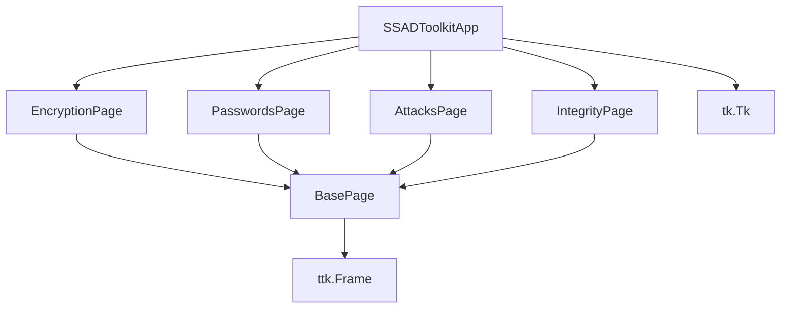
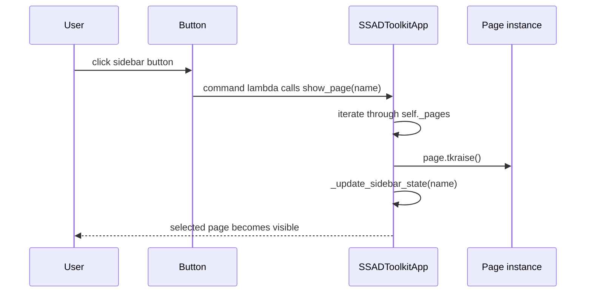
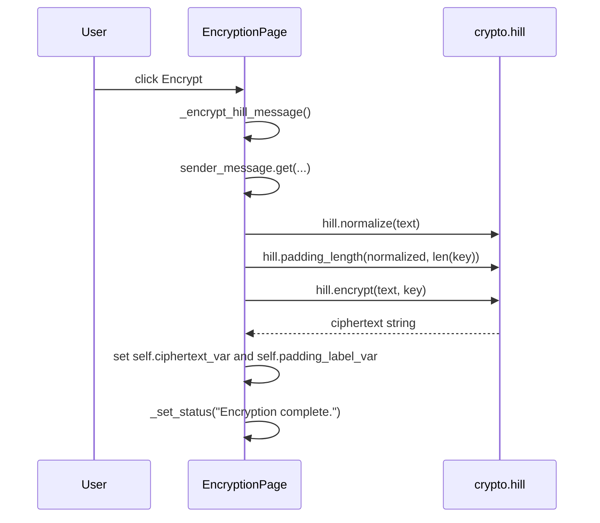
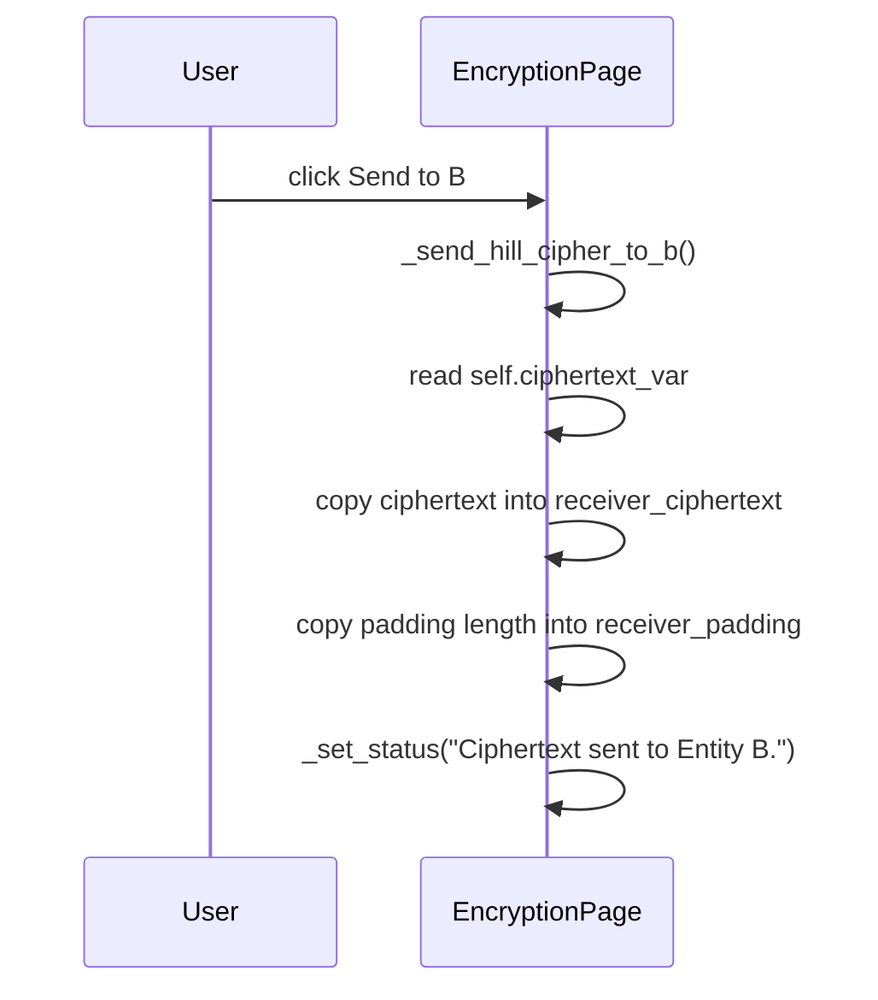
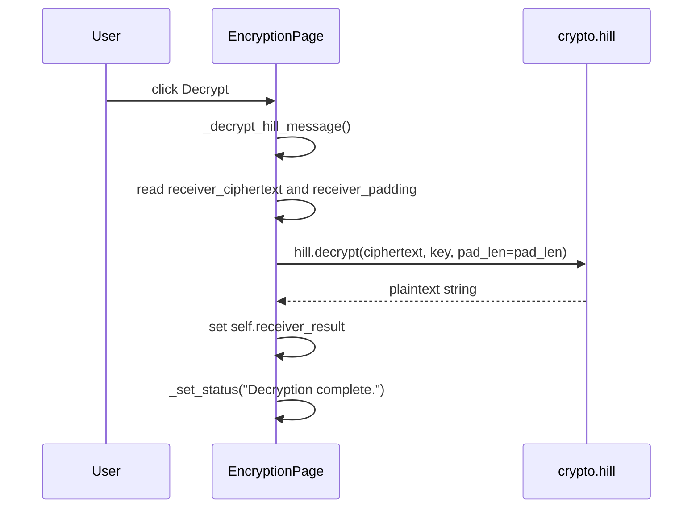
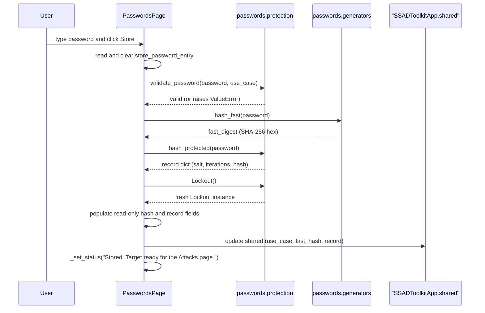
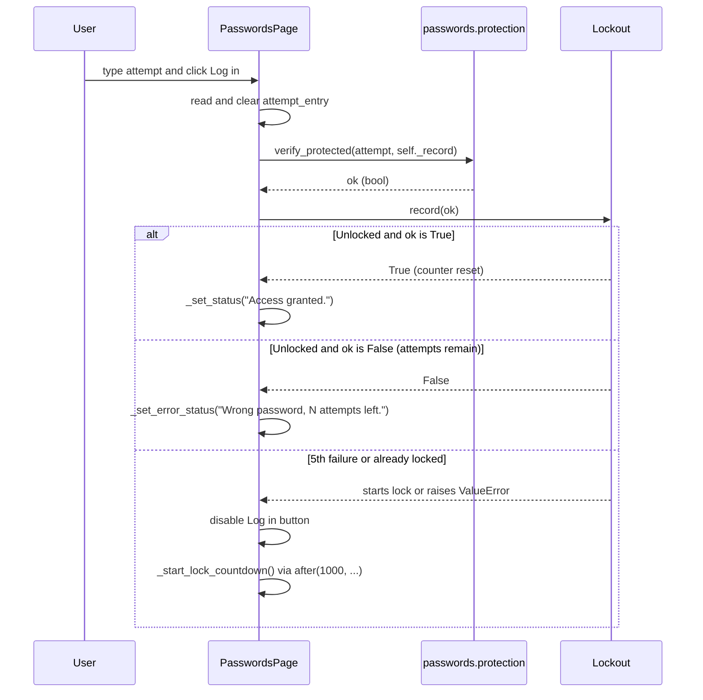
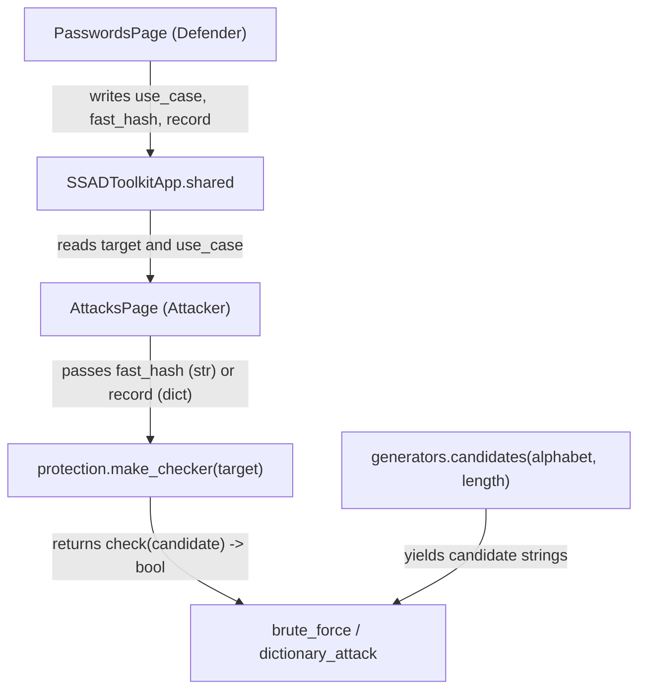

# SSAD Toolkit Project Guide

## 1. Overview

SSAD Toolkit is a Windows desktop application written in Python 3.10+ using only the standard library, mainly Tkinter and ttk. The project is a teaching-style practical work for classical cryptography and related security topics.

The expected workflow is:

```bash
python main.py
```

No external packages are required for the current code. The code imports only standard-library modules such as `tkinter`, `ttk`, `math`, and `time`.

### Implemented now vs still stubbed

| Area | Status | What the code does today |
| --- | --- | --- |
| App shell | Implemented | `main.py` launches `gui.app.run_app()`, and `SSADToolkitApp` builds the window and sidebar. |
| Encryption page | Implemented | The page includes Caesar, Playfair, and Hill panels with manual key entry and no pre-filled secrets. |
| Hill cipher logic | Implemented | `crypto/hill.py` provides `normalize`, `validate_key`, `determinant`, `inverse_key`, `padding_length`, `encrypt`, and `decrypt`. |
| Caesar cipher | Implemented | `crypto/caesar.py` encrypts and decrypts over the 52-letter alphabet, with key validation and frequency attack helpers. |
| Playfair cipher | Implemented | `crypto/playfair.py` validates manual keywords, builds the 5x5 matrix, and handles encryption/decryption with digraph padding. |
| Password defence & page | Implemented | `passwords/generators.py`, `passwords/protection.py`, and `gui/pages/passwords_page.py` implement use cases 1 and 2, fast SHA-256 hashing, PBKDF2-HMAC-SHA256 salted storage, constant-time verification, `make_checker`, `Lockout`, and the Passwords GUI page. |
| Password attack modules | Stub | `passwords/brute_force.py` and `passwords/dictionary.py` remain stubs for the attacker team. |
| Integrity module | Stub | `integrity/integrity.py` function stubs exist and intentionally do nothing. |
| Attack helpers | Stub | `attacks/*.py` function stubs exist and intentionally do nothing. |
| Tests | Implemented | Unit tests cover Caesar, Playfair, Hill, password defence (`tests/test_protection.py`), and import smoke checks. |
| Benchmark helper | Implemented | `benchmarks.py` times callable functions and skips unavailable ones. |

> The GUI does not auto-populate keys. All algorithms require the user to type the key manually.

## 2. Folder tree

```text
SSAD/
├── main.py
├── README.md
├── PROJECT_UPDATE.md
├── benchmarks.py
├── .gitignore
├── attacks/
│   ├── __init__.py
│   ├── caesar_attack.py
│   ├── hill_attack.py
│   └── playfair_attack.py
├── crypto/
│   ├── __init__.py
│   ├── caesar.py
│   ├── hill.py
│   └── playfair.py
├── gui/
│   ├── __init__.py
│   ├── app.py
│   ├── background.py
│   └── pages/
│       ├── __init__.py
│       ├── attacks_page.py
│       ├── base_page.py
│       ├── encryption_page.py
│       ├── integrity_page.py
│       └── passwords_page.py
├── integrity/
│   ├── __init__.py
│   └── integrity.py
├── passwords/
│   ├── __init__.py
│   ├── brute_force.py
│   ├── dictionary.py
│   ├── generators.py
│   └── protection.py
├── tests/
│   ├── __init__.py
│   ├── test_ciphers.py
│   ├── test_hill.py
│   ├── test_protection.py
│   ├── test_smoke.py
│   └── vectors.py
└── docs/
    ├── EXAMPLE_KEYS.md
    ├── HOW_IT_WORKS.md
    └── PROJECT_GUIDE.md
```

### Roles of the main files

- `main.py`: application entry point; runs the app.
- `gui/app.py`: main window and sidebar logic; registers pages and switches them.
- `gui/pages/encryption_page.py`: UI for Caesar, Playfair, and Hill workflows.
- `crypto/caesar.py`: Caesar cipher implementation.
- `crypto/hill.py`: Hill cipher implementation.
- `crypto/playfair.py`: Playfair implementation with 5x5 matrix generation, key validation, and digraph-based encryption/decryption.
- `tests/*`: unit tests and known-good vectors.
- `docs/EXAMPLE_KEYS.md`: verified example values for the real algorithms.
- `README.md`: project overview and run instructions.

`CONVENTIONS.md` was not found in this workspace, so the implementation itself remains the source of truth.

## 3. Verified cipher examples

The ciphers in the code were checked directly against their runtime behavior. The verified examples are:

- Caesar: `Meriem` with key `4` -> `Qivmiq`
- Caesar: `Hello World 2026!` with key `5` -> `Mjqqt btwqi 2026!`
- Hill: `HELP` with key `[[3, 3], [2, 5]]` -> `HIAT`
- Hill: `BONJOUR` with key `[[3, 2], [5, 7]]` -> `FZFYECTM`
- Hill: `ALGORITHM` with key `[[6, 24, 1], [13, 16, 10], [20, 17, 15]]` -> `KCRGONILD`
- Playfair: `HELLO` with key `MONARCHY` -> `CFSUPM`
- Playfair: `MEETME` with key `MONARCHY` -> `CLKLCL`
- Playfair: `INSTRUMENTS` with key `MONARCHY` -> `GATLMZCLRQXA`
- Playfair: `INFORMATION` with key `MONARCHY` -> `GAPHMORSFAAW`
- Playfair: `EXAMPLE` with key `KEYWORD` -> `WURPSHWU`

Playfair is implemented in the crypto layer (`crypto/playfair.py`) and verified against standard Playfair rules in the GUI and test suite.

## 4. Running the tests

Run the suite with:

```bash
python -m unittest discover -s tests -v
```

This validates the real Caesar, Playfair, and Hill logic with the current implementation and known-good vectors.

It creates:

- `self.algorithm_var`: combobox value, default `"Hill"`
- `self.status_var`: a status message for success or error
- `self.hill_key_size_var`: default `"2x2"`
- a top-level `page_frame` to hold the selection and algorithm-specific panel
- a `Hill` panel with sender and receiver sections
- `ttk.Entry` widgets for the Hill key matrix
- `tk.Text` for the sender message
- `ttk.Button` objects for `Encrypt`, `Send to B`, `Check key`, and `Decrypt`

The code for the Hill panel is built in `_build_hill_panel()`. The matrix grid for the key is created and destroyed in `_rebuild_hill_key_grid()`.

#### `PasswordsPage`

`gui/pages/passwords_page.py` implements the password defence controls:

- Classroom use case selector (`USE_CASES`: use case 1 `"01"`, length 3; use case 2 `"1234"`, length 4; use cases 3, 4, 5 for Case 3 64-character alphabet with lengths 4, 6, and 8)
- Password entry field with hidden characters (`*`), cleared immediately upon storage
- Fast hash calculation using SHA-256 (`passwords/generators.py`)
- Salted, iterated PBKDF2-HMAC-SHA256 protected record storage (`passwords/protection.py`)
- Hand-off of the stored target to `SSADToolkitApp.shared` for the Attacks page
- Login testing panel with constant-time verification (`verify_protected()`) and 5-attempt lockout (`Lockout`) with a live 30-second countdown timer.

#### `AttacksPage`

`gui/pages/attacks_page.py` is a placeholder page with the same pattern as `PasswordsPage` and a `# TODO` comment.

#### `IntegrityPage`

`gui/pages/integrity_page.py` is also a placeholder page for authenticity/integrity tools, with the same pattern.

### 4.4 Mermaid class diagram



This reflects the actual code: `SSADToolkitApp` owns the page instances, and each page inherits from `BasePage`, which inherits from `ttk.Frame`.

## 5. How the components interact

### 5.1 Sequence diagrams

#### a) User clicks a sidebar button



Important detail: the actual callback is created in `_build_sidebar()` as:

```python
command=lambda name=page_name: self.show_page(name)
```

The button does not directly call the page; it calls the app method, which raises the frame to the front.

#### b) User clicks Encrypt in the Hill panel



The boundary is clear: the GUI does not compute the Hill matrix math itself. It passes the raw text and matrix into `crypto.hill.encrypt()`.

#### c) User clicks Send to B



This is a GUI-only handoff. There is no crypto call here; it just copies values from the sender-side fields to the receiver-side fields.

#### d) User clicks Decrypt



Again, all actual mathematics is centralized in `crypto/hill.py`.

### 5.2 Exact method call order for Hill interaction

For the Hill workflow, the call pattern is:

1. `EncryptionPage._build_hill_panel()` creates the inputs and hooks buttons.
2. `EncryptionPage._rebuild_hill_grids()` creates the matrix `ttk.Entry` widgets for both sender and receiver (all starting empty).
3. When the user clicks `Check key`, `EncryptionPage._check_hill_key()` (sender) or `_check_hill_receiver_key()` (receiver) runs:
   - `_parse_hill_key()` or `_parse_hill_receiver_key()` reads the `ttk.Entry` values and validates that each cell is an integer
   - `hill.validate_key(key)` checks invertibility modulo 26
   - `hill.determinant(key) % 26` is used to get the determinant modulo 26
   - `_set_status()` or `_set_error_status()` sets the label text
4. When the user clicks `Encrypt`, `EncryptionPage._encrypt_hill_message()` runs:
   - `_parse_hill_key()` strictly validates Entity A's key matrix before encryption
   - `hill.normalize(text)` strips non-letters and uppercases
   - `hill.padding_length(...)` computes the number of trailing `X` letters needed
   - `hill.encrypt(text, key)` returns ciphertext
   - the result is assigned to `self.ciphertext_var`
5. When the user clicks `Send to B`, `EncryptionPage._send_hill_cipher_to_b()` copies only the ciphertext and padding count to the receiver side (keys are never copied).
6. When the user clicks `Decrypt`, `EncryptionPage._decrypt_hill_message()` runs:
   - `_parse_hill_receiver_key()` strictly validates Entity B's key matrix first
   - reads the ciphertext and optional padding value from `receiver_padding`
   - calls `hill.decrypt(ciphertext, key, pad_len=pad_len)`
   - writes the result to `self.receiver_result`

### 5.3 Error propagation from `crypto/hill.py` to the status label

The error flow is explicit:

- `hill.encrypt()` raises `ValueError` for malformed keys or non-invertible matrices.
- `hill.decrypt()` raises `ValueError` for invalid ciphertext length, bad padding values, or out-of-range padding.
- `EncryptionPage._encrypt_hill_message()` catches `ValueError` and calls:

```python
self._set_error_status(str(exc))
self.ciphertext_var.set("")
self.padding_label_var.set("0")
```

- `EncryptionPage._decrypt_hill_message()` catches `ValueError` similarly:

```python
self._set_error_status(str(exc))
self.receiver_result.set("")
```

- `EncryptionPage._check_hill_key()` does the same for invalid matrix entries and invalid keys.

The actual status color is set in `_set_status()` with red for errors and green for normal status:

```python
self.status_var.set(message)
self.status_label.configure(foreground="#c92a2a" if is_error else "#0f5132")
```

### 5.4 How the matrix grids are built and rebuilt

Both Entity A (sender) and Entity B (receiver) have their own independent matrix grids. Pre-filled keys and `HILL_KEY_DEFAULTS` no longer exist: all key grids start completely empty, requiring manual typing.

The sender grid is built in `_rebuild_hill_key_grid()` and the receiver grid in `_rebuild_hill_receiver_key_grid()`. Both are managed together by `_rebuild_hill_grids()`:

```python
size = 2 if self.hill_key_size_var.get() == "2x2" else 3
self.hill_entries = []

for row_index in range(size):
    row_entries = []
    for col_index in range(size):
        entry = ttk.Entry(self.hill_key_matrix_frame, width=4)
        entry.grid(row=row_index, column=col_index, padx=2, pady=2)
        row_entries.append(entry)
    self.hill_entries.append(row_entries)
```

When key size changes, both old matrices are destroyed and rebuilt with empty cells. When Entity A changes size via `self.hill_key_size_var`, Entity B's size variable `self.hill_receiver_key_size_var` automatically follows A's size (size only, never values), and both grids are cleared. Both grids are also cleared when switching algorithms or pressing the **Clear keys** button.

The obsolete `_current_hill_key()` method that silently converted empty or non-integer cells to `0` was removed entirely. Validation is performed strictly by `_parse_hill_key()` (for sender A) and `_parse_hill_receiver_key()` (for receiver B):

- If a cell is empty:
  `Entry at row R, column C is empty.` (displayed in red `#c92a2a`)
- If a cell contains a non-integer:
  `Entry at row R, column C is not an integer.` (displayed in red `#c92a2a`)

Decryption reads ONLY Entity B's matrix grid via `_parse_hill_receiver_key()`. Nothing ever copies keys from A to B.

## 6. The Hill cipher: the theory

### 6.1 Plain-language explanation

The Hill cipher is a polygraphic substitution cipher. Instead of replacing one letter at a time, it encrypts blocks of letters together using a matrix.

The code uses the standard alphabet mapping:

- `A -> 0`
- `B -> 1`
- `C -> 2`
- ...
- `Z -> 25`

The mapping is implemented implicitly in the code:

```python
vector = [ord(letter) - 65 for letter in block]
```

and later:

```python
plaintext_letters.extend(chr(value + 65) for value in decoded_vector)
```

For a 2x2 key matrix, block size is 2. For a 3x3 key matrix, block size is 3.

For a key matrix `K` and a column vector `v` of letters in the block, the code does matrix multiplication modulo 26:

```python
sum(matrix[row_index][col_index] * vector[col_index] for col_index in range(len(vector))) % 26
```

This means each output letter is a linear combination of the input letters, reduced modulo 26.

A valid Hill key must be invertible modulo 26. If the determinant is not coprime to 26, the matrix cannot be inverted and decryption is impossible.

### 6.2 Why the key must satisfy gcd(det, 26) = 1

The code checks:

```python
det_mod = determinant(normalized) % 26
gcd_value = math.gcd(det_mod, 26)
if gcd_value != 1:
    raise ValueError(f"Key is not invertible mod 26: gcd(det, 26) = {gcd_value}")
```

This means the determinant must be relatively prime to 26. Since `26 = 2 * 13`, the determinant must be odd and not divisible by 13. In modular arithmetic, a matrix is invertible modulo 26 exactly when its determinant has a multiplicative inverse modulo 26.

The modular inverse is computed with:

```python
inverse_det = pow(det_mod, -1, 26)
```

This works because Python 3.8+ supports modular inverses via `pow(x, -1, m)` for values that are invertible modulo `m`.

### 6.3 Decryption and the inverse matrix

Decryption multiplies the ciphertext block by the inverse of the key matrix modulo 26.

For a 2x2 matrix

$$
K = \begin{bmatrix} a & b \\ c & d \end{bmatrix}
$$

its inverse is:

$$
K^{-1} = \frac{1}{ad-bc} \begin{bmatrix} d & -b \\ -c & a \end{bmatrix} \pmod{26}
$$

The code does the equivalent with the adjugate matrix and then multiplies by the modular inverse of the determinant:

```python
adjugate = [[d, -b], [-c, a]]
inverse = [[((entry * inverse_det) % 26) for entry in row] for row in adjugate]
```

For 3x3, the code builds the cofactor matrix and then transposes it (adjugate) before applying the modular inverse of the determinant.

### 6.4 Worked examples matching the code

#### Example 1: `HELP` with key `[[3, 3], [2, 5]]`

This matches the vector in `tests/vectors.py` and the code behavior.

Plaintext: `HELP`

Normalized letters: `H E L P` = `7,4,11,15`

Key:

$$
K = \begin{bmatrix} 3 & 3 \\ 2 & 5 \end{bmatrix}
$$

Block 1: `HE` = `7, 4`

$$
\begin{bmatrix} 3 & 3 \\ 2 & 5 \end{bmatrix}
\begin{bmatrix} 7 \\ 4 \end{bmatrix}
= \begin{bmatrix} 33 \\ 34 \end{bmatrix}
\equiv
\begin{bmatrix} 7 \\ 8 \end{bmatrix}
\pmod{26}
$$

`7 -> H`, `8 -> I` => `HI`

Block 2: `LP` = `11, 15`

$$
\begin{bmatrix} 3 & 3 \\ 2 & 5 \end{bmatrix}
\begin{bmatrix} 11 \\ 15 \end{bmatrix}
= \begin{bmatrix} 78 \\ 97 \end{bmatrix}
\equiv
\begin{bmatrix} 0 \\ 19 \end{bmatrix}
\pmod{26}
$$

`0 -> A`, `19 -> T` => `AT`

So the ciphertext is `HIAT`, exactly as in the test vector.

The inverse key used in the code is `[[15, 17], [20, 9]]`, which is the modular inverse of the matrix modulo 26.

#### Example 2: `BONJOUR` with key `[[3, 2], [5, 7]]`

This is the vector in `tests/vectors.py`.

Plaintext: `BONJOUR` -> 7 letters.

- block size is 2
- padding length is 1, because `7 % 2 = 1`
- padded plaintext is `BONJOURX`

The actual code computes the ciphertext as `FZFYECTM`.

The padding rule is visible in `padding_length()`:

```python
remainder = len(normalized) % n
return 0 if remainder == 0 else n - remainder
```

This appends `X` characters until the message length is a multiple of the block size.

#### Example 3: 3x3 key with `BONJOUR`

Key: `[[6, 24, 1], [13, 16, 10], [20, 17, 15]]`

Plaintext: `BONJOUR`

- length is 7, block size is 3
- padding length is 2, because `7 % 3 = 1`, so the required padding is `2` letters
- padded plaintext is `BONJOURXX`

This matches the vector in `tests/vectors.py`: ciphertext `RDLUVQBNK`.

#### Example 4: 3x3 key with `ALGORITHM`

The project also contains a known 3x3 vector:

```python
ALGORITHM -> KCRGONILD
```

The actual block decomposition is:

- `ALG` -> `KCR`
- `ORI` -> `GON`
- `THM` -> `ILD`

This matches the vector in the implementation and the code path in `tests/test_hill.py`.

### 6.5 Weaknesses of Hill

The code comments in `crypto/hill.py` explicitly note that the cipher is linear and vulnerable to known-plaintext attacks. In practice:

- it is vulnerable to algebraic attacks because the output is a linear function of the plaintext
- if an attacker knows enough plaintext/ciphertext pairs, they can recover the key matrix
- padding with `X` is an ad hoc fix, not a security feature, and it introduces a canonical ambiguity when the last genuine letter is already `X`
- the scheme is deterministic, so repeated blocks produce repeated ciphertext blocks for the same key if the input repeats

A practical example of the padding ambiguity: if the real plaintext ends with `X`, the code cannot tell whether the trailing `X` was intentional or added for block completion. That is why `decrypt()` must be called with `pad_len` when the caller knows how much padding was appended; otherwise it leaves the trailing characters alone.

## 7. The Hill cipher: the implementation

This section describes the functions in `crypto/hill.py` in the order they appear.

### `normalize(text: str) -> str`

Purpose: remove all non-letter characters and uppercase the result.

```python
def normalize(text: str) -> str:
    if not isinstance(text, str):
        text = str(text)
    return "".join(char for char in text.upper() if "A" <= char <= "Z")
```

What it does:

- converts anything to a string if it is not already a string
- keeps only letters `A` to `Z`
- discards spaces, punctuation, digits, and other symbols
- returns uppercase text for the rest of the algorithm

Example: `"Hello, world!"` becomes `"HELLOWORLD"`.

### `_coerce_key(key) -> list[list[int]] | None`

Purpose: validate the matrix shape and type without raising a user-facing exception.

```python
def _coerce_key(key) -> list[list[int]] | None:
    if not isinstance(key, Sequence) or isinstance(key, (str, bytes)):
        return None

    rows = [list(row) for row in key]
    if not rows or len(rows) not in (2, 3):
        return None
```

Important rules enforced here:

- the matrix must be a sequence, not a string or bytes
- it must be either 2x2 or 3x3
- each row must have the same length as the matrix size
- each entry must be an integer, not a Boolean, and is normalized modulo 26

`_coerce_key()` is internal and used by the public functions.

### `determinant(key) -> int`

Purpose: calculate the determinant of a valid 2x2 or 3x3 matrix.

```python
def determinant(key) -> int:
    normalized = _coerce_key(key)
    if normalized is None:
        raise ValueError("Key must be a 2x2 or 3x3 square matrix of integers.")
```

For a 2x2 matrix, it computes:

```python
return normalized[0][0] * normalized[1][1] - normalized[0][1] * normalized[1][0]
```

For a 3x3 matrix, it computes:

```python
return (
    a * (e * i - f * h)
    - b * (d * i - f * g)
    + c * (d * h - e * g)
)
```

This is the standard determinant formula. In the actual code, `_coerce_key()` reduces every entry modulo 26 before the determinant is computed, so the determinant is evaluated on already-normalized entries.

### `inverse_key(key) -> list[list[int]]`

Purpose: return the modular inverse of the key matrix modulo 26.

```python
def inverse_key(key) -> list[list[int]]:
    normalized = _coerce_key(key)
    if normalized is None:
        raise ValueError("Key must be a 2x2 or 3x3 square matrix of integers.")

    det_mod = determinant(normalized) % 26
    gcd_value = math.gcd(det_mod, 26)
    if gcd_value != 1:
        raise ValueError(f"Key is not invertible mod 26: gcd(det, 26) = {gcd_value}")

    inverse_det = pow(det_mod, -1, 26)
```

This is the central decryption rule. The inverse matrix is computed by:

- finding the determinant modulo 26
- checking whether the determinant is coprime to 26
- computing the modular inverse of the determinant
- building the adjugate matrix
- multiplying each adjugate entry by `inverse_det` modulo 26

For 2x2, the code uses the formula `[[d, -b], [-c, a]]`.
For 3x3, it first computes cofactors, then transposes them to create the adjugate matrix.

### `validate_key(key) -> bool`

Purpose: return `True` only for invertible 2x2 or 3x3 matrices modulo 26.

```python
def validate_key(key) -> bool:
    normalized = _coerce_key(key)
    if normalized is None:
        return False

    try:
        det_mod = determinant(normalized) % 26
    except ValueError:
        return False

    return math.gcd(det_mod, 26) == 1
```

This function never raises exceptions for malformed input; it returns `False` instead. `EncryptionPage._check_hill_key()` uses this to decide whether to show the green VALID or red INVALID label.

### `padding_length(text: str, n: int) -> int`

Purpose: compute how many trailing `X` letters are needed for a message to complete the final block.

```python
def padding_length(text: str, n: int) -> int:
    normalized = normalize(text)
    if not isinstance(n, int) or isinstance(n, bool) or n <= 0:
        raise ValueError("Block size must be a positive integer.")
    remainder = len(normalized) % n
    return 0 if remainder == 0 else n - remainder
```

Example: `padding_length("HELLO", 2) == 1` because `HELLO` has length 5, and the next multiple of 2 is 6.

### `_matrix_multiply(matrix, vector) -> list[int]`

Purpose: multiply a matrix by a column vector modulo 26.

```python
def _matrix_multiply(matrix: list[list[int]], vector: list[int]) -> list[int]:
    return [
        sum(matrix[row_index][col_index] * vector[col_index] for col_index in range(len(vector))) % 26
        for row_index in range(len(matrix))
    ]
```

This is the math engine used by both encryption and decryption.

### `encrypt(text: str, key) -> str`

Purpose: encrypt a string with the Hill cipher using a valid key matrix.

This is the full real code from `crypto/hill.py`:

```python
def encrypt(text: str, key) -> str:
    """Encrypt a message with the Hill cipher using a valid invertible key.

    Known weaknesses: the cipher is linear and vulnerable to known-plaintext
    attacks, and the key matrix must be invertible modulo 26.
    """
    normalized = normalize(text)
    if not normalized:
        raise ValueError("Message has no letters A-Z.")

    normalized_key = _coerce_key(key)
    if normalized_key is None:
        raise ValueError("Key must be a 2x2 or 3x3 square matrix of integers.")

    det_mod = determinant(normalized_key) % 26
    gcd_value = math.gcd(det_mod, 26)
    if gcd_value != 1:
        raise ValueError(f"Key is not invertible mod 26: gcd(det, 26) = {gcd_value}")

    block_size = len(normalized_key)
    padded = normalized + ("X" * padding_length(normalized, block_size))
    ciphertext_letters: list[str] = []

    for start in range(0, len(padded), block_size):
        block = padded[start : start + block_size]
        vector = [ord(letter) - 65 for letter in block]
        encrypted_vector = _matrix_multiply(normalized_key, vector)
        ciphertext_letters.extend(chr(value + 65) for value in encrypted_vector)

    return "".join(ciphertext_letters)
```

This is the exact behavior in the code: before any block math, `encrypt()` rejects an empty message, validates the matrix shape, and checks the determinant modulo 26. If `gcd(det_mod, 26) != 1`, it raises `ValueError("Key is not invertible mod 26: gcd(det, 26) = {gcd_value}")` and stops. There is no bug here: the current implementation does reject non-invertible keys.

### `decrypt(text: str, key, pad_len: int | None = None) -> str`

Purpose: recover the plaintext, optionally stripping trailing padding.

```python
def decrypt(text: str, key, pad_len: int | None = None) -> str:
    normalized_key = _coerce_key(key)
    if normalized_key is None:
        raise ValueError("Key must be a 2x2 or 3x3 square matrix of integers.")

    det_mod = determinant(normalized_key) % 26
    gcd_value = math.gcd(det_mod, 26)
    if gcd_value != 1:
        raise ValueError(f"Key is not invertible mod 26: gcd(det, 26) = {gcd_value}")

    block_size = len(normalized_key)
    normalized_cipher = normalize(text)
    if len(normalized_cipher) % block_size != 0:
        raise ValueError(
            f"Ciphertext length {len(normalized_cipher)} is not a multiple of the key size {block_size}."
        )

    inverse_matrix = inverse_key(normalized_key)
    plaintext_letters: list[str] = []
    for start in range(0, len(normalized_cipher), block_size):
        block = normalized_cipher[start : start + block_size]
        vector = [ord(letter) - 65 for letter in block]
        decoded_vector = _matrix_multiply(inverse_matrix, vector)
        plaintext_letters.extend(chr(value + 65) for value in decoded_vector)

    decoded = "".join(plaintext_letters)

    if pad_len is None:
        return decoded

    if not isinstance(pad_len, int) or isinstance(pad_len, bool) or pad_len < 0 or pad_len >= block_size:
        raise ValueError(f"Padding length must be between 0 and {block_size - 1}.")
    if pad_len > len(decoded):
        raise ValueError("Padding length is larger than the decrypted text length.")

    return decoded[:-pad_len] if pad_len else decoded
```

This is the exact current logic in the code: `pad_len` is valid only when `0 <= pad_len < n`, and the code rejects any value outside that range with `ValueError(f"Padding length must be between 0 and {block_size - 1}.")`.

### Trace of one full encryption

Use the exact code path and the key `[[3, 3], [2, 5]]` with plaintext `HELP`.

1. `normalize("HELP")` returns `"HELP"`.
2. `padding_length("HELP", 2)` returns `0` because length is already even.
3. `encrypt()` sees a valid key, computes the matrix multiplication block by block.
4. First block `HE` -> `[7, 4]` -> `[7, 8]` -> `HI`.
5. Second block `LP` -> `[11, 15]` -> `[0, 19]` -> `AT`.
6. Final ciphertext: `HIAT`.

This matches the vector in `tests/vectors.py` exactly.

### Trace of one full decryption

Decrypt `HIAT` with the same key and `pad_len=0`.

1. `normalize("HIAT")` returns `"HIAT"`.
2. `decrypt()` checks the length is a multiple of 2.
3. `inverse_key([[3, 3], [2, 5]])` returns `[[15, 17], [20, 9]]` modulo 26.
4. The first block `HI` is transformed back to `HE`.
5. The second block `AT` is transformed back to `LP`.
6. The result is `HELP`.

If the ciphertext came from a padded message and the caller passes the correct pad length, the function strips the extra `X` characters after decryption.

### Every validation rule and exact error message

The code raises the following exact texts in the current implementation:

- `"Key must be a 2x2 or 3x3 square matrix of integers."`
- `"Key is not invertible mod 26: gcd(det, 26) = {gcd_value}"`
- `"Message has no letters A-Z."`
- `"Block size must be a positive integer."`
- `"Ciphertext length {len(normalized_cipher)} is not a multiple of the key size {block_size}."`
- `"Padding length must be between 0 and {block_size - 1}."`
- `"Padding length is larger than the decrypted text length."`

In addition, `_coerce_key()` rejects invalid shapes and non-integer values before the public functions are called.

## 8. The padding length feature

The padding feature exists because Hill requires block lengths to match the key size. A message whose length is not already a multiple of `n` must be extended with trailing `X` characters.

The key rule is implemented in `padding_length(text, n)`: it calculates the remainder of `len(normalized_text) % n` and adds enough `X` letters to reach the next multiple of `n`.

Examples:

- `padding_length("HELLO", 2) -> 1`
- `padding_length("HELLO", 3) -> 1`
- `padding_length("HELLO", 4) -> 3`
- `padding_length("", 3) -> 0`

The Hill UI exposes this directly:

- `self.padding_label_var` stores the number of added `X` letters
- `self.ciphertext_var` stores the encrypted text
- `self.receiver_padding` is the optional field used for decryption

The sender-side button `Send to B` does this:

```python
pad_len = self.padding_label_var.get().strip()
self.receiver_padding.delete(0, tk.END)
self.receiver_padding.insert(0, pad_len if pad_len and pad_len != "0" else "")
```

This means:

- `0` or `"0"` becomes an empty field
- non-zero padding is copied into the receiver field
- an empty field means `pad_len = None` during decryption

This is important because automatic padding removal is ambiguous. Consider a legitimate plaintext ending in `X`. The code cannot know whether the trailing `X` was original text or material added to complete a block. That is why the UI includes the optional field and why `decrypt(..., pad_len=None)` intentionally keeps the trailing padding in the output.

### What happens when the field is empty, wrong, or out of range

The GUI path is:

```python
ciphertext = self.receiver_ciphertext.get().strip()
pad_value = self.receiver_padding.get().strip()
try:
    pad_len = None if pad_value == "" else int(pad_value)
    result = hill.decrypt(ciphertext, key, pad_len=pad_len)
    self.receiver_result.set(result)
    self._set_status("Decryption complete.")
except ValueError as exc:
    self._set_error_status(str(exc))
    self.receiver_result.set("")
```

In other words:

- Empty field: `pad_value == ""` => `pad_len = None` => `decrypt()` returns the decoded text with trailing padding left in place.
- Wrong type: non-numeric text such as `"abc"` triggers `int(pad_value)` before `hill.decrypt()` runs, so the user sees the exact message: `ValueError: invalid literal for int() with base 10: 'abc'`.
- Negative value: `pad_len < 0` => `ValueError("Padding length must be between 0 and {block_size - 1}.")`.
- Too large for the key: `pad_len >= block_size` => `ValueError("Padding length must be between 0 and {block_size - 1}.")`.
- Too large for the decrypted text: `pad_len > len(decoded)` => `ValueError("Padding length is larger than the decrypted text length.")`.
- Zero: `pad_len == 0` -> the result is returned unchanged.

The `pad_len > len(decoded)` check is real in the API but is not the first failure in the GUI path. In the GUI, a non-numeric entry fails earlier at `int(pad_value)`. In raw library usage, it is reachable only if the caller deliberately passes a pad length larger than the decrypted text length after decryption is complete.

## 9. Tests

The project has a small test suite in `tests/`.

### `tests/vectors.py`

This file stores known-good vectors. It contains:

- `CAESAR_VECTORS`: empty at the moment
- `PLAYFAIR_VECTORS`: empty at the moment
- `HILL_VECTORS`: four real Hill test vectors, including the 3x3 `ALGORITHM` case

The Hill vectors are:

```python
HILL_VECTORS = [
    {"plaintext": "BONJOUR", "key": [[3, 2], [5, 7]], "ciphertext": "FZFYECTM"},
    {
        "plaintext": "BONJOUR",
        "key": [[6, 24, 1], [13, 16, 10], [20, 17, 15]],
        "ciphertext": "RDLUVQBNK",
    },
    {"plaintext": "HELP", "key": [[3, 3], [2, 5]], "ciphertext": "HIAT"},
    {"plaintext": "ALGORITHM", "key": [[6, 24, 1], [13, 16, 10], [20, 17, 15]], "ciphertext": "KCRGONILD"},
]
```

These vectors correspond exactly to the actual Hill implementation and are used by `tests/test_ciphers.py` and `tests/test_hill.py`.

### `tests/test_ciphers.py`

This test file checks the vector-based behavior for Caesar, Playfair, and Hill.

- Caesar and Playfair tests are skipped if their vector lists are empty.
- Hill tests are active because `HILL_VECTORS` is not empty.
- For each vector, it calls `hill.encrypt()` and `hill.decrypt()` and asserts that the results match the expected values.

The test also includes a skip path:

```python
except NotImplementedError:
    self.skipTest("not implemented yet")
```

This is how the suite handles stubs that are not implemented yet.

### `tests/test_hill.py`

This is the real logic test file for the Hill cipher. It checks:

- invalid keys are rejected by `hill.validate_key()`
- invalid key matrices raise `ValueError` in `hill.encrypt()`
- randomized round trips work for valid matrices
- `padding_length()` behaves as expected
- `decrypt()` without `pad_len` preserves the trailing `X`
- ciphertexts with invalid length produce `ValueError`
- `pad_len` is rejected when it is negative, non-integer, or larger than `n - 1`
- an empty message raises `ValueError("Message has no letters A-Z.")`
- the `BOX` and `ALGORITHM` vectors behave exactly as expected

### `tests/test_smoke.py`

This file verifies that:

- importlib can import `crypto`, `passwords`, `integrity`, `attacks`, and `gui`
- Caesar/Playfair stub functions raise `NotImplementedError`
- `hill` itself functions as expected for the identity key and a valid round trip

### `benchmarks.py`

This file imports `caesar`, `hill`, and `playfair` and uses a timing helper:

```python
from crypto import caesar, hill, playfair
```

It calls `time_it()` for each cipher function. If a cipher raises `NotImplementedError`, `_benchmark_entry()` returns `None`, so the benchmark silently skips unavailable algorithms.

### How to run the tests

From the project root, run:

```bash
python -m unittest discover -s tests -v
```

Real output from the current workspace:

```text
test_vectors (test_ciphers.TestCaesarCipher.test_vectors) ... ok
test_vectors (test_ciphers.TestHillCipher.test_vectors) ... ok
test_vectors (test_ciphers.TestPlayfairCipher.test_vectors) ... ok
test_algorithm_vector_3x3 (test_hill.TestHillCipherLogic.test_algorithm_vector_3x3) ... ok
test_box_padding_behavior (test_hill.TestHillCipherLogic.test_box_padding_behavior) ... ok
test_decrypt_rejects_non_multiple_length (test_hill.TestHillCipherLogic.test_decrypt_rejects_non_multiple_length) ... ok
test_decrypt_rejects_padding_range_and_type (test_hill.TestHillCipherLogic.test_decrypt_rejects_padding_range_and_type) ... ok
test_decrypt_without_pad_len_keeps_padding (test_hill.TestHillCipherLogic.test_decrypt_without_pad_len_keeps_padding) ... ok
test_empty_message_rejected (test_hill.TestHillCipherLogic.test_empty_message_rejected) ... ok
test_padding_length (test_hill.TestHillCipherLogic.test_padding_length) ... ok
test_round_trip_randomized_text (test_hill.TestHillCipherLogic.test_round_trip_randomized_text) ... ok
test_validate_key_rejects_invalid_keys (test_hill.TestHillCipherLogic.test_validate_key_rejects_invalid_keys) ... ok
test_candidates_case_3_vector_abcd (test_protection.TestGenerators.test_candidates_case_3_vector_abcd) ... ok
test_candidates_use_case_1 (test_protection.TestGenerators.test_candidates_use_case_1) ... ok
test_candidates_use_case_2 (test_protection.TestGenerators.test_candidates_use_case_2) ... ok
test_hash_fast_known_vector (test_protection.TestGenerators.test_hash_fast_known_vector) ... ok
test_five_failures_lock_and_unlock_after_lock_seconds (test_protection.TestLockout.test_five_failures_lock_and_unlock_after_lock_seconds) ... ok
test_success_resets_failure_counter (test_protection.TestLockout.test_success_resets_failure_counter) ... ok
test_case_3_round_trip (test_protection.TestProtectedHashingAndChecker.test_case_3_round_trip) ... ok
test_make_checker_hex_and_record_and_invalid (test_protection.TestProtectedHashingAndChecker.test_make_checker_hex_and_record_and_invalid) ... ok
test_round_trip_and_wrong_password (test_protection.TestProtectedHashingAndChecker.test_round_trip_and_wrong_password) ... ok
test_tampered_and_malformed_records (test_protection.TestProtectedHashingAndChecker.test_tampered_and_malformed_records) ... ok
test_unique_salts_and_hashes (test_protection.TestProtectedHashingAndChecker.test_unique_salts_and_hashes) ... ok
test_unknown_use_case_rejected (test_protection.TestProtectionValidation.test_unknown_use_case_rejected) ... ok
test_use_case_1_rejections (test_protection.TestProtectionValidation.test_use_case_1_rejections) ... ok
test_use_case_2_rejections (test_protection.TestProtectionValidation.test_use_case_2_rejections) ... ok
test_use_case_3_rejections (test_protection.TestProtectionValidation.test_use_case_3_rejections) ... ok
test_use_case_4_rejections (test_protection.TestProtectionValidation.test_use_case_4_rejections) ... ok
test_use_case_5_rejections (test_protection.TestProtectionValidation.test_use_case_5_rejections) ... ok
test_valid_passwords_accepted (test_protection.TestProtectionValidation.test_valid_passwords_accepted) ... ok
test_attack_stubs (test_smoke.TestCipherFunctions.test_attack_stubs) ... ok
test_crypto_implementations (test_smoke.TestCipherFunctions.test_crypto_implementations) ... ok
test_password_and_integrity_stubs (test_smoke.TestCipherFunctions.test_password_and_integrity_stubs) ... ok
test_packages_import (test_smoke.TestImports.test_packages_import) ... ok

----------------------------------------------------------------------
Ran 34 tests in 0.085s

OK
```

This is the exact current status from the workspace: 34 tests ran, all 34 passed, 0 were skipped, and the suite ended with `OK`.

## 10. How to add a new algorithm or page

### Adding a new cipher to the encryption page

To add a new algorithm such as Caesar or Playfair, the code path is:

1. Add the actual algorithm to the matching file in `crypto/`.
   - `crypto/caesar.py`
   - `crypto/playfair.py`
2. Add or update the vector file in `tests/vectors.py`.
3. Add or update tests in `tests/test_ciphers.py`.
4. Update `gui/pages/encryption_page.py` in `_render_algorithm_panel()`:

```python
if algorithm == "Caesar":
    self._build_caesar_panel()
elif algorithm == "Playfair":
    self._build_playfair_panel()
else:
    self._build_hill_panel()
```

5. Add the actual UI widgets in the matching builder method such as `_build_caesar_panel()` or `_build_playfair_panel()`.
6. Hook the UI to the algorithm functions in the same file.
7. Re-run `python -m unittest discover -s tests -v`.

### Adding a completely new page to the sidebar

To add another page to the left sidebar:

1. Create a new file in `gui/pages/` with a class that inherits from `BasePage`.
2. Import that class in `gui/app.py`.
3. Add a tuple to `PAGE_DEFINITIONS` in `gui/app.py`:

```python
("New page", NewPageClass),
```

4. The next time the app starts, the sidebar button appears automatically because `_build_sidebar()` iterates over `PAGE_DEFINITIONS`.
5. The new page instance is created automatically because `_build_pages()` also iterates over the same list.

This is the expected extension pattern for the current application structure.

## 11. Conventions and decisions

There is no `CONVENTIONS.md` file in the repository. `UNCERTAIN: the project does not currently include a separate conventions document; the code itself is the only source of truth.`

The actual conventions that are visible in the code are:

- alphabet is uppercase A-Z
- non-letter characters are removed by `normalize()`
- key matrices are 2x2 or 3x3 integer matrices
- matrices are interpreted modulo 26
- encryption and decryption require an invertible determinant with `gcd(det, 26) == 1`
- padding uses trailing `X` letters
- `ValueError` is the standard user-visible error type for invalid inputs
- the GUI status messages use green for success and red for errors

Notable disagreement with documentation: the README still describes the project as a shell, while the code now includes a working Hill cipher and a real Hill UI. This means the docs are partly stale and the code is the final authority.

## 12. Known limitations and open points

This section is based only on the code as it exists today.

- `crypto/caesar.py`, `crypto/playfair.py`, and `crypto/hill.py` are fully implemented and verified against unit test vectors.
- `passwords/generators.py`, `passwords/protection.py`, and `gui/pages/passwords_page.py` are implemented on the defence side.
- `passwords/brute_force.py`, `passwords/dictionary.py`, `attacks/*.py`, and `integrity/integrity.py` remain stubs for teammate implementation.
- `gui/pages/attacks_page.py` and `gui/pages/integrity_page.py` remain placeholder pages.
- The app does not yet connect any real network or persistence layer.
- The default GUI is a classroom shell rather than a production-ready cryptography suite.
- Keys are always typed manually; no pre-filled or automatic keys exist. Entity B has its own key field / matrix in all three panels. "Clear keys" clears all keys across sender and receiver.
- `_current_hill_key()` was removed entirely and replaced by strict matrix validation in `_parse_hill_key()` and `_parse_hill_receiver_key()`.
- There is no bug in `encrypt()`: it does reject non-invertible keys by checking `gcd(det_mod, 26) == 1` before performing any block math.
- `gui/background.py` exists as a helper for long-running work (used by the attacker team's background attack execution).
- There is no `CONVENTIONS.md` in the workspace, so conventions are implicit and visible in the code.

## 13. Quick start

### Run the app

From the project root, run:

```bash
python main.py
```

This is the app entry point defined in `main.py`.

### Sidebar pages

The app has four entries in `PAGE_DEFINITIONS` in `gui/app.py`:

1. `Encryption / Decryption`
2. `Passwords`
3. `Attacks`
4. `Authenticity / Integrity`

### Which page works today

`EncryptionPage` (with working Caesar, Playfair, and Hill panels) and `PasswordsPage` (with use cases 1 and 2, fast SHA-256 hash, salted PBKDF2 storage, lockout, and shared hand-off) contain real algorithm and defence logic and are functionally active. `AttacksPage` and `IntegrityPage` remain placeholder pages.

## 14. User guide for the Hill panel

### Layout and controls

The Hill panel in `gui/pages/encryption_page.py` contains:

- `Entity A (sender)` Key size selector: `2x2` or `3x3`
- `Check key` buttons: validate the matrix for Entity A and Entity B
- `Entity A (sender)` matrix grid: editable `ttk.Entry` cells, empty at startup
- `Entity A (sender)` message area: a `tk.Text` input for plaintext
- `Encrypt` button: encrypts the sender text and computes padding length
- `Clear keys` button: clears all key fields across sender and receiver
- `Ciphertext:` output field: read-only result of encryption
- `Padding added:` label: number of trailing `X` letters required
- `Send to B` button: copies ciphertext and padding count only, never keys
- `Entity B (receiver)` Key size selector and matrix grid: editable `ttk.Entry` cells, empty at startup
- `Entity B (receiver)` ciphertext field: editable ciphertext entry
- `Padding length (optional):` field: optional pad length used during decryption
- `Decrypt` button: decrypts the receiver ciphertext using Entity B's key grid
- `Result:` field: read-only plaintext result

### Status messages and colors

The status label is created in `_build_algorithm_selector()` and uses `self.status_var`.

- default text: `""`
- success color: green, `#0f5132`
- error color: red, `#c92a2a`

The code paths are:

```python
self.status_var.set(message)
self.status_label.configure(foreground="#c92a2a" if is_error else "#0f5132")
```

Text examples from the current code:

- success example: `"Key is valid."`
- success example: `"Encryption complete."`
- success example: `"Ciphertext sent to Entity B."`
- error example: `"Entry at row 1, column 2 is not an integer."`
- error example: `"Padding length must be between 0 and 1."`

### Choosing a valid key

A Hill key must be:

- a square matrix of size 2 or 3
- integers only
- invertible modulo 26, meaning `gcd(det(K), 26) == 1`

The determinant rule comes directly from `validate_key()`:

```python
det_mod = determinant(normalized) % 26
return math.gcd(det_mod, 26) == 1
```

Examples:

- valid: `[[3, 3], [2, 5]]` with determinant $3 \times 5 - 3 \times 2 = 9$
  - $9 \bmod 26 = 9$
  - `gcd(9, 26) = 1`
  - valid key
- invalid: `[[2, 4], [1, 3]]` with determinant $2 \times 3 - 4 \times 1 = 2$
  - `gcd(2, 26) = 2`
  - invalid key
- invalid: `[[1, 2], [3, 4]]` with determinant $1 \times 4 - 2 \times 3 = -2$
  - `(-2) mod 26 = 24`
  - `gcd(24, 26) = 2`
  - invalid key

These exact values appear in the tests.

### Word-to-matrix method

The GUI does not have a key-word input field. The key is typed as numeric entries, one cell at a time, into the matrix grid in `EncryptionPage`. The code uses the standard A-Z mapping `A = 0, B = 1, ..., Z = 25`, and a key word such as `DDCF` is just a convenient way to describe a matrix when you write it out as numbers. In matrix form, `DDCF` becomes:

```text
D D
C F
```

which is read as:

```python
[[3, 3],
 [2, 5]]
```

because `D = 3`, `C = 2`, `F = 5`. The matrix is filled row by row, not as a word lookup table. For `HELP`, the rows/blocks are treated as column vectors: `H, E` and `L, P`, and each block is multiplied by the matrix modulo 26. This produces the known vector `HIAT`.

The implementation path for the arithmetic is:

```python
vector = [ord(letter) - 65 for letter in block]
encrypted_vector = _matrix_multiply(normalized_key, vector)
```

This is how the GUI-side “Encrypt” button ultimately hands the work to `crypto.hill.encrypt()`; the matrix is not built from a keyword field in the interface.

## 15. Demo script

This section is a documented walkthrough. The exact examples below are taken from the test vectors and code paths. The entries marked “confirmed by tests” are exactly what the unit tests assert; the others are derived from the code and the same vector data.

### 15.1 HELP with `[[3, 3], [2, 5]]`

- Input: plaintext = `HELP`
- Key: `[[3, 3], [2, 5]]`
- Expected output: `HIAT`
- Padding added: `0`
- Status: confirmed by tests

This matches `tests/vectors.py` and `tests/test_hill.py`.

### 15.2 BONJOUR with `[[3, 2], [5, 7]]`

- Input: plaintext = `BONJOUR`
- Key: `[[3, 2], [5, 7]]`
- Expected ciphertext: `FZFYECTM`
- Padding added: `1`
- Status: confirmed by tests

Decryption examples:

- Decrypt `FZFYECTM` with padding `1` -> `BONJOUR`
- Decrypt `FZFYECTM` with empty field (meaning `pad_len = None`) -> `BONJOURX`
- Status: confirmed by tests

The trailing `X` remains when `pad_len` is not supplied, because `decrypt(..., pad_len=None)` returns the decoded text unchanged.

### 15.3 ALGORITHM with 3x3 key

- Input: plaintext = `ALGORITHM`
- Key: `[[6, 24, 1], [13, 16, 10], [20, 17, 15]]`
- Expected ciphertext: `KCRGONILD`
- Padding added: `0`
- Status: confirmed by tests

This is the 3x3 vector checked in `tests/test_hill.py`.

### 15.4 BONJOUR with the 3x3 key

- Input: plaintext = `BONJOUR`
- Key: `[[6, 24, 1], [13, 16, 10], [20, 17, 15]]`
- Expected ciphertext: `RDLUVQBNK`
- Padding added: `2`
- Status: confirmed by tests

### 15.5 BOX with `[[3, 2], [5, 7]]`

- Input: plaintext = `BOX`
- Key: `[[3, 2], [5, 7]]`
- Ciphertext: `FZLQ`
- Padding added: `1`
- `decrypt(ciphertext, key, pad_len=1)` -> `BOX`
- `decrypt(ciphertext, key)` -> `BOXX`
- Status: confirmed by tests

This is the exact logic for the `BOX` regression case in `tests/test_hill.py`.

### 15.6 Error-case examples

The exact error cases below are code-backed and match the tests or the function checks:

1. Invalid key `[[2, 4], [1, 3]]`:
   - `validate_key()` -> `False`
   - `encrypt("HELLO", key)` raises `ValueError("Key is not invertible mod 26: gcd(det, 26) = 2")`
2. Invalid key `[[1, 2], [3, 4]]`:
   - invalid because determinant is `-2` and `gcd(24,26)=2`
3. Non-integer value in a matrix cell, for example `[[3, "x"], [2, 5]]`:
   - `_parse_hill_key()` raises `ValueError` via the GUI status message `"Entry at row 1, column 2 is not an integer."`
4. Padding value `5` on a 2x2 key:
   - `decrypt(..., pad_len=5)` raises `ValueError("Padding length must be between 0 and 1.")`
5. Empty message:
   - `encrypt("", key)` raises `ValueError("Message has no letters A-Z.")`

The GUI was not run here; these results come from the code and the current unit tests.

## 16. Design decisions and why

- Tkinter only: the project uses `tkinter` and `ttk` from the Python standard library. There is no external GUI framework in the code.
- One file per algorithm: the layout expects each cipher algorithm to live in its own module, such as `crypto/hill.py` and the stubs for Caesar or Playfair.
- No cipher math in the GUI: `EncryptionPage` reads values and calls `crypto.hill.encrypt()` / `decrypt()`. The matrix math is stored in the cipher module, not in the page layer.
- Explicit `pad_len` instead of guessing: the code does not guess the trailing padding length. It needs either the correct value or `None` to leave padding visible.
- Strict matrix parser: `EncryptionPage._parse_hill_key()` rejects malformed cells immediately rather than silently converting them to zero.
- `PAGE_DEFINITIONS` registry: the application uses a single registry to build the sidebar and page instances, which keeps page creation centralized.

## 17. Likely questions and answers

1. Why use modulo 26?
   - The alphabet has 26 letters and the Hill key matrix is interpreted over the alphabet modulo 26.

2. Why must `gcd(det(K), 26) == 1`?
   - The determinant must be invertible modulo 26, otherwise the inverse matrix does not exist and decryption fails.

3. How many valid 2x2 keys exist?
   - There are `157,248` invertible `2x2` matrices over `Z_26` out of `26^4 = 456,976` total matrices. This is the count obtained by counting invertible matrices modulo 2 (`6`) and modulo 13 (`168 * 156 = 26,208`) and combining them via the Chinese remainder theorem. The approximation is about `34.4%` of all 2x2 matrices. For `3x3`, the count is about `1.63 trillion` matrices, which is why the project does not enumerate them in code.

4. What happens with an invalid key?
   - `validate_key()` returns `False`, and `encrypt()` or `decrypt()` raises a `ValueError`.

5. Why is `X` used for padding?
   - Because the implementation chooses trailing `X` letters to complete the last block, as implemented in `padding_length()`.

6. Why is `X` padding a weakness?
   - The code comments note that it is an ad hoc fix and ambiguous when the real plaintext ends with `X`.

7. How does a known-plaintext attack work?
   - For a square key of size `n`, an attacker can collect `n` independent blocks and solve `K = C * P^-1 mod 26` when enough plaintext/ciphertext pairs are known.

8. How do sender and receiver share the key?
   - The code does not define a network protocol or key exchange. It assumes the key matrix is already shared out of band.

9. How do I add Playfair?
   - Add a new implementation in `crypto/playfair.py`, then add the UI builder and page logic in `gui/pages/encryption_page.py`, and extend `tests/vectors.py` plus the test suite.

10. Why are Caesar and Playfair still stubs?
   - Because the current code only implements Hill and leaves the other algorithm modules as `NotImplementedError`-raising stubs.

11. Why is the matrix parser strict?
   - Because `EncryptionPage._parse_hill_key()` rejects bad cells instead of converting them to `0`, which makes bad data visible immediately.

12. What is the difference between `validate_key()` and `_parse_hill_key()`?
   - `validate_key()` checks math properties; `_parse_hill_key()` checks whether the GUI input can even be interpreted as integers.

13. Why does `decrypt()` keep trailing `X` when `pad_len` is `None`?
   - Because the code makes no guess and simply returns the decoded result unchanged unless the caller provides `pad_len`.

14. What is a round trip?
   - A round trip is `decrypt(encrypt(text, key), key, pad_len=padding_length(...)) == normalized(text)` in tests.

15. Why is `normalize()` important?
   - It strips all non-letter characters and uppercases the message before encryption or decryption, making the alphabet consistent.

16. What is a column vector?
   - It is the block representation `[letter_1, letter_2, ...]^T` used in the matrix multiplication step.

17. What is a stub in this project?
   - A stub is a placeholder file or module that exists but raises `NotImplementedError` or is otherwise intentionally unimplemented.

18. What is `PAGE_DEFINITIONS` used for?
   - It creates the sidebar list and the page instances in `gui/app.py`.

## 18. Hill security analysis

The current implementation is a teaching implementation, not a hardened production cipher. The relevant behavior is visible in `crypto/hill.py` and the stubbed attack file.

### Linearity

Hill is linear over the alphabet modulo 26. The transformation is:

```python
encrypted_vector = _matrix_multiply(normalized_key, vector)
```

This means that a known linear combination of plaintext vectors can be mapped to a corresponding ciphertext vector. That is the core reason the scheme is vulnerable to algebraic analysis.

### Known-plaintext attack

If an attacker knows enough independent plaintext/ciphertext blocks, they can recover the key matrix using the usual relation:

$$
K = C \cdot P^{-1} \pmod{26}
$$

This requires the plaintext block matrix `P` to be invertible modulo 26. If `P` is not invertible, the inverse does not exist and more blocks or different plaintext choices may be needed to recover the key. The project documentation does not implement the attack; it only documents the algebraic vulnerability in the comments and the design notes. The current file `attacks/hill_attack.py` is still a stub.

### Padding and trailing X

Padding is handled by `padding_length()` and then removed only when the caller supplies the correct `pad_len`. This means the implementation is explicit and transparent, but the choice of trailing `X` is still a weakness because it can make the output ambiguous when the real plaintext itself ends with `X`.

### Deterministic blocks

The matrix transformation is deterministic for a fixed key. Repeated input blocks produce repeated ciphertext blocks under the same key, which is a classic weakness of classical linear ciphers.

### How the platform handles this

The platform currently documents the risk in the narrative sections of this guide and keeps the actual attack logic absent. The code makes no attempt to conceal or remediate the linear algebra weakness. The attack module remains a stub.

## 19. File-by-file reference

This section is grounded in the actual workspace files.

| File | Role | Public functions or classes | Who is expected to edit it |
| --- | --- | --- | --- |
| `main.py` | App entry point | `run_app()` | App/GUI maintainer |
| `gui/app.py` | Window shell, page registry, sidebar, shared hand-off state | `SSADToolkitApp`, `PAGE_DEFINITIONS`, `self.shared`, `show_page()`, `_build_sidebar()`, `_build_pages()` | GUI maintainer |
| `gui/background.py` | Background-task helper | `run_in_background()` or equivalent helper pattern | GUI maintainer |
| `gui/pages/base_page.py` | Shared page frame | `BasePage.__init__()` | GUI maintainer |
| `gui/pages/encryption_page.py` | Caesar, Playfair, and Hill UI and control logic | `EncryptionPage.__init__()`, `_build_algorithm_selector()`, `_render_algorithm_panel()`, `_build_caesar_panel()`, `_build_playfair_panel()`, `_build_hill_panel()`, `_rebuild_hill_grids()`, `_parse_hill_key()`, `_parse_hill_receiver_key()`, `_check_hill_key()`, `_check_hill_receiver_key()`, `clear_keys()`, `_encrypt_hill_message()`, `_decrypt_hill_message()` | Hill/GUI maintainer |
| `gui/pages/passwords_page.py` | Defender password storage and login UI | `PasswordsPage.__init__()`, `_store_password()`, `_send_to_attacks()`, `_clear_all()`, `_login()`, `_start_lock_countdown()` | password defender maintainer |
| `gui/pages/attacks_page.py` | Placeholder page | `AttacksPage` | future attack feature work |
| `gui/pages/integrity_page.py` | Placeholder page | `IntegrityPage` | future integrity/authenticity work |
| `crypto/hill.py` | Actual Hill implementation | `normalize()`, `_coerce_key()`, `determinant()`, `inverse_key()`, `validate_key()`, `padding_length()`, `_matrix_multiply()`, `encrypt()`, `decrypt()` | cryptography maintainer |
| `crypto/caesar.py` | Caesar cipher implementation | `normalize()`, `validate_key()`, `encrypt()`, `decrypt()` | cryptography maintainer |
| `crypto/playfair.py` | Playfair cipher implementation | `validate_key()`, `encrypt()`, `decrypt()`, `_build_matrix()` | cryptography maintainer |
| `passwords/brute_force.py` | Stubbed password tooling | undefined/placeholder functions | password attacker maintainer |
| `passwords/dictionary.py` | Stubbed password tooling | undefined/placeholder functions | password attacker maintainer |
| `passwords/generators.py` | Password use cases, fast SHA-256 hash, candidate generator | `USE_CASES`, `hash_fast()`, `candidates()` | password defender maintainer |
| `passwords/protection.py` | Password validation, PBKDF2 storage, constant-time verify, checker factory, lockout | `ITERATIONS`, `SALT_BYTES`, `MAX_FAILURES`, `LOCK_SECONDS`, `validate_password()`, `hash_protected()`, `verify_protected()`, `make_checker()`, `Lockout` | password defender maintainer |
| `integrity/integrity.py` | Stubbed integrity helpers | undefined/placeholder functions | integrity maintainer |
| `attacks/caesar_attack.py` | Stubbed Caesar attack logic | undefined/placeholder functions | attack analysis maintainer |
| `attacks/hill_attack.py` | Stubbed Hill attack logic | undefined/placeholder functions | attack analysis maintainer |
| `attacks/playfair_attack.py` | Stubbed Playfair attack logic | undefined/placeholder functions | attack analysis maintainer |
| `tests/vectors.py` | Test vectors | `CAESAR_VECTORS`, `PLAYFAIR_VECTORS`, `HILL_VECTORS` | test maintainer |
| `tests/test_hill.py` | Hill regression tests | `TestHillCipherLogic` | cryptography maintainer |
| `tests/test_ciphers.py` | Vector-driven tests | `TestCaesarCipher`, `TestHillCipher`, `TestPlayfairCipher` | test maintainer |
| `tests/test_protection.py` | Password generator and defence unit tests | `TestGenerators`, `TestProtectionValidation`, `TestProtectedHashingAndChecker`, `TestLockout` | password defender maintainer |
| `tests/test_smoke.py` | Import, stub, and cipher smoke checks | `TestImports`, `TestCipherFunctions` | test maintainer |
| `tests/test_smoke.py` | Import and stub smoke tests | `TestImports`, `TestCipherFunctions` | project maintainer |
| `benchmarks.py` | Timing helper for cipher functions | helper functions for timing benchmark entries | project maintainer |
| `README.md` | User-level overview | project README | documentation maintainer |
| `PROJECT_UPDATE.md` | Update log | status notes | project maintainer |
| `docs/PROJECT_GUIDE.md` | Current code-grounded guide | all sections in this document | documentation maintainer |

## 20. The passwords study and the three use cases

Part 3 of the SSAD practical work studies password security by pitting two sides against each other:

1. **The Defender** (`passwords/generators.py`, `passwords/protection.py`, `gui/pages/passwords_page.py`), who validates user passwords according to a selected use case, produces both an unprotected fast digest and a salted PBKDF2-HMAC-SHA256 protected record, enforces a login lockout policy, and exposes a unified `check(candidate) -> bool` callable for the attacker.
2. **The Attacker** (`passwords/brute_force.py`, `passwords/dictionary.py`, `gui/pages/attacks_page.py`), who runs brute-force and dictionary attacks against either the fast SHA-256 hash or the protected record to measure attempts and elapsed time.

### The three classroom use cases

The use cases are defined in `USE_CASES` at the top of `passwords/generators.py`:

```python
CASE_3_ALPHABET = (
    "abcdefghijklmnopqrstuvwxyz"
    "ABCDEFGHIJKLMNOPQRSTUVWXYZ"
    "0123456789"
    "+*"
)

USE_CASES: dict[int, dict[str, str | int]] = {
    1: {"alphabet": "01", "length": 3},
    2: {"alphabet": "1234", "length": 4},
    3: {"alphabet": CASE_3_ALPHABET, "length": 4},
    4: {"alphabet": CASE_3_ALPHABET, "length": 6},
    5: {"alphabet": CASE_3_ALPHABET, "length": 8},
}
```

| Use case | Alphabet | Length ($L$) | Keyspace size ($N = \lvert\Sigma\rvert^L$) | Status in code |
| --- | --- | --- | --- | --- |
| Use case 1 | `"01"` | `3` | $2^3 = 8$ passwords (`"000"` to `"111"`) | Implemented in `USE_CASES[1]` |
| Use case 2 | `"1234"` | `4` | $4^4 = 256$ passwords (`"1111"` to `"4444"`) | Implemented in `USE_CASES[2]` |
| Use case 3 | 64 chars (`a-z`, `A-Z`, `0-9`, `+`, `*`) | `4` | $64^4 = 16,777,216$ passwords | Implemented in `USE_CASES[3]` |
| Use case 4 | 64 chars (`a-z`, `A-Z`, `0-9`, `+`, `*`) | `6` | $64^6 = 68,719,476,736$ passwords | Implemented in `USE_CASES[4]` |
| Use case 5 | 64 chars (`a-z`, `A-Z`, `0-9`, `+`, `*`) | `8` | $64^8 = 281,474,976,710,656$ passwords | Implemented in `USE_CASES[5]` |

#### Case 3 alphabet and mathematical model

The 64 characters are indexed in exact order:
- `a-z` = indices 0 to 25
- `A-Z` = indices 26 to 51
- `0-9` = indices 52 to 61
- `+` = index 62
- `*` = index 63

For any password of length $L$, its base-64 value is:
$$\text{value} = \sum_{i=0}^{L-1} \text{index}(password[i]) \times 64^{L - 1 - i}$$
Brute force attempts:
$$\text{attempts} = \text{value} + 1$$
Percentage tried:
$$\% \text{ tried} = \frac{\text{attempts}}{N} \times 100\%$$

#### Maths team specification tables (verified test vectors)

**Case 1 ($N = 8$, alphabet `"01"`, $L = 3$):**
Dictionary: `000`, `111`, `101`, `001`
- `010`: value $2 + 1 = 3$ attempts ($37.50\%$), Dictionary: Not found (4 attempts)
- `101`: value $5 + 1 = 6$ attempts ($75.00\%$), Dictionary: Found (3 attempts)
- `111`: value $7 + 1 = 8$ attempts ($100.00\%$), Dictionary: Found (2 attempts)

**Case 2 ($N = 256$, alphabet `"1234"`, $L = 4$):**
Mapping: $1 \to 0, 2 \to 1, 3 \to 2, 4 \to 3$ with weights 64, 16, 4, 1.
Dictionary: `1111`, `1234`, `4321`, `2222`, `3333`, `4444`, `1212`, `1122`
- `1234`: mapped `0123`, value $0 + 16 + 8 + 3 = 27 \implies 28$ attempts ($10.94\%$), Dictionary: Found (2 attempts)
- `2413`: mapped `1302`, value $64 + 48 + 0 + 2 = 114 \implies 115$ attempts ($44.92\%$), Dictionary: Not found (8 attempts)
- `4444`: mapped `3333`, value $192 + 48 + 12 + 3 = 255 \implies 256$ attempts ($100.00\%$), Dictionary: Found (6 attempts)

**Case 3 ($L = 4$, $N = 16,777,216$):**
Dictionary: `1234`, `0000`, `1111`, `4321`, `1212`, `2000`, `abcd`, `pass`, `root`, `test`
- `abcd`: values `[0, 1, 2, 3]`, $4,228$ attempts ($0.025\%$), Dictionary: Found (7 attempts)
- `Ab56`: values `[26, 1, 57, 58]`, $6,823,547$ attempts ($40.67\%$), Dictionary: Not found (10 attempts)
- `Q+g4`: values `[42, 62, 6, 56]`, $11,264,441$ attempts ($67.14\%$), Dictionary: Not found (10 attempts)

**Case 3 ($L = 6$, $N = 68,719,476,736$):**
Dictionary: `123456`, `111111`, `123123`, `654321`, `112233`, `secret`, `abc123`, `abcdef`, `Abc123`, `master`
- `abcdef`: values `[0, 1, 2, 3, 4, 5]`, $17,314,054$ attempts ($0.025\%$), Dictionary: Found (8 attempts)
- `Abc123`: values `[26, 1, 2, 53, 54, 55]`, $27,934,809,528$ attempts ($40.65\%$), Dictionary: Found (9 attempts)
- `H*bD88`: values `[33, 63, 1, 29, 60, 60]`, $36,490,829,629$ attempts ($53.10\%$), Dictionary: Not found (10 attempts)

**Case 3 ($L = 8$, $N = 281,474,976,710,656$):**
Dictionary: `12345678`, `password`, `11111111`, `welcome1`, `admin123`, `87654321`, `abcdefgh`, `Pass1234`, `Abcd1234`, `football`
- `abcdefgh`: values `[0, 1, 2, 3, 4, 5, 6, 7]`, $70,918,361,480$ attempts ($0.025\%$), Dictionary: Found (7 attempts)
- `Abcd1234`: values `[26, 1, 2, 3, 53, 54, 55, 56]`, $114,420,140,699,129$ attempts ($40.65\%$), Dictionary: Found (9 attempts)
- `jK+73*Dd`: values `[9, 36, 62, 59, 55, 63, 29, 3]`, $42,123,896,289,092$ attempts ($14.97\%$), Dictionary: Not found (10 attempts)

*Conclusion*: Dictionary attack is very fast (at most 10 attempts in this suite) but fails if the target password is not in the list; brute force always succeeds eventually, but the number of required attempts explodes exponentially with length ($N = 64^L$).

## 21. The defence system: theory and worked examples

### 21.1 Fast hash vs protected record

An unprotected system hashes the password once with a fast cryptographic hash function such as SHA-256:

```python
hashlib.sha256(password.encode("utf-8")).hexdigest()
```

SHA-256 is designed to process megabytes per second. An offline attacker who steals a raw SHA-256 digest can test millions of candidate passwords per second and can precompute lookup tables (rainbow tables) ahead of time.

To defend stored passwords, `hash_protected()` in `passwords/protection.py` returns a **protected record** dictionary:

```python
{
    "salt": "<32-char hex string (16 random bytes)>",
    "iterations": 100000,
    "hash": "<64-char hex string (32 derived bytes)>",
}
```

**Worked example:**

- Input password: `"abc"`
- `hash_fast("abc")` always produces:
  `ba7816bf8f01cfea414140de5dae2223b00361a396177a9cb410ff61f20015ad`
- Calling `hash_protected("abc", iterations=1000)` twice produces two distinct records because each call draws a fresh 16-byte random salt from `os.urandom(16)`:
  - Call 1: `salt = "a1f0..."`, `hash = "7c92..."`
  - Call 2: `salt = "38b4..."`, `hash = "e04d..."`

### 21.2 Cryptographic salt

A **salt** is a random byte string generated with `os.urandom(SALT_BYTES)` (`SALT_BYTES = 16`, i.e., 128 bits) each time a password is stored. The salt is stored in cleartext alongside the hash in the record (`record["salt"]`).

**Worked example:**
Suppose two users both pick the password `"3214"` in use case 2.
- Without a salt, both accounts store `hash_fast("3214")`, which is identical (`"96045403..."`). Cracking one cracks both, and a single precomputed table works for every account.
- With a 16-byte random salt, User 1 receives salt $S_1$ and User 2 receives salt $S_2 \neq S_1$. Their PBKDF2 outputs `hash_protected("3214")` are completely different, forcing an attacker to attack each salt independently.

### 21.3 Key stretching with PBKDF2 and iteration count

`hash_protected()` uses `hashlib.pbkdf2_hmac("sha256", password.encode("utf-8"), salt, iterations)` with `ITERATIONS = 100_000`. Instead of computing HMAC-SHA256 once, PBKDF2 chains 100,000 sequential HMAC-SHA256 rounds.

**Worked example:**
- A single `hash_fast("3214")` call executes 1 SHA-256 compression.
- A single `verify_protected("3214", record)` call with `iterations = 100_000` executes 100,000 HMAC-SHA256 rounds—multiplying the CPU work per candidate guess by a factor of roughly $10^5$. For the legitimate user logging in once, a few tens of milliseconds is imperceptible; for a brute-force attacker testing every candidate in a keyspace, every single guess pays that 100,000-iteration penalty.

### 21.4 Constant-time comparison

When checking a candidate password against a stored digest, standard string equality (`derived == expected_hash`) stops at the first mismatched byte. In principle, an attacker who can measure response times with high precision could infer how many leading bytes matched.

`verify_protected()` and `make_checker()` avoid early-exit comparison by calling `hmac.compare_digest(derived, expected_hash)` from Python's standard `hmac` module.

**Worked example:**
- Stored digest: `"ba7816bf..."`
- Candidate 1 digest: `"00000000..."` (differs at index 0)
- Candidate 2 digest: `"ba7816be..."` (matches first 7 chars, differs at index 7)
`hmac.compare_digest` inspects all 64 hexadecimal characters in both cases before returning `False`, taking time independent of where the first difference occurs.

### 21.5 Online account lockout

While PBKDF2 slows down offline and online guessing per attempt, an online login form needs a hard cap on consecutive wrong tries. `Lockout` in `passwords/protection.py` tracks consecutive failed login attempts and locks the account for `LOCK_SECONDS = 30` seconds once `MAX_FAILURES = 5` consecutive failures occur.

**Worked example:**
- Start: `attempts_left() == 5`, `remaining() == 0.0`.
- Wrong attempts 1..4: `record(False)` returns `False`; `attempts_left()` counts down `4, 3, 2, 1`.
- Wrong attempt 5: `record(False)` reaches `max_failures = 5`, sets `_locked_until = clock() + 30.0`, resets `_failures = 0`, and returns `False`. Now `attempts_left() == 0` and `remaining() == 30.0`.
- Attempt during lock (e.g. 10 seconds later, even with the **correct** password): `record(True)` sees `remaining() == 20.0 > 0` and raises `ValueError("Locked. Try again in 20 s.")`.
- After 30 seconds have elapsed: `remaining() == 0.0`, `attempts_left() == 5`, and `record(True)` returns `True`.

### 21.6 Input validation per use case

Before hashing a password on the defender page, `validate_password(password, use_case)` enforces the alphabet and exact length of the chosen use case.

**Worked example:**
- `validate_password("101", 1)` -> valid (length 3, all chars in `"01"`).
- `validate_password("10", 1)` -> raises `ValueError("Password must have exactly 3 characters.")`.
- `validate_password("102", 1)` -> raises `ValueError("Only these characters are allowed: 01")`.

## 22. Walkthrough of `passwords/generators.py` and `passwords/protection.py`

### 22.1 `passwords/generators.py`

#### `USE_CASES`
Dictionary mapping integer use case IDs (`1` to `5`) to `{"alphabet": str, "length": int}`:
- `1`: Alphabet `"01"`, length 3 ($N = 8$)
- `2`: Alphabet `"1234"`, length 4 ($N = 256$)
- `3`: Case 3 64-character alphabet, length 4 ($N = 16,777,216$)
- `4`: Case 3 64-character alphabet, length 6 ($N = 68,719,476,736$)
- `5`: Case 3 64-character alphabet, length 8 ($N = 281,474,976,710,656$)


#### `hash_fast(password: str) -> str`
Computes `hashlib.sha256(password.encode("utf-8")).hexdigest()`.
- Raises `ValueError("Password must be a string.")` if `password` is not a `str`.

#### `candidates(alphabet: str, length: int) -> Iterator[str]`
Generator yielding `"".join(combo)` for every tuple in `itertools.product(alphabet, repeat=length)`. Because `itertools.product` advances the rightmost position fastest and the leftmost position slowest, `candidates("01", 3)` yields:
`"000", "001", "010", "011", "100", "101", "110", "111"`.
For use case 2 (`candidates("1234", 4)`), it yields 256 strings starting at `"1111"`, ending at `"4444"`, with `"3214"` at 0-based index `147` ($2 \times 4^3 + 1 \times 4^2 + 0 \times 4^1 + 3 \times 4^0 = 128 + 16 + 0 + 3 = 147$).
- Raises `ValueError("Alphabet must be a non-empty string.")` if `alphabet` is not a non-empty `str`.
- Raises `ValueError("Length must be a positive integer.")` if `length` is a `bool`, not an `int`, or `<= 0`.

### 22.2 `passwords/protection.py`

Named constants at the top of the file:

```python
ITERATIONS = 100_000
SALT_BYTES = 16
MAX_FAILURES = 5
LOCK_SECONDS = 30
```

#### `validate_password(password: str, use_case: int) -> None`
Validates `password` against `USE_CASES[use_case]`. Exact error messages raised:
- `"Unknown use case."` — if `use_case` is a boolean or not a key in `USE_CASES`.
- `"Password is empty."` — if `password` is not a `str` or equals `""`.
- `"Password must have exactly {length} characters."` — if `len(password) != length`.
- `"Only these characters are allowed: {alphabet}"` — if any character in `password` is not in `alphabet`.

#### `hash_protected(password: str, iterations: int = ITERATIONS) -> dict[str, str | int]`
Generates `salt = os.urandom(SALT_BYTES)`, derives a 32-byte key via `hashlib.pbkdf2_hmac("sha256", password.encode("utf-8"), salt, iterations)`, and returns `{"salt": salt.hex(), "iterations": iterations, "hash": derived.hex()}`.
- Raises `ValueError("Password must be a string.")` if `password` is not a `str`.
- Raises `ValueError("Iterations must be a positive integer.")` if `iterations` is not a positive `int`.

#### `verify_protected(password: str, record: dict[str, Any]) -> bool`
Validates the shape and hexadecimal fields of `record` via `_parse_record(record)`, recomputes `hashlib.pbkdf2_hmac("sha256", password.encode("utf-8"), salt_bytes, iterations).hex()`, and returns `hmac.compare_digest(derived, expected_hash)`.
- Raises `ValueError("Password must be a string.")` if `password` is not a `str`.
- Raises `ValueError("Malformed record.")` if `record` is not a `dict`, does not have exact keys `{"salt", "iterations", "hash"}`, has an empty or non-hex `"salt"`, has a non-positive or non-int `"iterations"`, or has a `"hash"` that is not a 64-character hex string.

#### `make_checker(target: str | dict[str, Any]) -> Callable[[str], bool]`
Builds and returns a `check(candidate: str) -> bool` function so the attacker's code can attack either target representation with the exact same interface:
- If `target` is a `str`: validates that it is a non-empty hexadecimal string and returns `lambda candidate: hmac.compare_digest(hash_fast(candidate), normalized_target)`.
  - Raises `ValueError("Target hash string is empty.")` if empty after stripping.
  - Raises `ValueError("Target string must be valid hexadecimal.")` if `bytes.fromhex()` fails.
- If `target` is a `dict`: validates it immediately with `_parse_record(target)` (raising `ValueError("Malformed record.")` if malformed), copies it, and returns `lambda candidate: verify_protected(candidate, snapshot)`.
- Otherwise: raises `ValueError("Target must be a hex string or a protected record dict.")`.

#### `class Lockout`
Constructed as `Lockout(max_failures=MAX_FAILURES, lock_seconds=LOCK_SECONDS, clock=time.monotonic)`.
- `remaining() -> float`: returns `0.0` when unlocked or after the lock expires; otherwise returns `_locked_until - clock()`.
- `attempts_left() -> int`: returns `0` while locked (`remaining() > 0.0`), or `max_failures - _failures` when unlocked.
- `record(success: bool) -> bool`:
  - If `remaining() > 0.0`, computes `n = max(1, int(math.ceil(rem)))` and raises `ValueError(f"Locked. Try again in {n} s.")` even if `success` is `True`.
  - If `success` is `True`, resets `_failures = 0` and returns `True`.
  - If `success` is `False`, increments `_failures`; when `_failures >= max_failures`, sets `_locked_until = float(clock()) + lock_seconds` and resets `_failures = 0`; returns `False`.

## 23. How the Passwords page works step by step

`gui/pages/passwords_page.py` defines `PasswordsPage(BasePage)` and follows the same layout and status-line conventions as `EncryptionPage`:

- Top bar: a read-only `Use case:` `ttk.Combobox` populated from `generators.USE_CASES` (e.g., `"1 - alphabet 01, length 3"` and `"2 - alphabet 1234, length 4"`) and a status label (`#0f5132` green for normal status, `#c92a2a` red for errors).
- Left `ttk.LabelFrame` (`"Store a password"`):
  - Masked password `ttk.Entry` (`show="*"`, empty at startup) with an optional `Show` checkbutton.
  - Action buttons: `Store`, `Send to Attacks`, and `Clear`.
  - Read-only output entries for `Fast hash (SHA-256, unprotected)` and the `Protected record (PBKDF2-HMAC-SHA256)` broken out into `Salt:`, `Iterations:`, and `Hash:`.
- Right `ttk.LabelFrame` (`"Log in"`):
  - Masked attempt `ttk.Entry` (`show="*"`, cleared after every click) with a `Show` checkbutton.
  - `Log in` button.
  - `Protection status:` label displaying `"No password stored."`, `"Attempts left: N"`, or `"Locked. Try again in N s."`.

### 23.1 Sequence diagram: Store a password



### 23.2 Sequence diagram: Log in and lockout countdown



When the account enters the locked state, `_start_lock_countdown()` disables `self.login_button`, displays `"Locked. Try again in {secs} s."` in red, and schedules itself every `1000` ms with `self.after(1000, self._start_lock_countdown)`. When `remaining()` reaches `0.0`, it re-enables `self.login_button` and restores `"Attempts left: 5"`. Calling `_clear_all()` or changing the use case cancels any pending timer via `self.after_cancel(self._countdown_job)`.

## 24. Hand-off to the attacker

The defender and attacker pages do not import each other. Instead, they communicate through two clean contracts:

1. **`SSADToolkitApp.shared`**: initialized in `gui/app.py` before the pages are created:
   ```python
   self.shared = {"use_case": None, "fast_hash": None, "record": None}
   ```
   When the user stores a password on `PasswordsPage`, `_sync_shared()` writes the selected integer `use_case`, the 64-character `fast_hash` string, and a copy of the `record` dictionary into `self.winfo_toplevel().shared`. When the user clicks `Clear` or changes the use case, `shared` is reset back to `None` values.
2. **`protection.make_checker(target)`**: wraps either `shared["fast_hash"]` (a `str`) or `shared["record"]` (a `dict`) into a uniform `check(candidate: str) -> bool` callable. The attacker's brute-force and dictionary functions accept `check` and test candidate strings without needing to know how hashing or salting is implemented.



## 25. Tests for the defence side

`tests/test_protection.py` tests `passwords/generators.py` and `passwords/protection.py` using `unittest` without sleeping:

- **`TestGenerators`**:
  - Checks `hash_fast("abc") == "ba7816bf8f01cfea414140de5dae2223b00361a396177a9cb410ff61f20015ad"`.
  - Checks `list(candidates("01", 3))` equals `["000", "001", "010", "011", "100", "101", "110", "111"]`.
  - Checks `list(candidates("1234", 4))` has length `256`, starts with `"1111"`, ends with `"4444"`, and has `"3214"` at index `147`.
- **`TestProtectionValidation`**:
  - Verifies `validate_password` accepts `"101"` for use case 1 and `"3214"` for use case 2.
  - Verifies rejection of unknown use cases (`0`, `3`, `99`, `-1`, `True`), empty passwords (`""`), wrong lengths, and characters outside the alphabet for both use cases with exact error message assertions.
- **`TestProtectedHashingAndChecker`** (uses `iterations=1000` for fast execution):
  - Verifies `hash_protected` + `verify_protected` round-trip success and wrong-password rejection.
  - Verifies hashing the same password twice yields distinct salts and distinct hashes.
  - Verifies tampering with `"hash"` or `"salt"` causes `verify_protected` to return `False`, and malformed records raise `ValueError("Malformed record.")`.
  - Verifies `make_checker` works for both a fast hex string and a protected record, and raises `ValueError` for invalid types or malformed records.
- **`TestLockout`** (uses an injectable `FakeClock` so tests run instantaneously):
  - Verifies `attempts_left()` starts at `5` and counts down `4, 3, 2, 1, 0` across 5 consecutive failures.
  - Verifies the 5th failure locks the instance for `LOCK_SECONDS = 30`.
  - Verifies passing `record(True)` (a correct password) during the lock raises `ValueError("Locked. Try again in 20 s.")` after advancing the fake clock by 10 seconds.
  - Verifies advancing the fake clock past `LOCK_SECONDS` unlocks the instance, restores `attempts_left() == 5`, and allows `record(True)` to return `True`.
  - Verifies a successful login before the 5th failure resets the failure counter back to `5` attempts left.

## 26. Defender demo script

Follow these steps in the GUI (`python main.py` -> click **Passwords** in the sidebar) to demonstrate the defender workflow:

1. **Select use case 2 and store `"3214"`**:
   - In the `Use case:` combobox, select `2 - alphabet 1234, length 4`.
   - In `Password:`, type `3214` and click **Store**.
   - Expected result:
     - The password entry is immediately cleared.
     - `Fast hash (SHA-256, unprotected)` shows `96045403285b35d99e81c462e390b109c13644b7410862939c11b08a182d1564`.
     - `Salt:`, `Iterations:` (`100000`), and `Hash:` are populated with the fresh PBKDF2 record.
     - `Protection status:` shows `Attempts left: 5`.
     - Status line (green): `"Stored. Target ready for the Attacks page."`
2. **Trigger five wrong logins until lockout**:
   - In `Password attempt:`, type `1111` and click **Log in** four times.
   - Expected result after clicks 1..4: the attempt field clears after each click, and the red status line counts down `"Wrong password, 4 attempts left."` -> `"3 attempts left."` -> `"2 attempts left."` -> `"1 attempts left."`
   - Type `1111` a fifth time and click **Log in**.
   - Expected result: the `Log in` button is disabled, `Protection status:` and the red status line show `"Locked. Try again in 30 s."`, and the countdown ticks down every second.
3. **Correct password refused during the lock**:
   - While `Locked. Try again in N s.` is active, the `Log in` button is disabled in the UI, and at the logic level `lockout.record(True)` raises `ValueError("Locked. Try again in N s.")`, refusing access even for `"3214"`.
4. **Correct login after the lock expires**:
   - Wait for the 30-second countdown to reach `0` (the `Log in` button re-enables and status shows `"Lock expired. You may try again."`).
   - Type `3214` into `Password attempt:` and click **Log in**.
   - Expected result: green status `"Access granted."` and `Protection status:` resets to `Attempts left: 5`.

## 27. Security analysis of the defence

| Defence mechanism | What it stops or slows down | What it does NOT stop |
| --- | --- | --- |
| **Input validation** (`validate_password`) | Prevents empty passwords or out-of-spec symbols from being stored during the classroom exercise. | Does not increase entropy; in fact, restricting use cases 1 and 2 to tiny alphabets and short lengths keeps the keyspace tiny. |
| **Random 16-byte salt** (`os.urandom(16)`) | Stops precomputed rainbow tables and prevents an attacker from attacking multiple accounts with the same password simultaneously. | Does not slow down a targeted brute-force search against a single stolen record. |
| **PBKDF2-HMAC-SHA256 (`100,000` iterations)** | Multiplies the CPU cost of every single offline or online password guess by $\approx 10^5$ compared to raw SHA-256. | Cannot save a tiny keyspace from offline exhaustion: use case 1 has only $8$ candidates and use case 2 has only $256$ candidates (`"3214"` is at index `147`, i.e. the 148th attempt). Even at a few milliseconds per PBKDF2 evaluation, 148 guesses finish in well under a second. |
| **Constant-time comparison** (`hmac.compare_digest`) | Prevents timing side-channel leaks when comparing candidate digests against stored digests. | Does not affect offline hash cracking where the attacker already possesses the target digest. |
| **Online lockout** (`MAX_FAILURES = 5`, `LOCK_SECONDS = 30`) | Stops online brute-force attacks against the login form after 5 wrong guesses, adding a 30-second penalty every 5 attempts. | Has no effect on an **offline** attacker who has stolen the fast hash or the protected record and runs `make_checker` locally without going through `Lockout`. |

In short, because use cases 1 ($2^3 = 8$) and 2 ($4^4 = 256$) have tiny keyspaces for classroom demonstration purposes, offline brute force still finds the password in both modes; the value of PBKDF2 is visible in the **cost per guess** (elapsed time per attempt in the Attacks page), while the value of `Lockout` is visible on the **online login interface**.

## 28. Open points for the passwords module

- `ITERATIONS = 100_000`, `SALT_BYTES = 16`, `MAX_FAILURES = 5`, and `LOCK_SECONDS = 30` at the top of `passwords/protection.py` are single-line named constants. The Case 3 specification from the maths team is fully integrated and tested across lengths $L = 4, 6, 8$.
- Use cases 3, 4, 5 in `USE_CASES` in `passwords/generators.py` expose the Case 3 64-character alphabet across lengths 4, 6, 8 in `validate_password()`, `candidates()`, and the `PasswordsPage` combobox.
- `passwords/brute_force.py`, `passwords/dictionary.py`, and `gui/pages/attacks_page.py` belong to the attacker teammate and are still stubs in this workspace.

## 29. Glossary

- `normalize`: remove non-letter characters and uppercase the result before processing; implemented in `crypto/hill.py`.
- `coprime`: two integers share no common factor other than 1; required here so the determinant has an inverse modulo 26.
- `gcd`: greatest common divisor; in this code, `math.gcd(det_mod, 26)` must equal 1.
- `cofactor`: a minor-based value used in the adjugate matrix for the 3x3 inverse calculation.
- `column vector`: a vertical list of values, such as `[7, 4]` or `[11, 15]`, used in matrix multiplication.
- `shared secret`: the agreed key matrix used by sender and receiver when encrypting and decrypting.
- `round trip`: a test pattern such as `decrypt(encrypt(text, key), key, pad_len=...)` returning the original normalized text.
- `test vector`: a known-good input-output example used to validate the algorithm.
- `stub`: a placeholder file or module that exists but raises `NotImplementedError` or is otherwise intentionally unimplemented.
- `block`: a fixed-length group of letters processed together in a Hill cipher.
- `matrix`: the square key used to transform blocks modulo 26.
- `adjugate`: the transpose of the cofactor matrix used to compute the inverse.
- `padding`: extra trailing `X` letters added to a message so its length matches the matrix size.
- `known-plaintext attack`: a cryptanalytic attack that uses matched plaintext/ciphertext pairs to recover the key.
- `salt`: a random byte sequence (`os.urandom(16)`) combined with a password before hashing so identical passwords produce different stored hashes and precomputed tables cannot be reused.
- `PBKDF2`: Password-Based Key Derivation Function 2 (`hashlib.pbkdf2_hmac`), which repeatedly applies a pseudorandom function (HMAC-SHA256) to a password and salt to make password guessing computationally expensive.
- `iteration count`: the number of sequential HMAC-SHA256 rounds performed by PBKDF2 (`ITERATIONS = 100_000` by default in `passwords/protection.py`), directly scaling the CPU work per candidate check.
- `lockout`: an online defence mechanism (`Lockout` in `passwords/protection.py`) that blocks login attempts for `LOCK_SECONDS` seconds after `MAX_FAILURES` consecutive failed attempts.
- `constant-time comparison`: a digest comparison (`hmac.compare_digest`) whose execution time does not depend on how many leading bytes match, preventing timing side channels.
- `check function`: a callable `check(candidate: str) -> bool` produced by `protection.make_checker(target)` that allows attack routines to test candidate passwords against either a fast SHA-256 hash or a protected PBKDF2 record through the same interface.
- `shared dictionary`: the `self.shared` dictionary on `SSADToolkitApp` (`{"use_case": ..., "fast_hash": ..., "record": ...}`) used by `PasswordsPage` to hand off the stored password target to `AttacksPage`.

This guide is deliberately grounded in the code that exists today. The actual authority is the Python source in `main.py`, `gui/app.py`, `gui/pages/encryption_page.py`, `gui/pages/passwords_page.py`, `crypto/hill.py`, `passwords/generators.py`, and `passwords/protection.py`.

`UNCERTAIN: the exact UX of the Attacks and Integrity pages and any project-wide convention document remain outside the code’s current proof; the current implementation is the only source of truth for event behavior and validation.`
